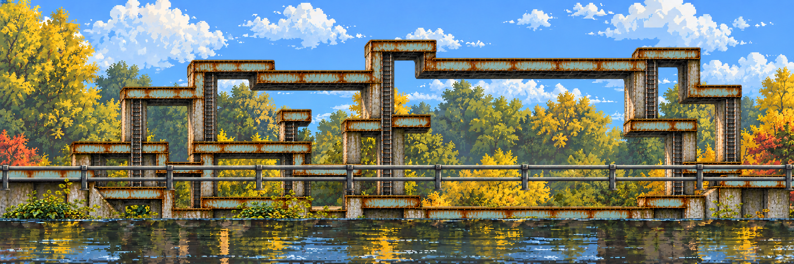
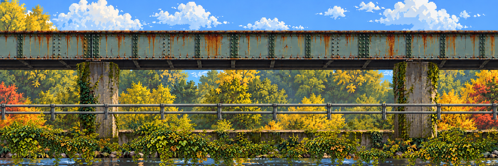
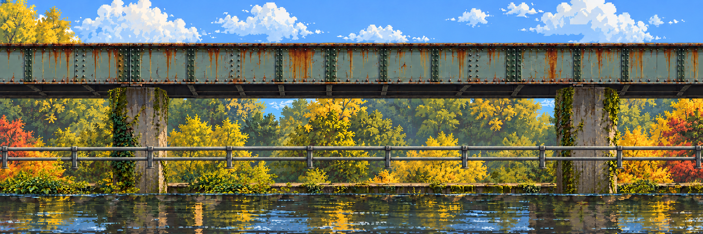
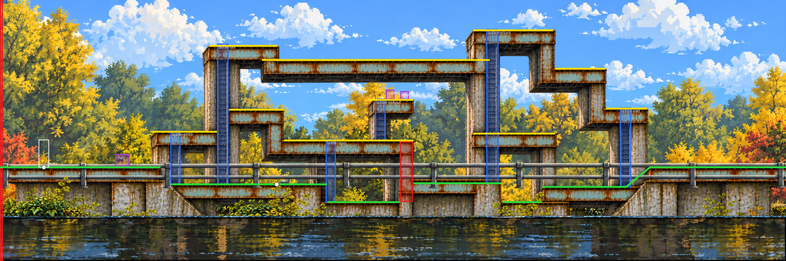
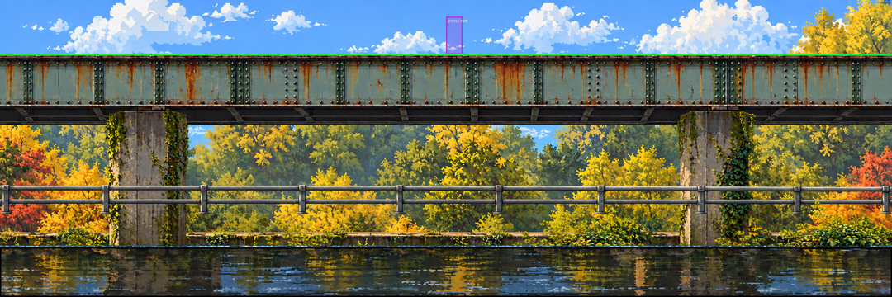
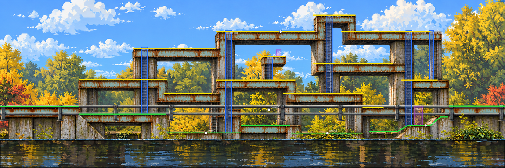
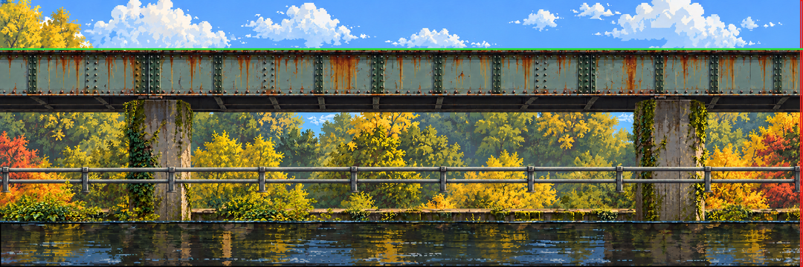
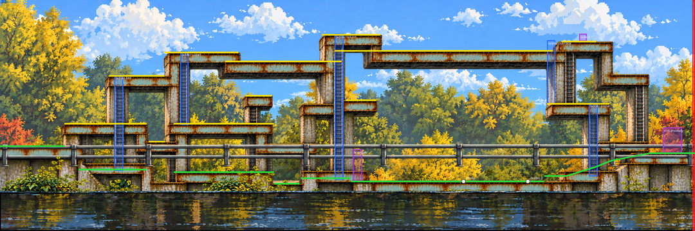

# Rusty Creek – stage art


Region 1 of the jam slice ([04 – World and levels](../../../docs/04-WORLD-AND-LEVELS.md)). Three chunks of 2160×720 make a 6480×720 stage, seven registered layers each. The creek, bank, rails and trees come from our [crossings photo board](../../../references/campus/crossings.md). The blue-green riveted girder maze is the anomaly's version of the creek: pathfinding imagery, a nod to the algorithms professor.

## The journey

| Left – entry, first climb | Centre – branches, reconnection | Right – boss clearing, exit |
| --- | --- | --- |
|  |  |  |

The same place before the anomaly (clean campus architecture, nature layers identical):

| Left | Centre | Right |
| --- | --- | --- |
|  |  |  |

## Seven layers

| # | Role | Left | Centre | Right | In game |
| --- | --- | --- | --- | --- | --- |
| 01 | Sky / distant trees | [png](images/01-distance-left.png) | [png](images/01-distance-center.png) | = left | Parallax 0.2 |
| 02 | Rear masonry | [png](images/02-supports-left.png) | [png](images/02-supports-center.png) | [png](images/02-supports-right.png) | Scrolls with 05 |
| 03 | Rocky bank | [png](images/03-bank-left.png) | [png](images/03-bank-center.png) | = left | 1.0 |
| 04 | Water / reflection mask | [png](images/04-water-left.png) | [png](images/04-water-center.png) | = left | Hazard zone; reflection clip |
| 05 | Girders and ladders | [png](images/05-traversal-left.png) | [png](images/05-traversal-center.png) | [png](images/05-traversal-right.png) | Collision is authored on top |
| 06 | Near rails | [png](images/06-near-rails-left.png) | [png](images/06-near-rails-center.png) | = left | Foreground 1.1, never collides |
| 07 | Near foliage | [png](images/07-foliage-left.png) | [png](images/07-foliage-center.png) | [png](images/07-foliage-right.png) | Foreground 1.15 |

"= left": shared scenery repeats on the right chunk and is stored once (alias in [media-sources.json](media-sources.json)). In the game, layers 01, 06 and 07 come from one region-wide plate each ([layers/](layers/), `python scripts/depth_layers.py region art/stages/rusty-creek`, #150): per chunk they overlapped at 0.2 and left gaps at 1.1 and 1.15. The creek as the game draws it: [parallax.png](previews/parallax.png). The clean architecture plates are [left](images/clean-architecture-left.png) and [centre](images/clean-architecture-center.png); right = left.

## Route

[route.json](route.json) is the authored route: 47 nodes and 47 edges (walk, ladder, jump) covering the entry, the climbs, three dead ends with rewards, a reconnection, the boss clearing and the exit. The verifier checks that it is connected, that every dead end returns, that ladders are vertical and that jumps fit the envelope. The collision data that the game uses is drawn separately: see the colour code in [04](../../../docs/04-WORLD-AND-LEVELS.md).

## Collision

Six files, one per chunk and state, in the [docs/13 schema](../../../docs/13-PRODUCTION-PIPELINE.md#contract-collisionjson). [chunks.json](chunks.json) maps the ids to the art: `rc-0-0` left, `rc-1-0` centre, `rc-2-0` right.

- **Clean:** the bridge deck at y 132 across all three chunks, the water below as no-go, the player on the left. Jenny's ram is the `jenny-ram` trigger in the centre ([M4-S1](https://github.com/THD-AI/WinCS/issues/54)).
- **Anomaly:** the hero walks in front of the maze, so every girder deck is a one-way platform and the quays are floors. The first chunk has the chair on the entry deck, the tutorial rover on the low deck, and a pillar down to the water that needs a ladder up: the spur ladder onto the low girder or the tall ladder onto the high beam. The lookout tower holds a muffin and note 1. In the centre, a high route (crab, Leberkäse cache) and a low route (two rovers under a drone) meet again at the coffee machine and Dexter. On the right, the top route and the low route both end at the boss gate before the open girder floor. Jenny and Dexter wait there, the overlook holds note 2, and the exit anomaly is behind the stone steps.

| Chunk | Clean | Anomaly |
| --- | --- | --- |
| Left |  |  |
| Centre |  |  |
| Right |  |  |

`python scripts/collision_check.py --overlay` checks them all and redraws these overlays. Colours are the [docs/04 legend](../../../docs/04-WORLD-AND-LEVELS.md#collision-and-interaction-annotation); the white box is the 28×76 body.

## Rebuild and verify

```bash
python scripts/creek_layers.py --build   # rebuilds every plate and preview from sources/ + inputs/
python scripts/creek_layers.py           # verifies hashes, alpha, exact recomposition, route graph
```

- `sources/` – the generated scene-first architecture plates, the foliage strip and the two seam-repair candidates
- `inputs/` – fixed earlier plates the stage is built from (far trees, bank, water, rails, clean structure, maze)
- `assembly.json` – mask regions, offsets, draw order · `prompts.json` – exact prompts · `stage.json` + `packet.json` + `repair-report.json` – the seam-repair record · `verification.json` – the last verification

To extend the stage (a new chunk left, right or in the middle), see [09 – Art pipeline](../../../docs/09-ART-PIPELINE.md).
