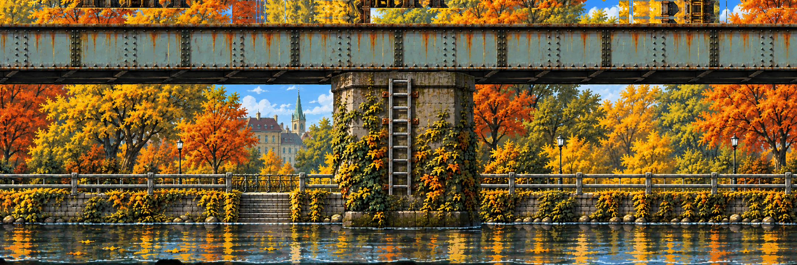

# Rusty Creek – stage art

Region 1 of the jam slice ([04 – World and levels](../../../docs/04-WORLD-AND-LEVELS.md)): a 3 × 3 zone of 2160×720 chunks, grown from one cut of the stacked concept ([#157](https://github.com/THD-AI/WinCS/issues/157), [zone](../../zones/rusty-creek/zone.json), [09 – World pipeline](../../../docs/09-ART-PIPELINE.md)). The rows are rooms; the camera frames the row the hero is in.

| Row | Chunks | What is there |
| --- | --- | --- |
| 0 – above | `rc-0-0` … `rc-2-0` | The rust maze standing on the railway girder: beams, ladders, open sky. |
| 1 – level | `rc-0-1` … `rc-2-1` | The creek path under the railway girder, three piers with ladders up to its deck, the lit culvert. |
| 2 – below | `rc-0-2` … `rc-2-2` | The drains under the creek bed: catwalks, a steel stair, the drain door under the culvert. |

## Two states, one picture

- **Clean:** you land on the path (`rc-0-1`); Jenny comes down it and rams you at the `jenny-ram` box (`rc-1-1`), and Dexter watches from beyond it. The ram turns the region.
- **Anomaly:** the same art with the 404 tears in the maze's sky (`tears/`, from the zone's `world.json`) and the rust maze's fight on the zone's floors:
  - the chair at the start;
  - rovers on the path, the maze and the drains;
  - the drone over the path and the crab on a maze girder;
  - the coffee machine with Dexter;
  - snacks and notes off the path.

  Jenny's arena is on the right-hand chunk (`rc-2-1`): the boss gate at x 1096, her floor to x 1690, and two platforms on chains from the railway girder (`arena/rc-2-1.png`, [arena_platforms.py](../../../scripts/arena_platforms.py)).

## Built by

`python scripts/zones/rusty_creek_zone.py --stage`, then:
1. `depth_layers.py fill … --only sky` for each row with sky, and `depth_layers.py whole …` for the drains;
2. `rusty_creek_zone.py --fills`;
3. `arena_platforms.py`;
4. `split_layers.py art/stages/rusty-creek`;
5. `collision_check.py art/stages/rusty-creek --surfaces`;
6. `export_stage.py`.

Every layer scrolls with the path for now; parallax comes back with region plates quilted per row.

The earlier one-row stage (seven registered layers, 24 Oct) is in git history; the paintings other boards still use as references are in [prototype/](prototype/).
