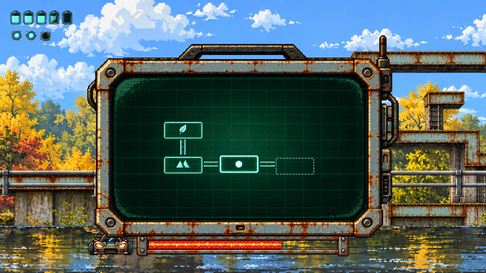
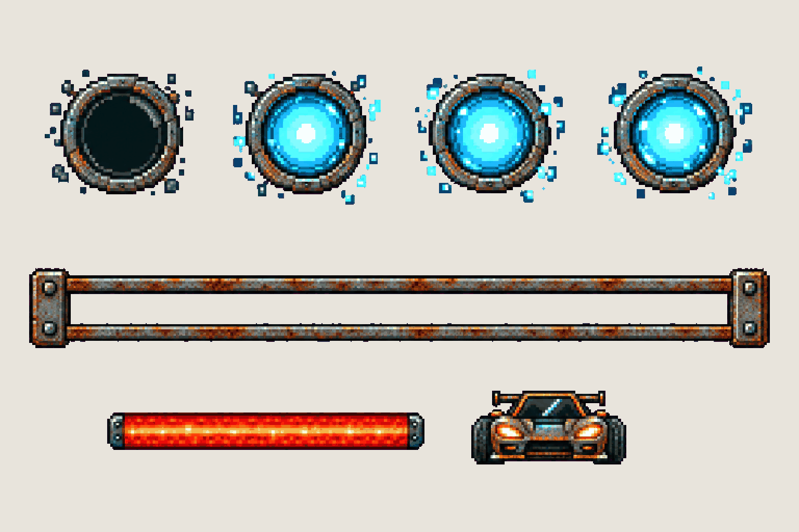
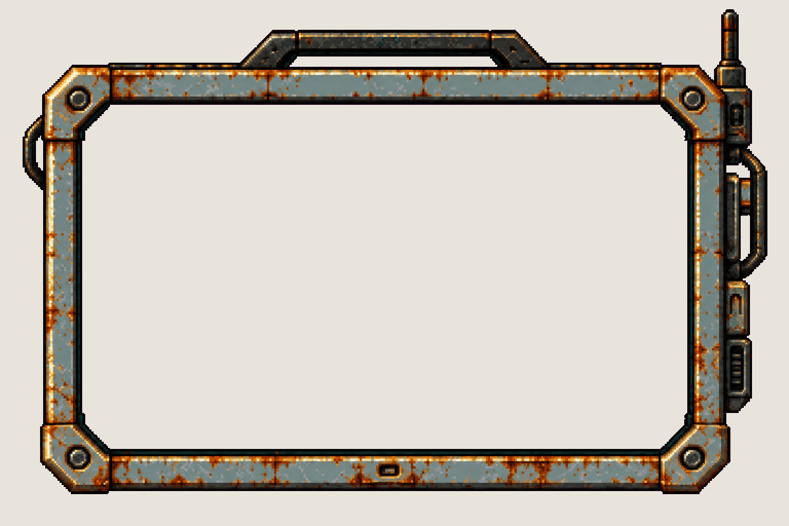
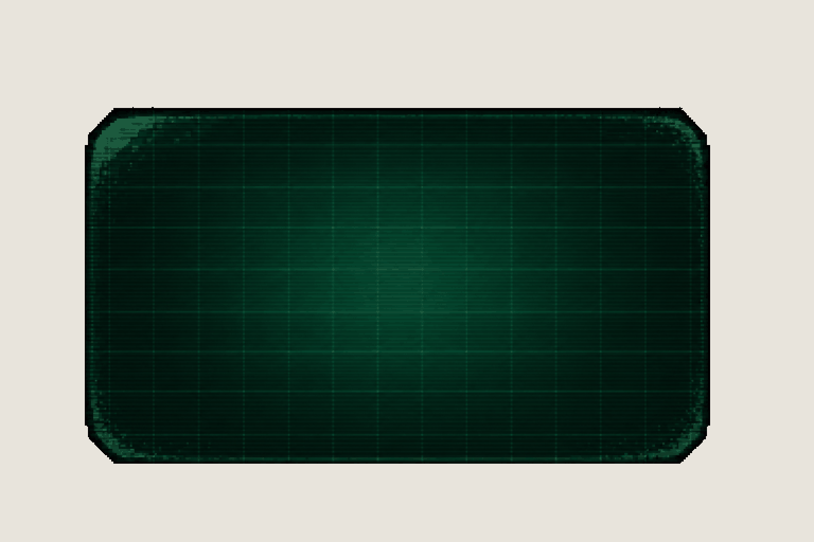

# UI sprites

HUD and pocket computer sprites, drawn from crops of the approved [HUD direction](../direction/hud.md) ('magnificent'). Plan, masks and steps: [09 – UI sprites](../../docs/09-ART-PIPELINE.md#ui-sprites--hud-and-pocket-computer). Each board waits for Alexander's Design review before `export_ui.py` puts it into the game.

*Contact sheet at game size (1280×720): `python scripts/export_ui.py --out tmp/ui --preview`.*

| | |
| --- | --- |
|  **[HUD · battery cells](hud-battery.md)** |  **[HUD · glitch meter and boss bar](hud-meters.md)** |
|  **[Pocket computer · case](pocket-frame.md)** |  **[Pocket computer · CRT screen](crt-screen.md)** |
|  **[Pocket computer · map tiles and icons](map-tiles.md)** |  |
