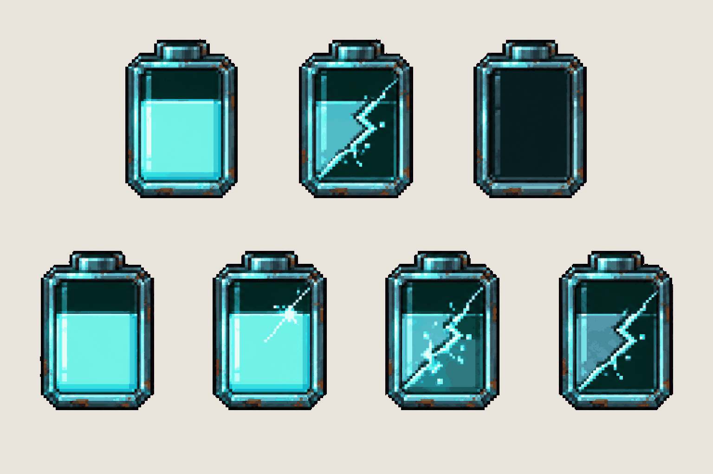

# HUD · battery cells

**Review:** Not reviewed yet.

## Brief

Solid flat pure magenta #FF00FF background everywhere. Draw the health battery cell of the game HUD, copied closely from the top row of the first image: a small upright battery with a dark bevelled metal casing, a short terminal cap on top, a glass front, filled with glowing pale teal charge. Each cell about 150 px tall. Row 1, three cells side by side: FULL (teal charge fills the glass), CRACKED (same cell, glass split by a diagonal lightning-shaped crack, the charge dimmer), EMPTY (dark glass, no charge). Row 2, four frames of a full cell cracking, left to right: full, a first hairline crack with a small spark, the crack spreading and the charge flickering, cracked. Every cell identical in size and outline, upright, front view, on the same baseline.

## Inputs

- [hud-preview.png](../direction/images/hud-preview.png), cropped to `40,45,300,135`
- [style-master-preview.png](../direction/images/style-master-preview.png)

Model `gpt-image-2.5-sunburst` · pixel factor 2 · source image `images/hud-battery.png` · rebuild: `python scripts/make_boards.py draw hud-battery --redo --config art/ui/ui.json`
