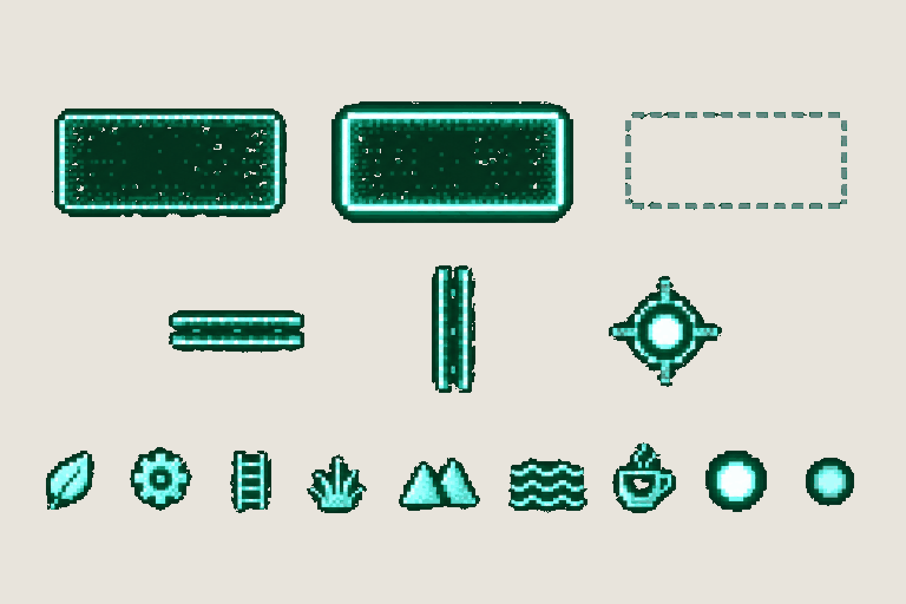

# Pocket computer · map tiles and icons

**Review:** ✅ Approved 24 Oct by Alexander. Every row's count matches its names; exported to game/public/assets/ui/ with export_ui.py.

## Brief

Solid flat dark green #071E16 background everywhere - exactly this one colour, no scanlines, no texture, no grid, no vignette. Draw the pieces of the CRT map from the first image, separately, glowing mint and teal like the map. Row 1, three room tiles, each a rectangle exactly three times as wide as it is tall, about 300 px wide: VISITED (filled darker green with a glowing mint outline and a fine inner dither), CURRENT (the same tile with a brighter, thicker glowing outline), UNEXPLORED (no fill, only a dim dashed outline). Row 2: a short HORIZONTAL CORRIDOR (two thin parallel glowing mint lines, about 120 px long), a short VERTICAL CORRIDOR (the same, upright), and a round JUNCTION node. Row 3, nine small glowing mint icons, each about 60 px, no frames around them: a leaf, a gear, a ladder, a grass tuft, two mountain peaks, three water waves, a coffee cup, and the player dot as a bright white-mint glowing point twice: bright, then dimmer.

## Inputs

- [hud-preview.png](../direction/images/hud-preview.png), cropped to `482,155,585,390`
- [style-master-preview.png](../direction/images/style-master-preview.png)

Model `gpt-image-2.5-sunburst` · pixel factor 2 · source image `images/map-tiles.png` · rebuild: `python scripts/make_boards.py draw map-tiles --redo --config art/ui/ui.json`
