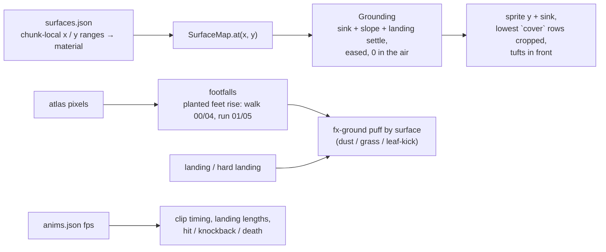
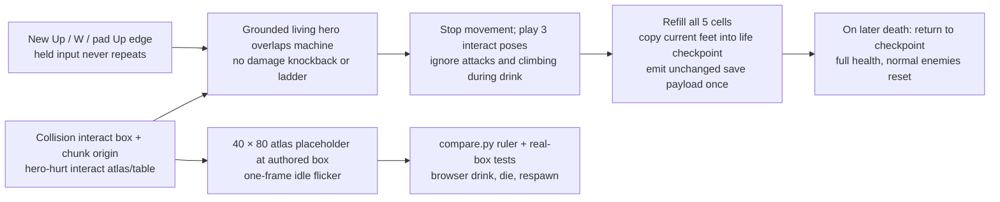
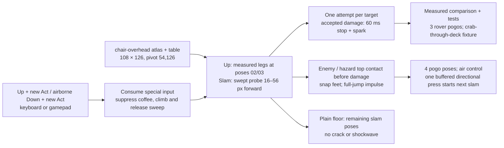
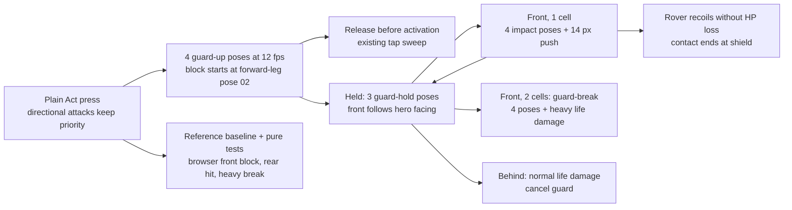

# 02 – Game design

<!-- nav:start -->
[← 01 – Proposal](01-PROPOSAL.md) · [Design docs](README.md) · **2 / 16** · [03 – Story and cast →](03-STORY-AND-CAST.md)
<!-- nav:end -->

| Explore | Fight | Rest | Cross |
| --- | --- | --- | --- |
|  |  |  |  |
| Hills, branches up and down, secrets behind grass | The chair against autonomous robots | Coffee machine save point; Dexter trades | Touch the anomaly, crash, land somewhere else |

## Core loop

**Explore a broken region → fight the anomalies living in machines → find the region's object or upgrade → reach the region's anomaly → cross into the next dimension.** Between fights you rest at coffee machines, where Dexter trades with you and takes the anomaly energy you collected.

The loop in one minute: walk right, something is wrong in the scenery, a rover spots you, you swing the chair, it stops dead and leaks black fluid that Dexter later absorbs, you climb a ladder to a branch you couldn't reach before, you find a muffin, you save at the coffee machine.

## Controls – four directions, two buttons

Left, right, up, down and two buttons. That works on keyboard, gamepad and a touch overlay alike. This was the explicit request in the 23 Oct meeting.

| Input | Keyboard | Gamepad | Action |
| --- | --- | --- | --- |
| ← → | A / D, arrows (read by key position, any layout) | Stick, D-pad | Walk; run after 0.4 s held |
| ↑ | W, ↑ | Up | Interact (sign, coffee machine, Dexter, pickup); climb ladder |
| ↓ | S, ↓ | Down | Drop through one-way platform; climb down |
| **Jump** | K, Z, Space | A / Cross | Jump. Hold for higher (variable height) |
| **Act** | J, X, left click (on the game) | X / Square | Tap: attack with the current weapon. Hold: guard (chair) |
| **Dodge** | L, C, Shift | B / Circle, RB | Dodge-dash: a quick burst you can't be hit in (see Movement) |
| ↑ + Act | | | Up attack |
| ↓ + Act on the ground | | | Low sweep along the floor (rovers, crabs) |
| ↓ + Act in air | | | Down slam / pogo (bounce off an enemy or hazard) |
| Menu | Esc | Start | The game menu: controls, settings, debug mode, coming soon (pauses the game) |
| Pocket computer | Tab | Back / Select | Map, archive, items (after you get it) |

Two laptop layouts work side by side (playtest 24 Oct): **WASD + J attack / K jump / L dodge**, or **arrows + Z jump / X attack / C dodge**; Space and Shift jump and dodge on either. Letters are read by key position, so every layout and input method works. The dodge is a third button – the "two buttons" rule bends for it.

The weapon is switched in the pocket computer menu (or ←/→ while the menu is open). The menu key is a system button, like Start, and does not count against "two buttons".

**Open (Lex, A14):** put Jump on ↑ (as in many arcade platformers) and free the second button for a skill – later glide and double jump on the same input. Then interact would move to ↓ or happen on contact. The team decides this once the controller is playable; the table above stays the default until then.

## Menu and debug mode

A ☰ button in the top-right corner, Esc or the pad's Start open the **game menu** and pause the stage (`game/src/ui/menu.ts`, plain DOM over the canvas so it stays crisp and works with mouse, touch and keyboard). Four tabs:

- **Controls** – the table above, for keyboard and gamepad.
- **Settings** – sound on/off and volume, zoom (the game's own view or 133 / 200 / 286 % wider), full screen.
- **Debug** – debug mode and its switches (`game/src/core/debug.ts`); the corner line names every switch that is on, so a playtest screenshot records what was showing:
  - **Layers**: every stage layer by id and z, switched off in all chunks at once; with the **purple backdrop** any hole or seam in a plate behind it shows at once (the hot-dog rule, docs/09).
  - **Collision**: walk lines, one-way beams, ladders, walls, water, hazards, triggers (the F2 legend).
  - **Actors**: the hero's body, speed and ground; every rover, crab and drone with its hitbox, facing arrow, sight box (red when it sees the hero), patrol path and turn points, phase and health; Jenny's arena, box, facing and phase; Dexter's position, state and next stop.
  - **FPS and position**: frame rate, the hero's position and chunk.
  - **Falls**: falling out of the level (below every floor, not into water) is always recorded – the frame, the position, the last safe spot and the last two seconds of the path. With `npm run dev` it lands in `tmp/falls/` (gitignored, via `game/vite.config.ts`); in a build the Debug tab saves the last one.
  - **Teleport** (`stage/teleports.ts`): "◀ Previous place" and "Next checkpoint ▶" in the hero's row, and a button for every place read from the region's collision – the start, coffee machines (save points), Jenny's gate, the pond's 404, doors, chunk exits, each chunk's left edge. **Level** jumps to the Hidden Garden, clean Rusty Creek or the rust maze. Both close the menu.
- **Coming soon** – what is next (the stacked zones, the glide, the next regions).

Falling into water is not a fall: the hero splashes and is put back on the bank they last stood on.

## Movement

- **Walk / run:** one speed curve, **2.2 m/s walking and 4.6 m/s running** (95 and 198 px/s at 43 px/m), with a short acceleration so the poncho has weight. The speeds come from the art (#156): the approved walk cycle's stride is 43 px and the run's 82 px (`python scripts/compare.py stride hero-move:walk hero-run:run`), and both cycles are played by distance – one frame per stride ÷ frames of travel – so the planted foot never slides at any speed. The first numbers (3.5 / 6 m/s) were 2.3–2.5× faster than the feet could carry the body.
- **Jump:** variable height, from about 1.2 m (tap) to 2.2 m (hold). Coyote time is 0.1 s and jump buffering 0.12 s. These two are the cheapest things that make a platformer feel good.
- **Hills:** the ground is a smooth polyline. You walk up and down slopes up to 40°, like Planet of Lana and Ori. There are no staircase blocks.
- **Slides:** slopes steeper than 40° are slides. You skid down them fast with the poncho flapping, and can jump off at any point.
- **No ledge pull-up.** Cut in the 23 Oct review (A14): our hero is a student, not a parkour athlete. Maybe a later update. Hanging from a rope or pipe and shimmying along it is possible post-jam. Ledge points stay in the annotation format so that update needs no re-annotation.
- **One-way platforms:** girder decks, scaffold planks, tray stacks. ↓ + Jump drops through.
- **Climbing:** ladders, vines, scaffold and stairs. Press ↑ in a climb zone. Climbing is slow, and you can't attack while climbing.
- **Glide (later, Lex's proposal):** hold Jump in the air and the poncho opens like a sail for a slow, steerable fall. You glide for as long as you're in the air – **there is no stamina bar** (decided in A14). It's the Region 2 upgrade that opens Lost in the Green's upper routes. It's in the design and the collision data from day one, but not in the jam slice.
- **Four directions:** every region is explored left/right *and* up/down: a mountainside route, a lower branch, an underground pocket ([04](04-WORLD-AND-LEVELS.md)).
- **Dodge-dash (playtest 24 Oct):** one move, a quick horizontal burst – 120 px in 0.2 s (600 px/s) – the way you press or face. Untouchable for its first 0.16 s, so it passes through rovers, crabs and Jenny's charge. On the ground any time, in the air once per jump (it holds the height; landing gives it back); 0.45 s cooldown after each. Not on a ladder or during an interaction, and it cancels a chair attack or guard. A Jump pressed during it is taken when it ends. No new art: a run stride held, with cool after-images and a ground puff (`player/dodge.ts`, `player.ts`).
- **No wall-jump in the jam slice.**

### Feel and grounding (prologue slice, workstream 3)

The hero stands *in* the ground, not on it, and every pose comes from the drawn clips at their own timing. All of it is data: `art/stages/<region>/surfaces.json` (exported next to `stage.json`) and the atlases' `anims.json`.

- **Sink by surface (visual only, physics unchanged).** Grass and leaves 3 px with the lowest 2 rows hidden and a few grass tufts drawn over the feet; earth and gravel 2 px; stone and wood 1 px; the creek's steel 1 px. The sink eases (no pop stepping from stone onto grass) and is 0 in the air. On a slope the sprite drops by the lower foot (8 px × slope, at most 4 px) instead of rotating the pixel art. A landing presses 1 px (hard: 2 px) further in and eases out over the landing clip – the drawn landing poses are the squash; nothing is scaled.
- **Footfalls** are measured from the atlas at load: a frame where the number of planted feet (opaque runs ≥ 6 px wide in the bottom 2 rows) rises. That is walk 00/04 and run 01/05 on the approved cycles. Each footfall kicks the surface's `fx-ground` clip behind the foot; a landing kicks one to each side, a hard landing wider plus debris pixels.
- **Jump and fall follow the arc, not the clock:** the jump row's crouch shows for one rendered frame on take-off (none out of a landing – the landing was the crouch), frames 1–4 map the rise (apex pose at vy 0) and 5–6 the descent; a fall longer than a jump's own drops into the fall loop; a walk-off starts on the descent. The landing is the jump row's own crouch and stand (07/08), the hard landing its clip with the impact held on twos; both lengths come from `anims.json`.
- **Steps are not falls (wave 2, P6):** a walk-off keeps its stride for 0.12 s of air (about 8 px), a step drop under 10 px lands without a pose, and a moving hero lands on the crouch only (a hard landing on its impact) and goes straight into the walk or run cycle it is in – never through the standing idle and a run-start. A released jump keeps its launch speed until it can still reach the 52 px minimum under 3× gravity, then brakes: a tap hop tops out in 0.18 s. A buffered press launches on the tick after touchdown.
- **Idle life:** the standing hero breathes – the chest rises 1 px for two idle loops in four, changing only where the idle clip loops – and the poncho's lower half takes 1 px downwind while a gust of the region's wind passes (whole pixels, three crops of the same frame; the legs never move). The variants (look-around, check-tablet; check-wounds at two hearts or fewer) start where the idle loops after 5–9 s standing, hold their key pose, and never repeat back to back.
- **Hurt and death** play the drawn `hit` clip (its first frame is the white flash), `knockback` for hits of 2+ hearts recovering through `hit` 03–07, and `death` – all at their fps. The invulnerability blink starts after the clip; walking away ends the recovery early.
- **Camera:** look-ahead 120 px at run speed, eased slowly enough that a turn never whips; a vertical dead zone (40 px up, 16 px down) so slopes and steps do not bob the view, and through a jump the framing holds unless the hero climbs 150 px above it or drops below it. The camera snaps to whole pixels as *hero position − rounded offset*, so at a stride-paced walk the hero stays on one screen pixel while the scenery scrolls.
- **Spawns and resets** stand on the walk line within 8 px, so an authored spawn a pixel inside the ground does not fall through.

## Health, damage, death

- **Health:** 5 battery cells (HUD top-left, Hollow Knight-sized). Enemy contact or a hit costs 1 cell; Jenny's charge costs 2.
- **On hit:** white flash, knockback (about 1.5 m), 1 s of invulnerability with flicker.
- **Death:** the hero collapses into pixel dust. You respawn at the last coffee machine with full health. Defeated normal enemies return; bosses stay defeated.
- **Healing:** Mensa food that **Dexter leaves on your path**. Each item heals a set amount, and some add a small extra: muffin 1 cell, cake slice 1, wafer 1, Leberkäse roll 2 + a short defence boost (it's heavy food). Drinks give small boosts (sparkling water: a short speed-up). Numbers and joke effects get tuned in playtests. Drinking coffee at a save point refills everything.
- **Pits and hazards** (creek current, toxic sap): lose 1 cell and reappear at the last safe ground. No full death.

### Coffee save implementation (#43)

Use the authored `interact` box with `kind: coffee-machine`, translated by
the chunk grid. Rusty Creek's `coffee-1` occupies local (1770, 457),
40 × 80 px in `rc-1-0.anomaly`; its bottom sits on the y=537 walk line.
The placeholder uses that exact box through the existing atlas contract.
`mensa-drinks` remains pending in [07](07-ASSET-MANIFEST.md); its named
idle/flicker/pour clips will replace the placeholder when lane A exports it.
Until then, flicker dims the rectangle for one 12 fps frame every two
seconds (placeholder timing). The hero uses the approved three-frame
`hero-hurt:interact` clip at its authored 12 fps, a quarter-second drink.
Its leaning poses measure 72 px high in the approved atlas; preserve their
native size against the 76 px standing body in the comparison.

This checkpoint lasts for the running game, as does the existing life state.
Disk persistence is outside this issue's acceptance criteria. A development
`coffee-test` URL starts at the real machine's foot position to check the
interaction without moving or duplicating its collision annotation.

## Combat

Every weapon is a real object we photographed and posed with on 23 Oct.

| Weapon | Found | Verbs | Feel |
| --- | --- | --- | --- |
| **Chair** (plywood + black steel legs) | Rusty Creek, first room | Side sweep, up attack, down slam / air pogo, **guard** (hold Act: legs pointed forward like a shield) | A **light** weapon with short range, not a heavy one. Repeated taps alternate the swing (back, forth, up, down), and each ends in a slight recoil. The slam has no ground crack and no shockwave. Hit-stop 60 ms |
| **Tray** (yellow Mensa tray) | Lost in the Green (region 2) | Throw: flies like a boomerang and returns; catch it to throw again | Ranged; lets you kite drones |
| **Sign pole** (yellow town-sign on a steel pole) | Campus (region 3) | Heavy forward thrust, long reach; breaks guards | Slow, strong |

- Every hit gets hit-stop, a pixel impact burst, a short knockback and a sound.
- Every swing is visible (playtest 24 Oct): a pale arc sweeps in front of the hero around the shoulder, brightest on the contact frame (`combat/swingFx.ts`); the up attack and slam flash their strike box; a landed hit adds a white impact ring and a ring of sparks.
- Enemies show a 0.4–0.6 s **tell** (flash, rear-up, lidar turns red) before attacking.
- **Attack buffer:** a press the chair can't take yet – during the up attack, the low sweep, a slam's landing or a dodge-dash – is kept for 0.2 s and starts the moment the chair is free (`combat/action-input.ts` `ATTACK_BUFFER`). The side swing already queues one tap.
- **Guard:** blocks frontal damage and pushes you back a little. A heavy hit (Jenny) breaks the guard.

### Chair sweep implementation – measured contact (#39)

The `chair-side` atlas uses 128 × 119 px cells with the feet at (64, 119)
(the hero is drawn 1.5x since 24 Oct; the old cells were 86 × 81).
The approved contact poses are A04 and B03; B is mirrored into the strike
direction. The chair's wood in A04 reaches 48 px forward and in B03 50 px;
it starts 12 px in front of the pivot, and the seat back is 87 px above the
feet. The collision envelope therefore extends **12–65 px forward (30 % past the drawn wood, Alexander 24 Oct: "longer range"), from the
floor to 87 px above the feet**. It goes down to the floor (playtest
24 Oct): the swung legs pass at 37 px, and a 25 px rover or a crab must not
slip under them. This envelope is gameplay collision, not an alpha mask of
the coat or legs.

The development rover fixture is 25 px tall ([05](05-ENEMIES-AND-BOSSES.md))
and 31 px wide (the approved `enemy-rover:idle-00` alpha bounds).
It starts 55.5 px ahead: 50 px reach + half the rover width − its 8 px test
knockback − 2 px overlap. Both alternating sweeps can then connect while
the hero stands still. The 8 px displacement is fixture tuning; real enemy
knockback belongs to the enemy controller.

### Up attack, slam and pogo implementation (#40)

Directional Act starts on the press: Up takes priority; Down requires
airborne feet. Ordinary Act retains release-to-sweep and later hold-to-guard
(#41). Act suppresses climbing and coffee interaction, so Up + Act selects
the attack even beside a ladder or machine. Damage, death and climbing
cancel attacks.

The `chair-overhead` cells are 160 × 187 px, pivot (80, 187) (1.5x). The
chair in `up-02`/`up-03` spans −4…64 px ahead and 118…181 px up; the up
contact envelope is **−4…64 px horizontally, 88…181 px above the feet** –
down to 88 px for the arc the chair travels from the shoulder, so the
Rusty Creek drone (hovering at y 470, 45 px tall: 66–111 px above the 536
deck, 100–145 px above the 570 ground) is reached from under it. Only up poses 02/03
are active, within the authored six-pose clip at 12 fps. It can overlap
an enemy above a one-way deck; a deck does not block a chair strike.

Slam uses wind-up poses 00–02, holds descent pose 03, then plays 04–06
on an ordinary floor. In slam-03 the low chair legs run
**16…56 px ahead of the pivot**. The downward contact probe sweeps between
the previous and current foot positions, with the documented 2 px grain
as its margin, to prevent tunnelling. Descent tuning is twice run speed
(516 px/s). Contact with a living enemy or hazard snaps the feet to its
top and bounces with the existing 485 px/s full-jump impulse (about 96 px).
The four authored pogo poses play during the bounce. Damage rejection
does not suppress a physical bounce; a defeated wreck is excluded.
One directional press during descent or those four poses is buffered until
pogo recovery ends. Landing on a plain floor, damage or death clears it,
as with the ordinary sweep buffer.

### Low sweep (playtest 24 Oct)

↓ + Act on the ground drives the chair down along the floor, for rovers
and crabs that crawl under a chest-high swing (`combat/lowSweep.ts`). It
reuses the slam's floor poses from `chair-overhead` – 02 (coming down),
03 twice (planted, with its dust), 04 twice – at 12 fps, no new art. The
chair is on the floor in poses 1–2; there the box runs **12–75 px ahead,
0–51 px up** (slam-03 measured on the 1.5x frames: seat and legs to 56 px,
the dust to ~60), a little further than the side swing. A pale streak
along the floor shows it. In the air, ↓ + Act stays the slam.

### Target assist (24 Oct)

An assist, not a lock-on (`combat/assist.ts`). When a side swing, low
sweep or up attack starts, the nearest live enemy (rover, crab, drone,
Jenny while the fight is on) within one body height (76 px) of the body
is picked if it is up to 1.4× the attack's reach ahead or within 40 px
behind. An enemy behind turns the hero round; one just out of reach gets
a nudge of at most 24 px over 0.1 s toward it (aiming 8 px inside the
reach), moved through the normal wall and ledge collision. A plain tap
under a drone hovering above the side swing, in the up attack's cone,
strikes up instead. Nothing steers during a guard or a block, and the
air slam has no assist.

### Chair guard implementation (#41)

Plain Act begins the four-pose `chair-block:guard-up` clip immediately.
The legs first point forward in pose 02 (2/12 s); that is when guarding
becomes active. Releasing before it is active remains a light sweep;
releasing an engaged guard never adds an accidental sweep. Hold loops the
three approved guard poses, and a block plays the four impact poses.
Up/airborne Down + Act retain priority over guard.
A hold begun during another chair attack raises the guard when that
attack finishes; it does not cancel the attack's remaining poses.
A complete tap between rendered frames is reconstructed from its release
flag: Phaser clears the press flag on key-up. An ordinary held release
does not create a fresh press or restart guard.

Frontal one-cell hits are blocked. The small push is half the documented
28 px body width (14 px), spread over three 12 fps frames with the normal
kinematic wall/floor checks. A blocked rover recoils without losing HP or
continuing through the hero into an unguarded back hit. Rear hits use normal
damage. A frontal two-cell Jenny charge breaks the guard, plays its four
break poses and applies normal heavy damage/knockback. Death takes priority
over the break animation. These are the initial push/recovery tuning;
standing guard poses preserve their measured 76 px native body height.

## Tuning – every value in one table ([#156](https://github.com/THD-AI/WinCS/issues/156))

The numbers the game plays with, and where each one lives. Speeds come from the measured stride of the approved cycles (43 px = 1 m); clip timing comes from each atlas's `anims.json`. Change a value in its file, then here.

| Group | Value | Number | Where |
| --- | --- | --- | --- |
| Body | hero box | 28 × 76 px | `player/body.ts` `BODY_WIDTH`, `BODY_HEIGHT` |
| Body | step-up / foothold | 16 px / 8 px | `body.ts` `STEP_UP`, `FOOTHOLD` |
| Move | walk / run | 2.2 m/s (95 px/s) / 4.6 m/s (198 px/s) | `player/movement.ts` `WALK_SPEED`, `RUN_SPEED` |
| Move | hold to run after | 0.4 s | `movement.ts` `RUN_DELAY` |
| Move | dodge-dash | 120 px in 0.2 s, untouchable 0.16 s, cooldown 0.45 s, one air dash per jump | `player/dodge.ts` `DODGE_DISTANCE`, `DODGE_TIME`, `DODGE_INVULNERABLE`, `DODGE_COOLDOWN` |
| Move | ladder climb | 70 px/s | `player/traversal.ts` `CLIMB_SPEED` |
| Jump | gravity / cut gravity | 1200 / 3600 px/s² | `player/jump.ts` `GRAVITY`, `CUT_GRAVITY` |
| Jump | tap / hold height | 52 / 96 px | `jump.ts` `TAP_HEIGHT`, `HOLD_HEIGHT` (`JUMP_SPEED` 485) |
| Jump | coyote / buffer | 0.10 / 0.12 s | `jump.ts` `COYOTE`, `BUFFER` |
| Feet | sink rate / landing settle | 30 px/s / 1–2 px | `player/grounding.ts`; per material in `surfaces.json` |
| Life | health | 5 | `combat/life.ts` `MAX_HEALTH` |
| Life | knockback | 258 px/s for 0.25 s | `life.ts` `KNOCK_SPEED`, `KNOCK_TIME` |
| Chair | damage per sweep, upswing, slam | 1 | `combat/sweeps.ts`, `combat/overhead.ts` |
| Chair | sweep reach | 12–65 px ahead, floor to 87 px up | `sweeps.ts` `SWEEP_CONTACT` |
| Chair | up attack / slam reach | −4…64 px, 88–181 px up / 16–56 px ahead | `overhead.ts` `UP_CONTACT`, `SLAM_CONTACT` |
| Chair | low sweep reach | 12–75 px ahead, 0–51 px up, poses 1–2 of 5 | `combat/lowSweep.ts` `LOW_CONTACT` |
| Chair | target assist | 1.3× reach ahead, 40 px behind, ±76 px; nudge ≤ 24 px in 0.1 s | `combat/assist.ts` `ASSIST` |
| Chair | guard push | 3 frames (0.25 s) | `combat/guard.ts` `GUARD_PUSH_TIME` |
| Chair | pick-up hold | 0.6 s | `combat/chairPickup.ts` `SHOW_SECONDS` |
| Rover | health / box | 3 / 31 × 25 px | `enemies/rover.ts` |
| Rover | patrol / charge | half walk / run speed, after a 0.5 s tell, within 150 px | `rover.ts` `PATROL_SPEED`, `CHARGE_SPEED`, `TELL_SECONDS`, `SPOT_RANGE` |
| Rover, crab | pause at a patrol end | 0.3 s idle, then turn | `rover.ts` `TURN_SECONDS` |
| Small enemies | hit shake / defeat shake | 70 ms 0.003 / 140 ms 0.006 | `enemies/rovers.ts` `MOB_SHAKE` |
| Crab | health / tell / spot / box | 4 / 0.6 s / 110 px, stab reach 30 px; creeps in and rears up within 70 px / 60 × 36 px | `enemies/crab.ts` (`CRAB_STRIKE`) |
| Drone | health / tell / dive / box | 8 / 0.5 s / 380 px/s / 45 × 45 px (the drawn body) | `enemies/drone.ts` |
| Jenny | health / damage | 30 / charge 2, parts 1 | `enemies/jenny.ts` `JENNY_HEALTH`, `CHARGE_DAMAGE`, `PART_DAMAGE` |
| Jenny | rev / turn rev / stall | 1 s / 0.5 s / 1.2 s | `jenny.ts` `REV_SECONDS`, `TURN_REV_SECONDS`, `STALL_SECONDS` |
| Jenny | stun warning | last 0.7 s blink fast | `jenny.ts` `STUN_WARNING` |
| Jenny's ram | lights, rev | 0.6 + 0.6 s, charge 900 px/s | `enemies/jennyRam.ts` `RAM` |

## The glitch meter (after Region 1)

Each defeated anomaly charges a 3-segment **glitch meter**. This was Lex's idea, merged with Alexander's Dexter version. **It is not a magic system** (A14): spells would make the game too easy.

- **Charges open anomaly interactions:** a glitched door, a pixel-stretched bridge you can walk while it holds, a puzzle object that only exists in the anomaly state.
- **At a coffee machine, Dexter takes whatever is left in the meter** and, once enough has piled up, gives you the region's upgrade. This is the hook for the story: you are feeding him. You don't need the energy; he does.

The jam slice ships without the meter if time runs out (cut item 2 in the [jam plan](10-JAM-PLAN.md)).

## Items and progression

| Item | Where | What it unlocks |
| --- | --- | --- |
| **Pocket computer** (the aluminium experiment suitcase, shrunk to a handheld) | Dexter gives it in Rusty Creek after the crash | Map (rooms fill in as you explore; no minimap), archive (notes, enemy entries), items, weapon switch |
| Region upgrade | Dexter, at the end of each region | One new movement or combat ability per region: glide (R2), tray recall (R3), wall-slide (R4) – post-jam |
| Notes / archive entries | Hidden in secret spots | Lore about the experiment and about Dexter. They are what makes "secret paths" worth finding |
| Food | Lying around, from Dexter | Healing |

**Backtracking:** a new ability makes an earlier visible ledge reachable. There is no free teleporting. Fast travel comes only through anomalies you have already crossed (see [world](04-WORLD-AND-LEVELS.md)).

## Every region has two states – clean and anomaly

You enter every region in its **clean** state: the real campus place, calm and pretty. Somewhere in it is that region's **anomaly**, which is always a different thing and always pointed out the first time (Dexter points at the pond). When you touch it (or, in Rusty Creek, when it hits you), the region **turns**. The same place becomes its anomaly version, you're pushed back to the region's start, and the stage you now explore is the broken one. Rusty Creek is the model: first the normal creek and bridge, then the rust maze that looks like a pathfinding algorithm.

| Region | Clean | Its anomaly (what you touch) | Anomaly state |
| --- | --- | --- | --- |
| Hidden Garden | Pond, deck, reeds | The patch of the pond that reflects girders | The reflection climbs out; girders grow through the reeds |
| Rusty Creek | Creek, rails, bridge | **Jenny** – the driverless car rams you on the bridge | The rust maze |
| Lost in the Green | Pampas hills, slab path | A granite boulder with one mirror face | Hedge maze, birches repeated, leaves fall upward |
| Campus | Plaza, scaffolded Mensa facade | A black puddle that reflects nothing | Scaffolding grows into the sky; facade cut and repeated |
| Mensa | Night cafeteria | The coffee machine screen shows a pond | Chairs stack into towers; trays float as steps |
| Toxic Garden | Corten beds under the highway bridge | One flower turned the wrong way | Plants huge and leaning; every flower watches you |
| Playground | Towers, net bridge, slide | The slide's opening is too dark | Towers stretch; the slide coils across the stage |

Concepts for every pair: [stage concepts](../art/locations/README.md).

**Crossing is cheap: sprites plus one window.** Touch → the regular damage sprite → freeze → an old Windows-style error window, **"THD.exe has stopped responding."** [OK] → cut → you land in the new state, and the damage sprite finishes. No cinematic, no special animation: the hit and knockback sprites the hero needs anyway, plus one UI window rendered by the game (real text, not art). The same sequence carries you into the next region at its exit anomaly.

## What is NOT in the game (on purpose)

Gore, blood, an apocalypse, a minimap, crafting, an economy, procedural runs, a stamina bar, spells, **dialogue of any kind**. Nobody speaks and there are no thought bubbles (A14): Dexter acts – he points, bows, sweats, hands things over. The only text is UI: the crash window, the pocket computer, archive notes.

<!-- nav:start -->
[← 01 – Proposal](01-PROPOSAL.md) · [Design docs](README.md) · **2 / 16** · [03 – Story and cast →](03-STORY-AND-CAST.md)
<!-- nav:end -->
