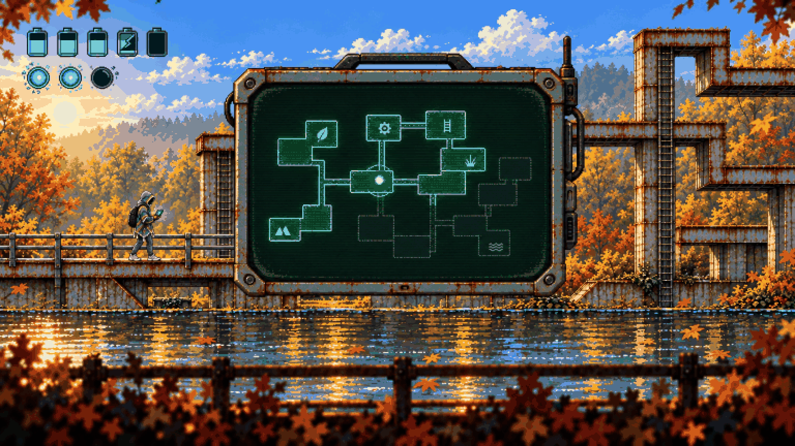
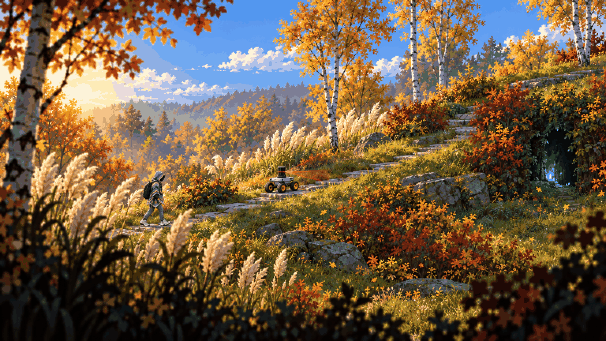
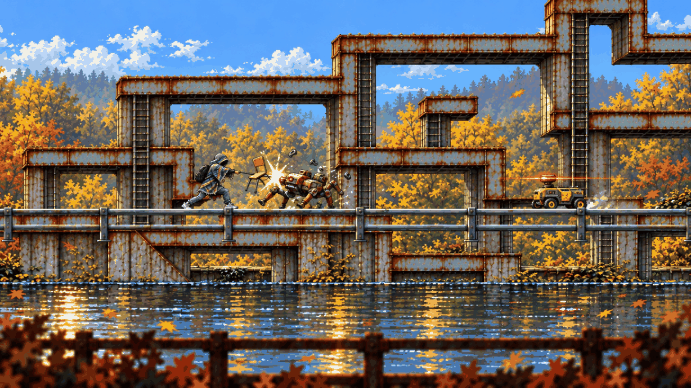
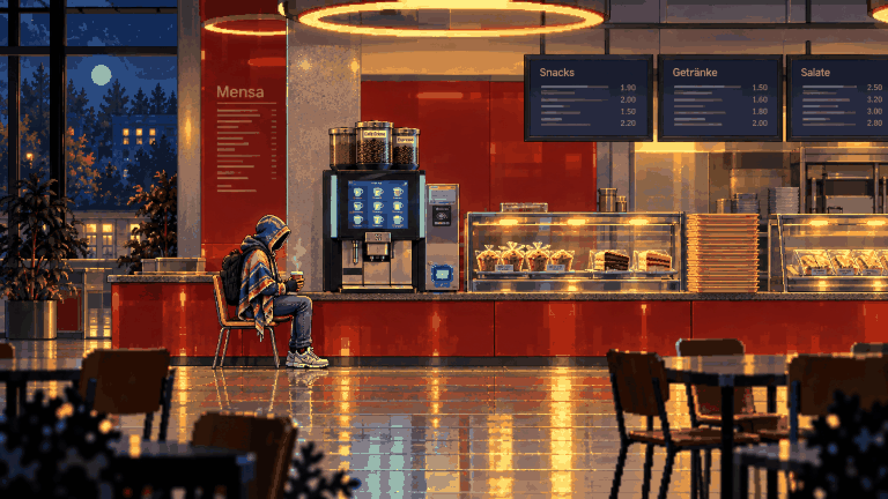
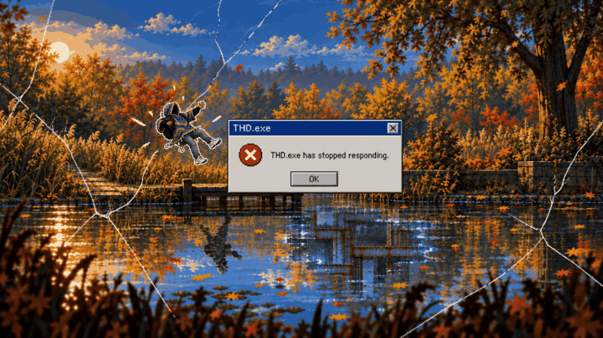
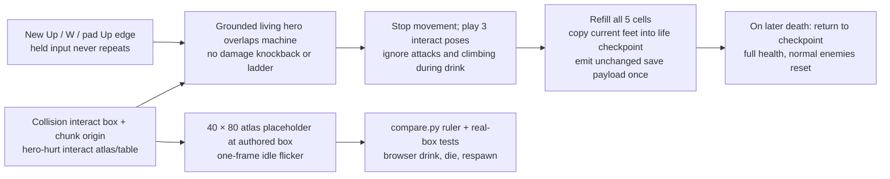
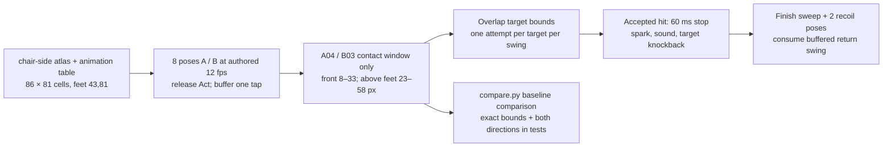
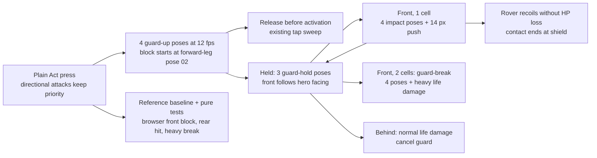

# 02 – Game design

<!-- nav:start -->
[← 01 – Proposal](01-PROPOSAL.md) · [Design docs](README.md) · **2 / 15** · [03 – Story and cast →](03-STORY-AND-CAST.md)
<!-- nav:end -->

| Explore | Fight | Rest | Cross |
| --- | --- | --- | --- |
|  |  |  |  |
| Hills, branches up and down, secrets behind grass | The chair against autonomous robots | Coffee machine save point; Dexter trades | Touch the anomaly, crash, land somewhere else |

## Core loop

**Explore a broken region → fight the anomalies living in machines → find the region's object or upgrade → reach the region's anomaly → cross into the next dimension.** Between fights you rest at coffee machines, where Dexter trades with you and takes the anomaly energy you collected.

The loop in one minute: walk right, something is wrong in the scenery, a rover spots you, you swing the chair, it stops dead and leaks black fluid that Dexter later absorbs, you climb a ladder to a branch you couldn't reach before, you find a muffin, you save at the coffee machine.

## Controls – four directions, two buttons

Left, right, up, down and two buttons. That works on keyboard, gamepad and a touch overlay alike. This was the explicit request in the 23 Oct meeting.

| Input | Keyboard | Gamepad | Action |
| --- | --- | --- | --- |
| ← → | A / D, arrows | Stick, D-pad | Walk; run after 0.4 s held |
| ↑ | W, ↑ | Up | Interact (sign, coffee machine, Dexter, pickup); climb ladder |
| ↓ | S, ↓ | Down | Drop through one-way platform; climb down |
| **Jump** | Space / K | A / Cross | Jump. Hold for higher (variable height) |
| **Act** | J | X / Square | Tap: attack with the current weapon. Hold: guard (chair) |
| ↑ + Act | | | Up attack |
| ↓ + Act in air | | | Down slam / pogo (bounce off an enemy or hazard) |
| Menu | Esc / Tab | Start | Pocket computer: map, archive, items (after you get it) |

The weapon is switched in the pocket computer menu (or ←/→ while the menu is open). The menu key is a system button, like Start, and does not count against "two buttons".

**Open (Lex, A14):** put Jump on ↑ (as in many arcade platformers) and free the second button for a skill – later glide and double jump on the same input. Then interact would move to ↓ or happen on contact. The team decides this once the controller is playable; the table above stays the default until then.

## Movement

- **Walk / run:** one speed curve, **2.2 m/s walking and 4.6 m/s running** (95 and 198 px/s at 43 px/m), with a short acceleration so the poncho has weight. The speeds come from the art (#156): the approved walk cycle's stride is 43 px and the run's 82 px (`python scripts/compare.py stride hero-move:walk hero-run:run`), and both cycles are played by distance – one frame per stride ÷ frames of travel – so the planted foot never slides at any speed. The first numbers (3.5 / 6 m/s) were 2.3–2.5× faster than the feet could carry the body.
- **Jump:** variable height, from about 1.2 m (tap) to 2.2 m (hold). Coyote time is 0.1 s and jump buffering 0.12 s. These two are the cheapest things that make a platformer feel good.
- **Hills:** the ground is a smooth polyline. You walk up and down slopes up to 40°, like Planet of Lana and Ori. There are no staircase blocks.
- **Slides:** slopes steeper than 40° are slides. You skid down them fast with the poncho flapping, and can jump off at any point.
- **No ledge pull-up.** Cut in the 23 Oct review (A14): our hero is a student, not a parkour athlete. Maybe a later update. Hanging from a rope or pipe and shimmying along it is possible post-jam. Ledge points stay in the annotation format so that update needs no re-annotation.
- **One-way platforms:** girder decks, scaffold planks, tray stacks. ↓ + Jump drops through.
- **Climbing:** ladders, vines, scaffold and stairs. Press ↑ in a climb zone. Climbing is slow, and you can't attack while climbing.
- **Glide (later, Lex's proposal):** hold Jump in the air and the poncho opens like a sail for a slow, steerable fall. You glide for as long as you're in the air – **there is no stamina bar** (decided in A14). It's the Region 2 upgrade that opens Lost in the Green's upper routes. It's in the design and the collision data from day one, but not in the jam slice.
- **Four directions:** every region is explored left/right *and* up/down: a mountainside route, a lower branch, an underground pocket ([04](04-WORLD-AND-LEVELS.md)).
- **No wall-jump, no dash in the jam slice.**

## Health, damage, death

- **Health:** 5 battery cells (HUD top-left, Hollow Knight-sized). Enemy contact or a hit costs 1 cell; Jenny's charge costs 2.
- **On hit:** white flash, knockback (about 1.5 m), 1 s of invulnerability with flicker.
- **Death:** the hero collapses into pixel dust. You respawn at the last coffee machine with full health. Defeated normal enemies return; bosses stay defeated.
- **Healing:** Mensa food that **Dexter leaves on your path**. Each item heals a set amount, and some add a small extra: muffin 1 cell, cake slice 1, wafer 1, Leberkäse roll 2 + a short defence boost (it's heavy food). Drinks give small boosts (sparkling water: a short speed-up). Numbers and joke effects get tuned in playtests. Drinking coffee at a save point refills everything.
- **Pits and hazards** (creek current, toxic sap): lose 1 cell and reappear at the last safe ground. No full death.

### Coffee save implementation (#43)

Use the authored `interact` box with `kind: coffee-machine`, translated by
the chunk grid. Rusty Creek's `coffee-1` occupies local (1770, 457),
40 × 80 px in `rc-1-0.anomaly`; its bottom sits on the y=537 walk line.
The placeholder uses that exact box through the existing atlas contract.
`mensa-drinks` remains pending in [07](07-ASSET-MANIFEST.md); its named
idle/flicker/pour clips will replace the placeholder when lane A exports it.
Until then, flicker dims the rectangle for one 12 fps frame every two
seconds (placeholder timing). The hero uses the approved three-frame
`hero-hurt:interact` clip at its authored 12 fps, a quarter-second drink.
Its leaning poses measure 72 px high in the approved atlas; preserve their
native size against the 76 px standing body in the comparison.

This checkpoint lasts for the running game, as does the existing life state.
Disk persistence is outside this issue's acceptance criteria. A development
`coffee-test` URL starts at the real machine's foot position to check the
interaction without moving or duplicating its collision annotation.

## Combat

Every weapon is a real object we photographed and posed with on 23 Oct.

| Weapon | Found | Verbs | Feel |
| --- | --- | --- | --- |
| **Chair** (plywood + black steel legs) | Rusty Creek, first room | Side sweep, up attack, down slam / air pogo, **guard** (hold Act: legs pointed forward like a shield) | A **light** weapon with short range, not a heavy one. Repeated taps alternate the swing (back, forth, up, down), and each ends in a slight recoil. The slam has no ground crack and no shockwave. Hit-stop 60 ms |
| **Tray** (yellow Mensa tray) | Lost in the Green (region 2) | Throw: flies like a boomerang and returns; catch it to throw again | Ranged; lets you kite drones |
| **Sign pole** (yellow town-sign on a steel pole) | Campus (region 3) | Heavy forward thrust, long reach; breaks guards | Slow, strong |

- Every hit gets hit-stop, a pixel impact burst, a short knockback and a sound.
- Enemies show a 0.4–0.6 s **tell** (flash, rear-up, lidar turns red) before attacking.
- **Guard:** blocks frontal damage and pushes you back a little. A heavy hit (Jenny) breaks the guard.

### Chair sweep implementation – measured contact (#39)

The `chair-side` atlas uses 86 × 81 px cells with the feet at (43, 81).
The approved contact poses are A04 and B03; B is mirrored into the strike
direction. A04 reaches 31 px forward and B03 reaches 33 px. Their wooden
seat pixels start 8 px in front of the pivot; the highest contact wood is
58 px above the feet. The collision envelope therefore extends **8–33 px
forward, 23–58 px above the feet**. Its lower edge includes two pixels of
overlap with a 25 px rover (the 2 px grain in [09](09-ART-PIPELINE.md)),
so the short sweep can catch the small ground enemy without extending its
horizontal reach beyond the approved pose. This envelope is gameplay
collision, not an alpha mask of the coat or legs.

The development rover fixture is 25 px tall ([05](05-ENEMIES-AND-BOSSES.md))
and 31 px wide (the approved `enemy-rover:idle-00` alpha bounds).
It starts 38.5 px ahead: 33 px reach + half the rover width − its 8 px test
knockback − 2 px overlap. Both alternating sweeps can then connect while
the hero stands still. The 8 px displacement is fixture tuning; real enemy
knockback belongs to the enemy controller.

### Up attack, slam and pogo implementation (#40)

Directional Act starts on the press: Up takes priority; Down requires
airborne feet. Ordinary Act retains release-to-sweep and later hold-to-guard
(#41). Act suppresses climbing and coffee interaction, so Up + Act selects
the attack even beside a ladder or machine. Damage, death and climbing
cancel attacks.

The `chair-overhead` cells are 108 × 126 px, pivot (54, 126). Measured dark
chair legs in `up-03` occupy x=51–78, y=12–37: the up contact envelope is
**−3…24 px horizontally, 89…114 px above the feet**. Only up poses 02/03
are active, within the authored six-pose clip at 12 fps. It can overlap
an enemy above a one-way deck; a deck does not block a chair strike.

Slam uses wind-up poses 00–02, holds descent pose 03, then plays 04–06
on an ordinary floor. In slam-03 the low chair legs span x=65–91, or
**11…37 px ahead of the pivot**. The downward contact probe sweeps between
the previous and current foot positions, with the documented 2 px grain
as its margin, to prevent tunnelling. Descent tuning is twice run speed
(516 px/s). Contact with a living enemy or hazard snaps the feet to its
top and bounces with the existing 485 px/s full-jump impulse (about 96 px).
The four authored pogo poses play during the bounce. Damage rejection
does not suppress a physical bounce; a defeated wreck is excluded.
One directional press during descent or those four poses is buffered until
pogo recovery ends. Landing on a plain floor, damage or death clears it,
as with the ordinary sweep buffer.

### Chair guard implementation (#41)

Plain Act begins the four-pose `chair-block:guard-up` clip immediately.
The legs first point forward in pose 02 (2/12 s); that is when guarding
becomes active. Releasing before it is active remains a light sweep;
releasing an engaged guard never adds an accidental sweep. Hold loops the
three approved guard poses, and a block plays the four impact poses.
Up/airborne Down + Act retain priority over guard.
A hold begun during another chair attack raises the guard when that
attack finishes; it does not cancel the attack's remaining poses.
A complete tap between rendered frames is reconstructed from its release
flag: Phaser clears the press flag on key-up. An ordinary held release
does not create a fresh press or restart guard.

Frontal one-cell hits are blocked. The small push is half the documented
28 px body width (14 px), spread over three 12 fps frames with the normal
kinematic wall/floor checks. A blocked rover recoils without losing HP or
continuing through the hero into an unguarded back hit. Rear hits use normal
damage. A frontal two-cell Jenny charge breaks the guard, plays its four
break poses and applies normal heavy damage/knockback. Death takes priority
over the break animation. These are the initial push/recovery tuning;
standing guard poses preserve their measured 76 px native body height.

## The glitch meter (after Region 1)

Each defeated anomaly charges a 3-segment **glitch meter**. This was Lex's idea, merged with Alexander's Dexter version. **It is not a magic system** (A14): spells would make the game too easy.

- **Charges open anomaly interactions:** a glitched door, a pixel-stretched bridge you can walk while it holds, a puzzle object that only exists in the anomaly state.
- **At a coffee machine, Dexter takes whatever is left in the meter** and, once enough has piled up, gives you the region's upgrade. This is the hook for the story: you are feeding him. You don't need the energy; he does.

The jam slice ships without the meter if time runs out (cut item 2 in the [jam plan](10-JAM-PLAN.md)).

## Items and progression

| Item | Where | What it unlocks |
| --- | --- | --- |
| **Pocket computer** (the aluminium experiment suitcase, shrunk to a handheld) | Dexter gives it in Rusty Creek after the crash | Map (rooms fill in as you explore; no minimap), archive (notes, enemy entries), items, weapon switch |
| Region upgrade | Dexter, at the end of each region | One new movement or combat ability per region: glide (R2), tray recall (R3), wall-slide (R4) – post-jam |
| Notes / archive entries | Hidden in secret spots | Lore about the experiment and about Dexter. They are what makes "secret paths" worth finding |
| Food | Lying around, from Dexter | Healing |

**Backtracking:** a new ability makes an earlier visible ledge reachable. There is no free teleporting. Fast travel comes only through anomalies you have already crossed (see [world](04-WORLD-AND-LEVELS.md)).

## Every region has two states – clean and anomaly

You enter every region in its **clean** state: the real campus place, calm and pretty. Somewhere in it is that region's **anomaly**, which is always a different thing and always pointed out the first time (Dexter points at the pond). When you touch it (or, in Rusty Creek, when it hits you), the region **turns**. The same place becomes its anomaly version, you're pushed back to the region's start, and the stage you now explore is the broken one. Rusty Creek is the model: first the normal creek and bridge, then the rust maze that looks like a pathfinding algorithm.

| Region | Clean | Its anomaly (what you touch) | Anomaly state |
| --- | --- | --- | --- |
| Hidden Garden | Pond, deck, reeds | The patch of the pond that reflects girders | The reflection climbs out; girders grow through the reeds |
| Rusty Creek | Creek, rails, bridge | **Jenny** – the driverless car rams you on the bridge | The rust maze |
| Lost in the Green | Pampas hills, slab path | A granite boulder with one mirror face | Hedge maze, birches repeated, leaves fall upward |
| Campus | Plaza, scaffolded Mensa facade | A black puddle that reflects nothing | Scaffolding grows into the sky; facade cut and repeated |
| Mensa | Night cafeteria | The coffee machine screen shows a pond | Chairs stack into towers; trays float as steps |
| Toxic Garden | Corten beds under the highway bridge | One flower turned the wrong way | Plants huge and leaning; every flower watches you |
| Playground | Towers, net bridge, slide | The slide's opening is too dark | Towers stretch; the slide coils across the stage |

Concepts for every pair: [stage concepts](../art/locations/README.md).

**Crossing is cheap: sprites plus one window.** Touch → the regular damage sprite → freeze → an old Windows-style error window, **"THD.exe has stopped responding."** [OK] → cut → you land in the new state, and the damage sprite finishes. No cinematic, no special animation: the hit and knockback sprites the hero needs anyway, plus one UI window rendered by the game (real text, not art). The same sequence carries you into the next region at its exit anomaly.

## What is NOT in the game (on purpose)

Gore, blood, an apocalypse, a minimap, crafting, an economy, procedural runs, a stamina bar, spells, **dialogue of any kind**. Nobody speaks and there are no thought bubbles (A14): Dexter acts – he points, bows, sweats, hands things over. The only text is UI: the crash window, the pocket computer, archive notes.

<!-- nav:start -->
[← 01 – Proposal](01-PROPOSAL.md) · [Design docs](README.md) · **2 / 15** · [03 – Story and cast →](03-STORY-AND-CAST.md)
<!-- nav:end -->
