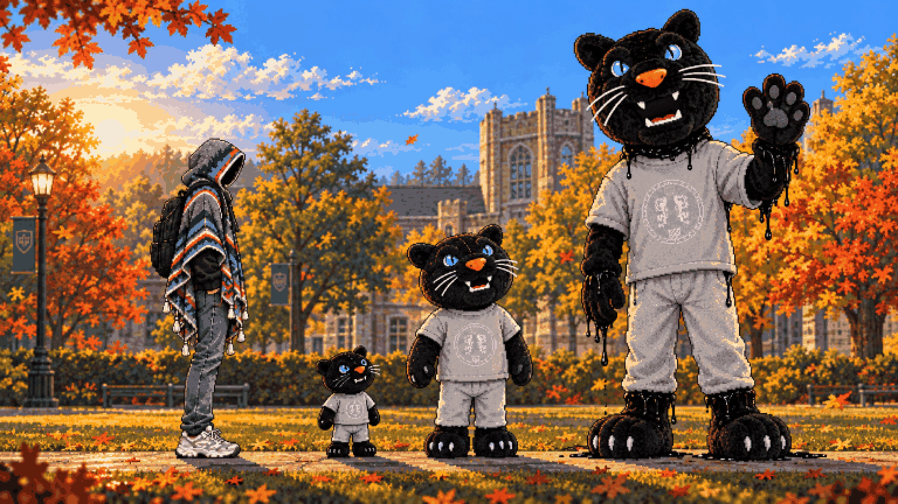
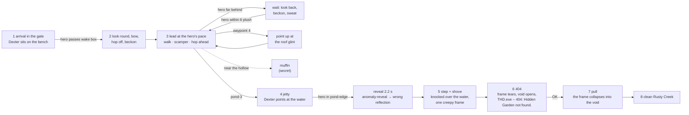
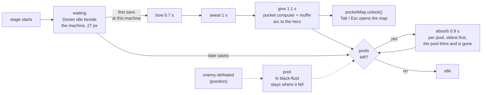

# 03 – Story and cast

<!-- nav:start -->
[← 02 – Game design](02-GAME-DESIGN.md) · [Design docs](README.md) · **3 / 16** · [04 – World and levels →](04-WORLD-AND-LEVELS.md)
<!-- nav:end -->

## Premise

THD is running a **quantum-computing field experiment** on campus. It works too well: the campus now overlaps with copies of itself from other dimensions. In those copies, **anomalies** – living errors – have moved into everything that thinks for itself: the **autonomous** lab rover and hexapod from the display cases, the quadcopter drone, and Jenny, Fast Forest's driverless race car. They don't need a driver, so the anomaly simply becomes one. Where an anomaly is strong, the world shows it the way a computer would: image cuts, stretched pixels, 404 holes, crash dialogs.

You are an ordinary student who touched the wrong pond.

The idea is fiction: no real experiment, person or department is depicted. The university's real places, objects and mascot are used affectionately, as in-jokes for a THD game jam.

## Tone

**A secret horror game.** It looks and plays like a cozy, funny campus adventure, and the horror hides in plain sight: a reflection that shows the wrong thing, every chair facing the coffee machine, a mascot that waves a little too long. The player should be able to finish the first minutes thinking it's a cute game. Familiar → uncanny → psychological horror, built on the mimic and doppelganger idea from the meeting and on Duck Season's friendly mascot. No gore, no blood, no apocalypse, no jump-scare spam. Jokes are things you *do* (hit a robot with a chair, get thrown by a crash dialog), not text.

## The slice's arc ([#160](https://github.com/THD-AI/WinCS/issues/160))

The jam slice is one build-up, not a list of beats: **cozy → something wrong → the crash → the maze → Dexter's kindness → the boss → the reveal**. Every beat is played, never told, and each one has a scene and a trigger in the data. The budget is the 8–12 minute slice.

| # | Beat | Mood | What lands | Scene · trigger | Budget |
| --- | --- | --- | --- | --- | --- |
| 1 | The garden | cozy | Dexter on his bench, the first quest is to follow him; secrets reward looking around | `Prologue` · the bench in the region data | 2–3 min |
| 2 | The pond | something wrong | the reflection shows the rust maze; he shoves you, and for one frame he is a silhouette | `FinaleSequence` · `pond-edge` | 20 s |
| 3 | The 404 | glitch | "404: Hidden Garden not found." – the garden tears and pulls you in | `Crossing` `'404'` · the fall | 10 s |
| 4 | Alone in the creek | quiet, watched | Dexter is gone – but far down the path a small black plush stands and **watches**. He never comes closer; when you near him he hops away | `Watcher` · the `jenny-ram` box (he stands 240 px past it) | 40 s |
| 5 | The silence | dread | **1.2 s of nothing**: the music stops, the hero stands. Then headlights | `Flow.ram` `hush` · `jenny-ram` | 1 s |
| 6 | The crash | violence | Jenny rams you; "THD.exe has stopped responding"; the creek turns into the rust maze | `Flow.ram` → `Crossing` | 3 s |
| 7 | The maze | play | the chair, the controls glyph, rovers, crab, drone – the real tutorial | rust maze · `pickup`, encounters | 3–4 min |
| 8 | Dexter's kindness | warmth, off | he is already at the coffee machine: bows, sweats, hands you the pocket computer. He takes the black pools the machines left – nobody remarks on it | `CoffeeVisit` · the first save | 30 s |
| 9 | The boss | climax | Jenny for real: rev, charge, crash, three phases | `JennyBoss` · the boss gate | 1.5–2 min |
| 10 | The reveal | the turn | he absorbs her, grows to 46 px, hops ahead – then **stops and looks back at you**, the garden's first look over a bigger shoulder, held. Then he goes, and the frame tears: "To be continued." | `Ending` · `boss-defeated` | 15 s + credits |

```mermaid
flowchart LR
  G["1 garden<br/>cozy · follow Dexter"] --> P["2 pond<br/>wrong reflection · shove"]
  P --> F["3 404<br/>the garden tears"]
  F --> W["4 creek, alone<br/>Dexter watches from too far"]
  W -->|"hero within 8 m"| H["5 silence 1.2 s<br/>music stops"]
  H --> C["6 Jenny's ram<br/>crash dialog"]
  C --> M["7 rust maze<br/>chair · encounters"]
  M --> K["8 coffee machine<br/>Dexter's kindness,<br/>he drinks the pools"]
  K --> M2["maze, second half"]
  M2 --> B["9 Jenny<br/>boss-defeated"]
  B --> R["10 absorb · grow ·<br/>he looks back · tear"]
  R --> E["To be continued."]
```

**Foreshadowing, never explained:** the wrong reflection (beat 2), Dexter watching from too far away (4), every pool he takes at the coffee machine (8), his look back (10) – the same look as in the garden, from a Dexter who is now more than half your height. His growth is shown and never commented on.

## The hero

- A first-year THD student, **6 ft**, in a **grey / THD-blue / teal poncho** with colourful accent stripes, cream tassels and a woven THD crest on the back. Black backpack, grey jeans, white sneakers.
- **The face is never seen.** Inside the hood there is only shadow. Gender is unknowable and irrelevant; the player fills it in.
- Never speaks. Reacts with body language: a tilt of the hood, a shrug, a startled hop.
- Character sheet: [art/sprites/images/hero-preview.png](../art/sprites/images/hero-preview.png).

## Dexter – the guide who is the secret boss

Dexter is THD's black panther mascot ("Deggster") as a **1.5 ft plush**: black velvet fur, ice-blue eyes, orange nose, little fangs, a grey THD T-shirt. In the meeting (A12) Lex asks, "Dexter, you mean the panther, right?" – yes.

| Stage | Height | Look | When |
| --- | --- | --- | --- |
| Plush | 1.5 ft (drawn 27 px, [04](04-WORLD-AND-LEVELS.md#scale--the-numbers-everything-follows)) | The Campus Store plush: black velvet fur, ice-blue eyes, orange nose, grey THD T-shirt | Prologue → Region 1 |
| Big plush | 3–4 ft | The same plush, too big; stitching strained, posture slightly too upright | Regions 2–3 |
| **Mascot (final form)** | **8.5 ft** | THD's real Deggster **mascot costume** – big fluffy head, grey crest T-shirt, furry gloves and feet – but far too tall. Friendly at first glance, like Duck Season's mascot. On a second look: thick black fluid seeps out exactly where the costume pieces join – the gap between the head and the neck sleeve, the glove cuffs, the ankles – the head sits a little too far forward, the eyes are too glossy. Nobody is inside, or something is | Region 4 → final boss |

**What he does:** he doesn't follow you around. He *appears* – at coffee machines, at the start of each region, sometimes sitting just out of reach. He **never speaks and never fights**: he is a proxy who needs someone to fight for him (A14). He bows, sweats, points, leaves food on your path, and hands over the pocket computer and the region upgrade. Every anomaly you defeat leaves a pool of black fluid, and **Dexter absorbs it**. That is why no bodies are left behind. The more you fight, the bigger he gets. He grows between visits; you see the change and nobody comments on it.

**The twist:** he wants you to keep clearing anomalies so he can become *the* anomaly. Inspired by the ally who betrays you in Little Nightmares and the friendly mascot who turns in Duck Season.

## Prologue script (the jam's opening)

About three minutes of play, without words or text: **cozy → something wrong → the shove → the 404 → the pull**. Every beat starts from the Hidden Garden's collision data (`art/stages/hidden-garden/*.collision.json`). `Flow` starts `story/Prologue.ts` whenever the stage has Dexter's bench. Dexter's lead is the pure model `prologueGuide.ts`, the pond is `prologueFinale.ts`, and the crash is `Crossing` in its `'404'` variant (`crossingSequence.ts` `TIMING_404`); all three are unit-tested.

| Beat | Mood | What the player sees | Trigger (data) | Where in code |
| --- | --- | --- | --- | --- |
| 1 Arrival | cozy | Late afternoon: you start in the open garden gate, on the gravel path. Ahead, a small black plush sits on a bench, swinging its legs (`dexter-prologue` sit) | stage start, the `player` spawn in the gate (hg-0-0 x 205) and `dexter-bench` | `Prologue` seats him |
| 2 The first quest | cozy | Walk up the path and he looks round (`look-back`), bows (`dexter-acts` bow), hops off and beckons. That is the quest, and nobody explains it. Run straight at him and he skips the bow | `dexter-waypoint-1` (`act: wake`, from x 420, ~9 m short of the bench), the hero passes its left edge | `DexterGuide` sit → wake → hop-off → wait |
| 3 Follow Dexter | cozy | He **leads**: always ahead of you, at your own pace – about four plush-lengths in front, walking when you walk and scampering when you run, hopping ahead when you close in. You can never overtake him. He hops steps and gaps on the walk lines. Only when you lag (more than 5 m behind at a waypoint, or 8 m anywhere) does he stop, look back, beckon, and – left waiting – sweat | `dexter-waypoint-2…5`, `-pond-1…2` (`act: wait`) | `DexterGuide` lead / wait |
| 3a Secrets | cozy | A muffin shows itself in the hollow behind the grass when you come near (+1 health). At the top of the terraces Dexter points back up at a glint on the shed roof | `hollow` (`secret`) and its item spawn, `glint-roof`, `dexter-waypoint-4` (`act: point`) | `Prologue.placeSecrets` |
| 4 The jetty | something wrong | Dexter stops on the jetty and points at the water. You walk past him to the edge. Control is taken, the light drains a little, and the reflection shows the rusty girder maze that isn't there | `dexter-waypoint-pond-3` (`act: pond`), then the hero in `pond-edge` (`anomaly`) | `FinaleSequence` reveal; emits **`anomaly-reveal`** for the water renderer |
| 5 The shove | the turn | He steps up behind you and shoves (`dexter` shove). You are knocked out over the water, and for one frame he is a black silhouette (`creepy`) | the finale's timing (reveal 2.2 s, step 0.65 s, shove 0.48 s, fall 0.42 s) | `FinaleSequence` step / shove / fall |
| 6 The 404 | glitch | A white flash. The frame freezes and tears around you (image cuts, a stretched column, the 404 void in the water). Then the window: **THD.exe – "404: Hidden Garden not found."** [OK] | the end of the fall | `Crossing` `'404'`: hit → freeze → dialog |
| 7 The pull | dread | After OK, the torn garden spins and collapses into the void, streaks rush inwards and the hero is dragged in, shrinking. Then black | Act / Enter / Space / click | `Crossing` pull (1.7 s) → cut |
| 8 Landing | quiet | Clean Rusty Creek, by the metal bridge. Dexter is gone | the cut | `swapRegion(rusty-creek, clean)` |

Dexter is the 27 px plush (decision 41), drawn at depth 101 with a 1 px warm rim (`addRim`, `stage/atmosphere/pipeline.ts`) so the black plush reads against the hedges; a landing squashes him a little.

**The lead rule** (#160 P4 – in the first build you could run past him, which was uncanny). Every distance is in plush-lengths (27 px) or metres (43 px), in `GUIDE` (`prologueGuide.ts`): he holds a **lead of 4 plush** (108 px) at the hero's own speed (walk 95, run 198 px/s, `player/movement.ts`); closer than that he speeds up, inside **3 plush** he hops ahead (one hop clip, at sprint speed), inside **2 plush** he scampers at his **sprint, 1.35 × the hero's run** – so a running hero can never close on him. Step and gap hops along the walk lines are never slower than the hero. When the hero stops he ambles on at 1 m/s until 8 m ahead, then waits; at a `wait` waypoint he pauses for a hero more than 5 m behind and not coming on. The pond is the one place he lets you pass: he stops on the jetty and you walk by him to the edge. The route is read from the walk lines at runtime, so re-authored terrain needs no change here. In dev builds, `game.scene.getScene('Flow').prologue.skipToPond()` puts Dexter on the jetty and the hero just before it.

## Region 1 story beats

1. You land in **clean** Rusty Creek on the **creek path** – the cement walk along the water, under the rusted rail bridge. The bridge stays above you as the railway; you never walk on it. Quiet, no enemies. Dexter is gone – except that far down the path, past where Jenny will come from, a small black plush stands facing you and watches (`story/watcher.ts`, model `dexterWatch.ts`). Within 8 m he turns and hops off.
2. Further along the path, **Jenny**, the driverless race car, comes down it towards you. One event, about 3.4 s before the crash window: first **silence** – the music stops and nothing moves for 1.2 s (`RAM.hush`) – then only her **headlights and engine** from beyond the right edge (the tell), then she rolls into view revving and smoking, charges, and hits you – you are thrown the way she drives, in the hurt clip, while she skids on. The frame breaks into the **crash** crossing ("THD.exe has stopped responding", cracks – not the 404's tear), and you land at the start of the rust maze ([02](02-GAME-DESIGN.md)). Only Dexter pushes you from behind; Jenny only ever comes from the front.
3. The maze is the real tutorial: jumping, climbing, ladders. A plywood chair lies by the path with a **glint** over it – **pick it up**: the hero bends down for it (the four-frame `pick-up` clip), holds it up, and a wordless key/button glyph (J on a key cap, X on a pad button, a swing arc over both) floats over him until his first swing. Then the encounters: rovers on the decks you walk, a crab on the high route that raises its front legs before it stabs, and a drone over the low route that tilts and dives when you pass under it.
4. Midway, at the first coffee machine: **Dexter is already sitting there.** He bows and sweats – sorry – and hands you the **pocket computer** and a muffin. No words.
5. The boss clearing: **Jenny** again, now for real (see [enemies](05-ENEMIES-AND-BOSSES.md)).
6. Jenny stalls and leaks black fluid. Dexter appears and **absorbs it**, a little too eagerly. He is visibly taller, and he hops off ahead of you. The jam slice ends here: the screen glitches and a "to be continued" error dialog appears.

### The ending sequence ([#58](https://github.com/THD-AI/WinCS/issues/58))

One overlay scene, `Ending` (`game/src/story/`), runs it after lane B emits `boss-defeated` for Jenny. It reads Jenny's position from the event and draws over the frozen stage; nothing in it is a cinematic – Dexter's frames come from the approved `dexter` and `dexter-acts` atlases, the fluid from `fx`, the window from the THD.exe crossing.

```mermaid
flowchart LR
  E["boss-defeated<br/>(Jenny, position)"] --> L["leak<br/>fx black-fluid pool<br/>under Jenny"]
  L --> A["appear<br/>Dexter hops in<br/>beside the pool, 27 px"]
  A --> B["absorb<br/>dexter-acts absorb ×4,<br/>pool shrinks, fluid-absorb sound"]
  B --> G["grow<br/>27 → 46 px,<br/>one creepy frame"]
  G --> H["leave<br/>hops 260 px ahead,<br/>stops in view"]
  H --> LK["look<br/>look-back, held 1.4 s"]
  LK --> EX["exit<br/>hops off screen"]
  EX --> X["glitch<br/>the frame tears"]
  X --> D["dialog<br/>THD.exe – To be continued.<br/>[OK]"]
  D --> C["credits<br/>(credits.ts)"]
  C --> T["title"]
```

**Sizes, measured from [04 – Scale](04-WORLD-AND-LEVELS.md#scale--the-numbers-everything-follows):** Dexter is the 27 px plush when he hops in. He reaches 101 px (8.5 ft) as the final boss of region 5, after absorbing the bosses of regions 1–4, so each absorb adds a quarter of the 74 px: after Jenny he is **46 px (≈ 3.5 ft)**, about 0.6 of the hero's 76 px body – on the way to the approved 4 ft plush (56 px). The pool is drawn at the `fx` atlas size, centred under Jenny.

Lane B's `boss-defeated` starts it; in dev builds **Shift + F8** runs it anywhere.

### Dexter at the coffee machine ([#52](https://github.com/THD-AI/WinCS/issues/52))

`CoffeeVisit` (`game/src/story/`) draws beat 4 into the stage. When the stage starts it seats Dexter at every `coffee-machine` box with a `dexter` spawn within 160 px of its foot (Rusty Creek: `coffee-1` and `dexter-1` in rc-1-0), so he is there before you. Lane B's coffee save (`save` with the machine's id as `checkpoint`) starts the visit. Every `enemy-defeated` leaves an `fx` pool where the enemy fell; he takes them at your next save, so the beat works with and without fighting.

**Sizes, measured against the 76 px hero ([04 – Scale](04-WORLD-AND-LEVELS.md#scale--the-numbers-everything-follows)):** Dexter 27 px; the coffee machine 80 px tall on its base cabinet, a little taller than the hero, filling its 40 × 80 collision box; the pocket computer a 19 × 10 px case closed (≈ 45 cm, the photographed suitcase shrunk to carry); food pickups 13–18 px, around the 16 px icon size. He doesn't grow at a coffee machine: only bosses make him bigger (decision 41). In dev builds **Shift + F4** seats him in the view, leaves one pool and saves at his machine.

## The rest of the arc (post-jam)

Regions 2–5 each end with a boss that Dexter absorbs. Archive notes reveal that the experiment's logs mention a "mascot-shaped containment vessel". In the Playground region Dexter stops pretending. The final fight is Dexter at 8.5 ft. **Endings** (Duck Season style): defeat him (he collapses back into a torn plush), or refuse to feed him (skip the absorbs), which leads to a different, quieter ending.

**Why did the machines turn?** Left open on purpose (A14): the archive notes hint at the experiment, and a later version explains it.

**Parked for later (A14), not for the jam:**

- Dexter in mascot form tries to **possess you** – a secret ending.
- An **underground lab with server farms** under the I-building car park, where the black fluid gathers: a candidate for the final area.
- The theme "the people and things you meet at university help you, then use you" – without real people, so it needs care.
- A Volkswagen boss; more humanoid monsters.

**Secret replay bosses** (after one completion, a joke layer): professors and university figures as giant bosses in the Terraria Moon Lord / Wall of Flesh mould. They tie into the corrupted subjects (the AI / algorithms professor → the pathfinding rust maze). Private portraits stay out of the repository.

<!-- nav:start -->
[← 02 – Game design](02-GAME-DESIGN.md) · [Design docs](README.md) · **3 / 16** · [04 – World and levels →](04-WORLD-AND-LEVELS.md)
<!-- nav:end -->
