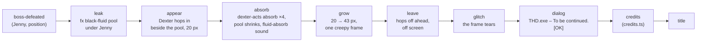

# 03 – Story and cast

<!-- nav:start -->
[← 02 – Game design](02-GAME-DESIGN.md) · [Design docs](README.md) · **3 / 14** · [04 – World and levels →](04-WORLD-AND-LEVELS.md)
<!-- nav:end -->

## Premise

THD is running a **quantum-computing field experiment** on campus. It works too well: the campus now overlaps with copies of itself from other dimensions. In those copies, **anomalies** – living errors – have moved into everything that thinks for itself: the **autonomous** lab rover and hexapod from the display cases, the quadcopter drone, and Jenny, Fast Forest's driverless race car. They don't need a driver, so the anomaly simply becomes one. Where an anomaly is strong, the world shows it the way a computer would: image cuts, stretched pixels, 404 holes, crash dialogs.

You are an ordinary student who touched the wrong pond.

The idea is fiction: no real experiment, person or department is depicted. The university's real places, objects and mascot are used affectionately, as in-jokes for a THD game jam.

## Tone

**A secret horror game.** It looks and plays like a cozy, funny campus adventure, and the horror hides in plain sight: a reflection that shows the wrong thing, every chair facing the coffee machine, a mascot that waves a little too long. The player should be able to finish the first minutes thinking it's a cute game. Familiar → uncanny → psychological horror, built on the mimic and doppelganger idea from the meeting and on Duck Season's friendly mascot. No gore, no blood, no apocalypse, no jump-scare spam. Jokes are things you *do* (hit a robot with a chair, get thrown by a crash dialog), not text.

## The hero

- A first-year THD student, **6 ft**, in a **grey / THD-blue / teal poncho** with colourful accent stripes, cream tassels and a woven THD crest on the back. Black backpack, grey jeans, white sneakers.
- **The face is never seen.** Inside the hood there is only shadow. Gender is unknowable and irrelevant; the player fills it in.
- Never speaks. Reacts with body language: a tilt of the hood, a shrug, a startled hop.
- Character sheet: [art/sprites/images/hero-preview.png](../art/sprites/images/hero-preview.png).

## Dexter – the guide who is the secret boss

Dexter is THD's black panther mascot ("Deggster") as a **1.5 ft plush**: black velvet fur, ice-blue eyes, orange nose, little fangs, a grey THD T-shirt. In the meeting (A12) Lex asks, "Dexter, you mean the panther, right?" – yes.

| Stage | Height | Look | When |
| --- | --- | --- | --- |
| Plush | 1.5 ft | The Campus Store plush: black velvet fur, ice-blue eyes, orange nose, grey THD T-shirt | Prologue → Region 1 |
| Big plush | 3–4 ft | The same plush, too big; stitching strained, posture slightly too upright | Regions 2–3 |
| **Mascot (final form)** | **8.5 ft** | THD's real Deggster **mascot costume** – big fluffy head, grey crest T-shirt, furry gloves and feet – but far too tall. Friendly at first glance, like Duck Season's mascot. On a second look: thick black fluid seeps out exactly where the costume pieces join – the gap between the head and the neck sleeve, the glove cuffs, the ankles – the head sits a little too far forward, the eyes are too glossy. Nobody is inside, or something is | Region 4 → final boss |

**What he does:** he doesn't follow you around. He *appears* – at coffee machines, at the start of each region, sometimes sitting just out of reach. He **never speaks and never fights**: he is a proxy who needs someone to fight for him (A14). He bows, sweats, points, leaves food on your path, and hands over the pocket computer and the region upgrade. Every anomaly you defeat leaves a pool of black fluid, and **Dexter absorbs it**. That is why no bodies are left behind. The more you fight, the bigger he gets. He grows between visits; you see the change and nobody comments on it.

**The twist:** he wants you to keep clearing anomalies so he can become *the* anomaly. Inspired by the ally who betrays you in Little Nightmares and the friendly mascot who turns in Duck Season.

## Prologue script (the jam's opening)

| Beat | What the player sees | What the player does |
| --- | --- | --- |
| 1 | Hidden Garden, late afternoon. Birdsong. A small black plush sits on a bench. | Walk right (movement tutorial) |
| 2 | The plush hops off and waddles away, looking back, like the White Rabbit. About 3 minutes of calm garden: hills, the deck, reeds, secrets behind grass. Lex's layout, toned down – less parkour, nothing fantastical yet | Follow; jump a log; climb a slope |
| 3 | Dexter stops at the pond and points at the ground. One patch of the reflection shows a rusty girder maze that isn't there | Walk up to the edge |
| 4 | Dexter shoves (or trips) you in → white flash, the normal damage recoil… No cutscene, no dialogue | – |
| 5 | …but instead of landing, the hero lifts and spins like a starfish; pixels tear | – |
| 6 | Freeze. An old Windows-style error window: **"THD.exe has stopped responding."** [OK] | Press Act to click OK |
| 7 | Black. Glitch lines. | – |
| 8 | The hero lands in clean Rusty Creek, by the metal bridge, and the damage animation finishes. Dexter is gone | Control returns |

## Region 1 story beats

1. You land in **clean** Rusty Creek: the real creek, rails and the metal bridge. Quiet, no enemies, nothing wrong yet.
2. On the bridge, **Jenny**, the driverless race car, comes out of nowhere and rams you. You fly back with the same cartoon knockback, and the anomaly activates: the region **turns** into the rust maze and you are back at its start ([02](02-GAME-DESIGN.md)).
3. The maze is the real tutorial: jumping, climbing, ladders. A plywood chair lies by the path – **pick it up**. First fight: one autonomous rover.
4. Midway, at the first coffee machine: **Dexter is already sitting there.** He bows and sweats – sorry – and hands you the **pocket computer** and a muffin. No words.
5. The boss clearing: **Jenny** again, now for real (see [enemies](05-ENEMIES-AND-BOSSES.md)).
6. Jenny stalls and leaks black fluid. Dexter appears and **absorbs it**, a little too eagerly. He is visibly taller, and he hops off ahead of you. The jam slice ends here: the screen glitches and a "to be continued" error dialog appears.

### The ending sequence ([#58](https://github.com/THD-AI/WinCS/issues/58))

One overlay scene, `Ending` (`game/src/story/`), runs it after lane B emits `boss-defeated` for Jenny. It reads Jenny's position from the event and draws over the frozen stage; nothing in it is a cinematic – Dexter's frames come from the approved `dexter` and `dexter-acts` atlases, the fluid from `fx`, the window from the THD.exe crossing.

**Sizes, measured from [04 – Scale](04-WORLD-AND-LEVELS.md#scale--the-numbers-everything-follows):** Dexter is the 20 px plush when he hops in. He reaches 113 px (8.5 ft) as the final boss of region 5, after absorbing the bosses of regions 1–4, so each absorb adds a quarter of the 93 px: after Jenny he is **43 px (≈ 3.3 ft)**, about half the hero's 76 px body. The pool is drawn at the `fx` atlas size, centred under Jenny.

Lane B's `boss-defeated` starts it; in dev builds **Shift + F8** runs it anywhere.

## The rest of the arc (post-jam)

Regions 2–5 each end with a boss that Dexter absorbs. Archive notes reveal that the experiment's logs mention a "mascot-shaped containment vessel". In the Playground region Dexter stops pretending. The final fight is Dexter at 8.5 ft. **Endings** (Duck Season style): defeat him (he collapses back into a torn plush), or refuse to feed him (skip the absorbs), which leads to a different, quieter ending.

**Why did the machines turn?** Left open on purpose (A14): the archive notes hint at the experiment, and a later version explains it.

**Parked for later (A14), not for the jam:**

- Dexter in mascot form tries to **possess you** – a secret ending.
- An **underground lab with server farms** under the I-building car park, where the black fluid gathers: a candidate for the final area.
- The theme "the people and things you meet at university help you, then use you" – without real people, so it needs care.
- A Volkswagen boss; more humanoid monsters.

**Secret replay bosses** (after one completion, a joke layer): professors and university figures as giant bosses in the Terraria Moon Lord / Wall of Flesh mould. They tie into the corrupted subjects (the AI / algorithms professor → the pathfinding rust maze). Private portraits stay out of the repository.

<!-- nav:start -->
[← 02 – Game design](02-GAME-DESIGN.md) · [Design docs](README.md) · **3 / 14** · [04 – World and levels →](04-WORLD-AND-LEVELS.md)
<!-- nav:end -->
