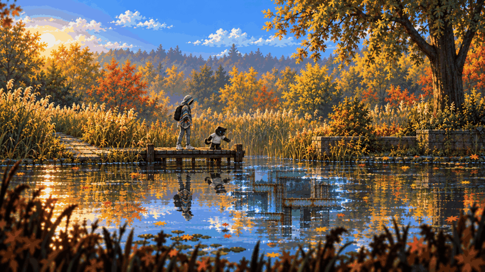
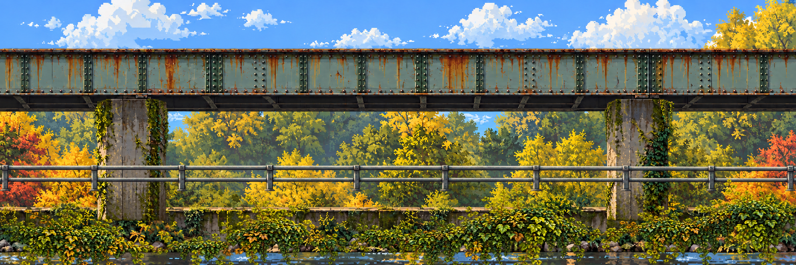
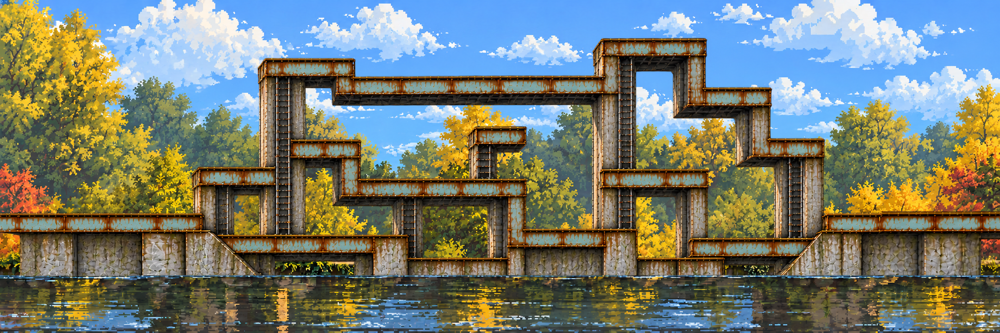

# 04 – World and levels

<!-- nav:start -->
[← 03 – Story and cast](03-STORY-AND-CAST.md) · [Design docs](README.md) · **4 / 14** · [05 – Enemies and bosses →](05-ENEMIES-AND-BOSSES.md)
<!-- nav:end -->

## The world

Every region is a real THD Deggendorf place we photographed on 22–23 Oct, rebuilt in side view, and then broken by the experiment. The [campus collages](../references/campus/README.md) are the source for each one.

| # | Region | Real place | Its anomaly | New weapon / upgrade | Boss | Jam slice? |
| --- | --- | --- | --- | --- | --- | --- |
| 0 | **Hidden Garden** (prologue) | Garden and pond behind the campus | The pond's wrong reflection | – | – | ✅ |
| 1 | **Rusty Creek** | The creek, rails, steel bridges | Jenny rams you on the bridge | Chair; pocket computer | **Jenny** | ✅ |
| 2 | **Lost in the Green** | Pampas grass, birches, slab paths, the granite boulders | A boulder with a mirror face | Tray; **glide** | Drone swarm queen | – |
| 3 | **Campus / Mensa** | Pink-render buildings, the scaffolded Mensa, the cafeteria | Black puddle; the coffee machine screen | Sign pole; tray recall | The Lunch Rush | – |
| 4 | **Toxic Garden** | Corten beds, granite, crimson plantings under the highway bridge | The turned flower | Wall-slide | Mutant planter | – |
| 5 | **Playground** | The adventure playground | The slide | – | **Dexter** | – |

The stepping-stone creek and the Playground slides are connectors between anomalies you have already crossed (Lex's fast-travel idea).

## Every region has two states

**Clean** first, then **anomaly** after you touch it ([02](02-GAME-DESIGN.md)): the region turns, pushes you back to its start, and the broken version is the one you explore. Rusty Creek is the model: the real creek and bridge, then the rust maze.

| Clean Rusty Creek | Anomaly Rusty Creek |
| --- | --- |
|  |  |

All seven pairs as concepts: **[stage concepts](../art/locations/README.md)**. Both states share the camera, layout and landmarks, so the anomaly can swap layers (as in Rusty Creek, where only the structure layers change) instead of redrawing the world.

## Explored in four directions

- **Chunks in a grid, not a line.** A stage is a grid of 2160×720 chunks, each with a stable ID (`rc-0-0`, `rc-1-0`, `rc-1--1` for x, y). Rusty Creek is one row of three today. A chunk can be added to the left, the right, above (a mountainside, a scaffold tower) or below (a culvert, a cellar, an underground pocket).
- **Transition chunks.** Moving between kinds of space – surface to underground, outside to the Mensa inside – goes through an authored transition chunk (a culvert mouth, a doorway, a hollow under roots) that blends the two layer stacks across its height. They're drawn like any other chunk, with both neighbours as context.
- **Lex's map decides.** Lex sketches each region's route: branches, secrets, dead ends, boss room, which neighbours exist. The art pipeline fills those chunks; it never invents the layout.
- **Not flat.** Ground is a polyline: hills like Planet of Lana and Ori, slopes you can slide down, ledges, drops. No staircase blocks.

## Layers – what goes over what

Every chunk is a stack of registered layers, all the same size and position, drawn back to front:

| z | Layer | Scroll | Notes |
| --- | --- | --- | --- |
| 0 | Sky | 0.1 | Gradient, clouds; can be shared across a whole region |
| 1 | Far background | 0.25 | Hazy hills, tree lines, distant buildings |
| 2 | Mid background | 0.6 | Trees, facades; still no collision |
| 3 | Rear structure | 1.0 | Structure behind the play layer (masonry, back walls) |
| 4 | Water + reflection | 1.0 | Water surface; the game draws the reflection of layers 1–6 into it |
| 5 | **Play layer** | 1.0 | Everything you stand on, climb or grab – collision is authored on top of it |
| 6 | Near props | 1.0 | Rails, bushes, chairs in front of the hero, never colliding |
| 7 | **Foreground blur** | 1.2 | Out-of-focus leaves, grass, table edges over the camera (Lana, the Mensa tables) |
| 8 | Particles | – | Falling leaves, dust, sparks – spawned by the game, not painted |
| 9 | Anomaly FX | – | Cuts, stretches, 404 voids applied over the frame by a shader |

The anomaly state replaces only the layers that change (usually 3 and 5, sometimes 2) and keeps the rest pixel-identical. `scripts/split_layers.py` cuts a composed chunk into these layers from ordered mask rules in the region's `layers.json` (rectangles, polygons, colours, another image's alpha). Every pixel goes to exactly one layer, so the stack rebuilds the art exactly; a layer that is identical in both states is stored once. Rusty Creek keeps its own `creek_layers.py`, because its plates are soft and overlap.

## Scale – the numbers everything follows

| Thing | Real size | Stage pixels (stage is 720 px tall) |
| --- | --- | --- |
| Screen | – | 1280×720 view of a 720-tall stage (pixel grain 2 px) |
| Hero | 6 ft / 1.83 m | **80 px tall**, body box 28×76 |
| 1 ft | 0.30 m | ≈ 13 px |
| Dexter (plush) | 1.5 ft | 20 px |
| Dexter (final, the mascot) | 8.5 ft | 113 px |
| Chair seat height | 0.45 m | 20 px |
| Jump (tap / hold) | 1.2 m / 2.2 m | 52 px / 96 px |
| Ledge reach (grab height above feet) | 2.4 m | 105 px |
| Ladder rung spacing | 0.3 m | 13 px |

`route.json` in Rusty Creek still records an older 18×32 body. Collision authoring replaces it with the 28×76 box above.

## Collision and interaction annotation

Every time a chunk's layers are made, it also gets an annotation drawn over the play layer – lines and boxes, colour-coded – exported as data. The colours are only for authoring:

| Colour | Shape | Meaning |
| --- | --- | --- |
| 🟩 Green | line | Walkable ground and gentle slopes (≤ 40°) |
| 🟫 Brown | line | Slide slope (> 40°): you skid down |
| 🟨 Yellow | line | One-way platform (decks, planks, tray stacks): stand on top, jump up through, ↓ + Jump to drop |
| 🩵 Cyan | point | Ledge: a grabbable edge (reserved – the pull-up was cut for the jam) |
| 🟦 Blue | box | Climb zone: ladder, vines, scaffold, stairs |
| 🟥 Red | box | Solid: wall or ceiling you can't enter |
| ⬛ Black | box | No-go / kill-free reset: out of bounds, deep water – respawn at last safe ground |
| 🟧 Orange | box | Hazard: current, sap, sparks – 1 cell of damage |
| 🟪 Purple | box | Interactable or trigger: coffee machine, pickup, Dexter, sign, **the anomaly**, boss gate, chunk exit |
| 🤍 White | dot | Spawn: player, enemy, item, Dexter |
| 🌬️ Pale blue | box | Glide lift (later): updraft that carries a gliding hero up |

Export: `art/stages/<region>/<chunk>.<state>.collision.json` – polylines, points and boxes in stage pixels, one file per chunk and state. They are drawn in **Tiled**, one object layer per row of the legend, on top of the composed chunk, and `scripts/collision_from_tiled.py` converts the export; Rusty Creek's first set was written straight from the art. Chunk ids are grid positions (`rc-0-0`, `rc-1-0` …), mapped to their art in the region's `chunks.json`. `python scripts/collision_check.py --overlay` checks every file against the schema and the 28×76 body (every spawn, pickup and trigger reachable, neighbouring chunks meeting at one ground height) and draws the review overlays into the region's `collision/` folder. The game builds the physics from it. Pixel masks never stand in for collision. The exact schema is in [13 – Production pipeline](13-PRODUCTION-PIPELINE.md#contract-collisionjson).

## Rusty Creek – the jam level

The route already exists as a graph ([route.json](../art/stages/rusty-creek/route.json): 47 nodes, 47 edges, verified connected). The beats on it:

| Chunk | Beat | Content |
| --- | --- | --- |
| Left – *entry, first climb* | Land from the pond crash. Quiet. | The **chair** lies on the first deck. One **rover** patrols the low deck (tutorial fight). Ladder up to the first branch. Optional lookout dead end: muffin + note #1 |
| Center – *branches, reconnection* | The maze opens up | Two routes: high (ladders, a **crab** on a deck) and low (along the creek, two rovers). A **drone** hovers over the low route: too hard to kill with the chair, so avoid it under girders. **Coffee machine** + **Dexter** (pocket computer) at the reconnection. Cache dead end: Leberkäse roll |
| Right – *boss clearing, exit* | Wide open girder floor | Boss gate closes behind you. **Jenny**. After the fight, Dexter absorbs the black fluid and the exit anomaly opens. Overlook dead end: note #2 (first hint about Dexter) |

Target play time for the slice: 8–12 minutes.

## Lex's next maps

For each next region: one hand-drawn route sketch on top of its collage. Mark the entry, branches, secrets, enemies and the boss room with arrows, using the colour legend above. Screenshots from reference games are welcome. These sketches are the input for generating that region's stage art.

<!-- nav:start -->
[← 03 – Story and cast](03-STORY-AND-CAST.md) · [Design docs](README.md) · **4 / 14** · [05 – Enemies and bosses →](05-ENEMIES-AND-BOSSES.md)
<!-- nav:end -->
