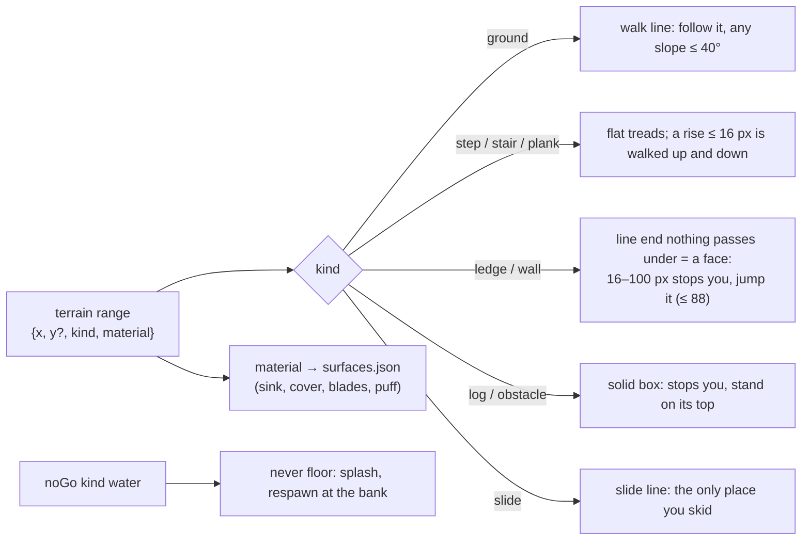
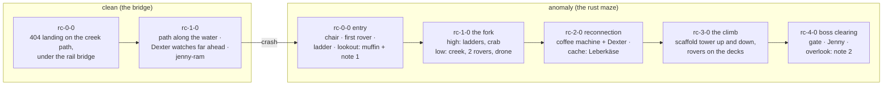
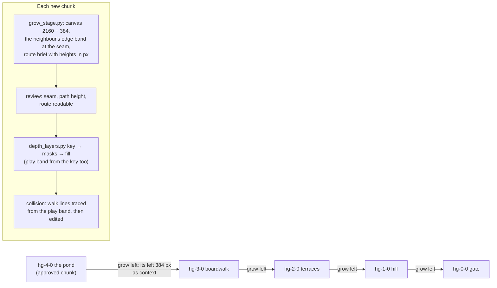

# 04 – World and levels

<!-- nav:start -->
[← 03 – Story and cast](03-STORY-AND-CAST.md) · [Design docs](README.md) · **4 / 15** · [05 – Enemies and bosses →](05-ENEMIES-AND-BOSSES.md)
<!-- nav:end -->

## The world

Every region is a real THD Deggendorf place we photographed on 22–23 Oct, rebuilt in side view, and then broken by the experiment. The [campus collages](../references/campus/README.md) are the source for each one.

| # | Region | Real place | Its anomaly | New weapon / upgrade | Boss | Jam slice? |
| --- | --- | --- | --- | --- | --- | --- |
| 0 | **Hidden Garden** (prologue) | Garden and pond behind the campus | The pond's wrong reflection | – | – | ✅ |
| 1 | **Rusty Creek** | The creek, rails, steel bridges | Jenny rams you on the bridge | Chair; pocket computer | **Jenny** | ✅ |
| 2 | **Lost in the Green** | Pampas grass, birches, slab paths, the granite boulders | A boulder with a mirror face | Tray; **glide** | Drone swarm queen | – |
| 3 | **Campus / Mensa** | Pink-render buildings, the scaffolded Mensa, the cafeteria | Black puddle; the coffee machine screen | Sign pole; tray recall | The Lunch Rush | – |
| 4 | **Toxic Garden** | Corten beds, granite, crimson plantings under the highway bridge | The turned flower | Wall-slide | Mutant planter | – |
| 5 | **Playground** | The adventure playground | The slide | – | **Dexter** | – |

The stepping-stone creek and the Playground slides are connectors between anomalies you have already crossed (Lex's fast-travel idea).

## Every region has two states

**Clean** first, then **anomaly** after you touch it ([02](02-GAME-DESIGN.md)): the region turns, pushes you back to its start, and the broken version is the one you explore. Rusty Creek is the model: the real creek and bridge, then the rust maze.

| Clean Rusty Creek | Anomaly Rusty Creek |
| --- | --- |
|  |  |

All seven pairs as concepts: **[stage concepts](../art/locations/README.md)**. Both states share the camera, layout and landmarks, so the anomaly can swap layers (as in Rusty Creek, where only the structure layers change) instead of redrawing the world.

## Explored in four directions

- **Chunks in a grid, not a line.** A stage is a grid of 2160×720 chunks, each with a stable ID (`rc-0-0`, `rc-1-0`, `rc-1--1` for x, y). Rusty Creek is one row of three today. A chunk can be added to the left, the right, above (a mountainside, a scaffold tower) or below (a culvert, a cellar, an underground pocket).
- **Transition chunks.** Moving between kinds of space – surface to underground, outside to the Mensa inside – goes through an authored transition chunk (a culvert mouth, a doorway, a hollow under roots) that blends the two layer stacks across its height. They're drawn like any other chunk, with both neighbours as context.
- **Lex's map decides.** Lex sketches each region's route: branches, secrets, dead ends, boss room, which neighbours exist. The art pipeline fills those chunks; it never invents the layout.
- **Not flat.** Ground is a polyline: hills like Planet of Lana and Ori, slopes you can slide down, ledges, drops. No staircase blocks.

## Layers – what goes over what

Every chunk is a stack of registered layers, all the same size and position, drawn back to front:

| z | Layer | Scroll | Notes |
| --- | --- | --- | --- |
| 0 | Sky | 0.1 | Gradient, clouds; can be shared across a whole region |
| 1 | Far background | 0.25 | Hazy hills, tree lines, distant buildings |
| 2 | Mid background | 0.6 | Trees, facades; still no collision |
| 3 | Rear structure | 1.0 | Structure behind the play layer (masonry, back walls) |
| 4 | Water + reflection | 1.0 | Water surface; the game draws the reflection of layers 1–6 into it |
| 5 | **Play layer** | 1.0 | Everything you stand on, climb or grab – collision is authored on top of it |
| 6 | Near props | 1.0 | Rails, bushes, chairs in front of the hero, never colliding |
| 7 | **Foreground blur** | 1.2 | Out-of-focus leaves, grass, table edges over the camera (Lana, the Mensa tables) |
| 8 | Particles | – | Falling leaves, dust, sparks – spawned by the game, not painted |
| 9 | Anomaly FX | – | Cuts, stretches, 404 voids applied over the frame by a shader |

The anomaly state replaces only the layers that change (usually 3 and 5, sometimes 2) and keeps the rest pixel-identical. `scripts/split_layers.py` cuts a composed chunk into these layers from ordered mask rules in the region's `layers.json` (rectangles, polygons, colours, another image's alpha). Every pixel goes to exactly one layer, so the stack rebuilds the art exactly; a layer that is identical in both states is stored once. Rusty Creek keeps its own `creek_layers.py`, because its plates are soft and overlap.

## Scale – the numbers everything follows

| Thing | Real size | Stage pixels (stage is 720 px tall) |
| --- | --- | --- |
| Screen | – | 1280×720 view of a 720-tall stage (pixel grain 2 px) |
| Hero | 6 ft / 1.83 m | **114 px drawn in a 118 px frame** (1.5× since 24 Oct, A15: the plates are drawn about 1.5–1.8× bigger than the old 76 px hero – the bench seat sat at his hip); physics body box stays 28×76 |
| 1 ft | 0.30 m | ≈ 13 px |
| Dexter (plush) | 1.5 ft in the story; drawn ≈ 2 ft, head just above the hero's knee | **40 px** (1.5× since 24 Oct; story distances still count in 27 px plush-lengths) |
| Dexter (after Jenny, end of the slice) | ≈ 3.5 ft | 46 px (each region boss he absorbs adds a quarter of the way from 27 to 101 px) |
| Dexter (bigger plush, mid-arc) | 4 ft | 56 px (0.73 of the hero) |
| Dexter (final, the mascot) | 8.5 ft | 101 px (1.33 of the hero) |
| Jenny (boss car) | ≈ 6.3 m drawn, as in the approved direction (Alexander, 24 Oct) | **≈ 270 px long**, body ≈ 95 px; rear wing and beacon above |
| Chair seat height | 0.45 m | 20 px |
| Jump (tap / hold) | 1.2 m / 2.2 m | 52 px / 96 px |
| Ledge reach (grab height above feet) | 2.4 m | 105 px |
| Ladder rung spacing | 0.3 m | 13 px |

Dexter's three sizes are measured from the approved [Dexter stages](../art/direction/dexter-stages.md) (reviewed "perfect"), not computed from feet: there the hero is 547 px tall, the plush 191, the 4 ft plush 400 and the mascot 730, so each is that share of the hero's 76 px ([#139](https://github.com/THD-AI/WinCS/issues/139)). The plush is drawn bigger than 1.5 ft would be – a toy's head reads at small size – and the art wins.

`route.json` in Rusty Creek still records an older 18×32 body. Collision authoring replaces it with the 28×76 box above.

## Collision and interaction annotation

Every time a chunk's layers are made, it also gets an annotation drawn over the play layer – lines and boxes, colour-coded – exported as data. The colours are only for authoring:

| Colour | Shape | Meaning |
| --- | --- | --- |
| 🟩 Green | line | Walkable ground and gentle slopes (≤ 40°); the hero never slides on it. Treads of planks and stairs are flat green lines, one per tread |
| 🟫 Brown | line | Slide slope: the only line you skid down |
| 🟨 Yellow | line | One-way platform (decks, planks, tray stacks): stand on top, jump up through, ↓ + Jump to drop |
| 🩵 Cyan | point | Ledge: a grabbable edge (reserved – the pull-up was cut for the jam) |
| 🟦 Blue | box | Climb zone: ladder, vines, scaffold, stairs |
| 🟥 Red | box | Solid (`kind` wall / log / obstacle): stops the body, its top is floor – the fallen birch is one. In the overlays a short red stroke at a line end marks a **ledge face** |
| ⬛ Black | box | No-go / kill-free reset: out of bounds; `kind: "water"` (tinted blue in the overlays) is the pond – never floor, falling in splashes and respawns at the last safe ground |
| 🟧 Orange | box | Hazard: current, sap, sparks – 1 cell of damage |
| 🟪 Purple | box | Interactable or trigger: coffee machine, pickup, Dexter, sign, **the anomaly**, boss gate, chunk exit |
| 🤍 White | dot | Spawn: player, enemy, item, Dexter |
| 🌬️ Pale blue | box | Glide lift (later): updraft that carries a gliding hero up |

### Terrain model (P1)

The trail is where you walk, and every stretch of it is typed. Physics reads only the geometry above; the `terrain` list in each collision file names what each stretch *is*, and the checker holds the geometry to it.

| Rule | Number | Where |
| --- | --- | --- |
| Step: walked up and down without a jump | rise ≤ 16 px | `STEP_UP`, `game/src/player/body.ts` |
| Ledge face: stops the body; higher ones are background you walk in front of | 16 < rise ≤ 100 px | `FACE_REACH` |
| An end with a floor ≤ 120 px under it is an overhang (the bench platform), not a face | 120 px | `FACE_DEPTH` |
| A face a lower floor stops at must be jumpable | ≤ 88 px | `collision_check.py` |
| Treads (`step`, `stair`, `plank`) are flat | slope ≤ 0.05 | `collision_check.py` |
| No floor over the pond's water pixels (04-water layer, not the play layer) | – | `collision_check.py` |

`python scripts/collision_check.py --surfaces` rebuilds the region's `surfaces.json` ranges from the terrain (the materials stay hand-tuned there; a `water` material carries the splash).

Export: `art/stages/<region>/<chunk>.<state>.collision.json` – polylines, points and boxes in stage pixels, one file per chunk and state. They are drawn in **Tiled**, one object layer per row of the legend, on top of the composed chunk, and `scripts/collision_from_tiled.py` converts the export; Rusty Creek's first set was written straight from the art. Chunk ids are grid positions (`rc-0-0`, `rc-1-0` …), mapped to their art in the region's `chunks.json`. `python scripts/collision_check.py --overlay` checks every file against the schema and the 28×76 body (every spawn, pickup and trigger reachable, neighbouring chunks meeting at one ground height) and draws the review overlays into the region's `collision/` folder. The game builds the physics from it. Pixel masks never stand in for collision. The exact schema is in [13 – Production pipeline](13-PRODUCTION-PIPELINE.md#contract-collisionjson).

## Rusty Creek – the jam level

The route already exists as a graph ([route.json](../art/stages/rusty-creek/route.json): 47 nodes, 47 edges, verified connected). The beats on it:

| Chunk | Beat | Content |
| --- | --- | --- |
| Left – *entry, first climb* | Land from the pond crash. Quiet. | The **chair** lies on the first deck. One **rover** patrols the low deck (tutorial fight). Ladder up to the first branch. Optional lookout dead end: muffin + note #1 |
| Center – *branches, reconnection* | The maze opens up | Two routes: high (ladders, a **crab** on a deck) and low (along the creek, two rovers). A **drone** hovers over the low route: too hard to kill with the chair, so avoid it under girders. **Coffee machine** + **Dexter** (pocket computer) at the reconnection. Cache dead end: Leberkäse roll |
| Right – *boss clearing, exit* | Wide open girder floor | Boss gate closes behind you. **Jenny**. After the fight, Dexter absorbs the black fluid and the exit anomaly opens. Overlook dead end: note #2 (first hint about Dexter) |

Target play time for the slice: 8–12 minutes.

### Rebuild plan ([#157](https://github.com/THD-AI/WinCS/issues/157))

The three chunks above were the proof of concept for map generation, made before the location concepts, the direction pack and the Hidden Garden's pipeline. The rebuild re-derives Region 1 from the sources and grows it the way the garden was grown. It also fixes the slice's length: with three chunks, a player who runs straight through finishes the whole slice in about 5 minutes. The target is 8–12.

**Sources:** the style master ("Rusty Creek, first light": blue-green riveted rusty girders, ladders, autumn trees, the creek, a rusty railing in front), the location concept in `art/locations/`, the creek, rail and steel-bridge photos (`media-sources.json`), and the [anomaly language](../art/direction/anomaly-language.md) (cuts, stretched rows, 404 holes, crash dialogs).

| Chunk | Clean | Anomaly (the maze) | Walk lines (brief for `grow_stage.py`) | Play time (walk) |
| --- | --- | --- | --- | --- |
| rc-0-0 | the 404 landing: the cement creek path under the rail bridge | entry: the chair on the first deck, one rover on the low deck, a ladder up, the lookout dead end | the path at y≈566; maze decks at 508 / 461, a ladder to 165 | 40 s |
| rc-1-0 | the path along the water; Dexter watches; `jenny-ram` | the fork: a high route (two ladders, a crab on a deck) and a low route along the creek (two rovers, the drone over it) | high deck ≈165, low deck ≈570; they rejoin at the right edge | 60 s |
| rc-2-0 | – | the reconnection: the coffee machine and Dexter (`coffee-1`, `dexter-1`), the Leberkäse cache | one broad deck ≈537 with a step down to the machine | 30 s |
| rc-3-0 | – | **new:** the climb, a scaffold tower beside a steel bridge pier, up three ladders and down the far side, a rover on each deck | decks at ≈540, 400, 260, 140; down by a slide or a drop | 50 s |
| rc-4-0 | – | the boss clearing: a wide open girder floor, the gate behind you, Jenny; the overlook with note 2 | one floor at ≈565, an overlook at ≈105 | 90 s + boss |

The clean state needs only rc-0-0 and rc-1-0, because the ram happens there. The rest exists only as the maze. That's two more chunks than today. Walking, the maze goes from about 2.3 to about 4 minutes, so a straight run of the whole slice lands at about 8–9 minutes.

**Pipeline, the same as the garden ([09](09-ART-PIPELINE.md)):**

1. **Seed:** draw rc-0-0 anomaly from the style master (it is that plate) with `make_boards.py draw`, at pixel factor 1, 2160 × 720.
2. **Grow:** `grow_stage.py art/stages/rusty-creek rc-0-0 right rc-1-0`, then onwards to rc-4-0. Each chunk's board has a brief with its walk lines (the column above) and a `route` the guide draws. Then use `feature` for anything the model smooths away: ladders, the scaffold tower, the gate.
3. **Clean pair:** repaint rc-0-0 and rc-1-0 as the clean creek. The structure layers change, and the far layers, bank and water stay pixel-identical.
4. **Split:** `depth_layers.py` (key, masks, fill, complete, near, under, clear) gives the region plates, the near grass and railing band, and the walkable `play` band. Then `split_layers.py` and `export_stage.py --verify`.
5. **Collision:** traced from the `play` band (`depth_layers.py collision`), adjusted by hand, and `collision_check.py` with 0 problems (reach, joins, step-ups ≤ 16 px).
6. **Encounters:** re-placed from the new art: player spawn, chair, rovers, crab, drone, coffee machine, Dexter, pickups, boss gate, Jenny and `jenny-ram`.
7. **Compare:** a parallax preview and `compare.py` against the style master and the direction boards go in the PR.

**When:** after the jury. The current three chunks are what the jury plays, and swapping the region's art, collision and every encounter three hours before the freeze would risk the whole slice.

## Hidden Garden – the prologue level

Docs/03 beat 2 asks for about three minutes of calm garden before the pond: hills, the deck, reeds, a secret behind grass, a log to jump, a slope to climb ([#50](https://github.com/THD-AI/WinCS/issues/50)). At 3.5 m/s (153 px/s) one 2160 px chunk is 14 s of walking, so the prologue is **five chunks** in a row: ≈ 70 s on foot, plus Dexter's waits and two detours. The pond chunk that exists becomes the last one, `hg-4-0`; the four before it grow leftwards from it, each from the edge of the one to its right, so the path meets at the same height (top y = 441).

| Chunk | Beat | Route | Teaches |
| --- | --- | --- | --- |
| `hg-0-0` the gate | Hero enters at the garden gate; **Dexter sits on a bench**, hops off when you come close | flat path, a fallen log at the end (≈ 30 px, a tap jump of 52) | walk, the first jump |
| `hg-1-0` the hill | The path rolls over a grassy hill with an old oak on top | slopes ≤ 25°; below the hill a **hollow behind tall grass** with a muffin (lower branch, dead end) | slopes, secrets |
| `hg-2-0` the terraces | Old stone garden terraces and a wooden shed | steps ≤ 48 px; a **ladder up the shed** to its roof, a glint up there (higher branch, dead end) | ladders, looking up |
| `hg-3-0` the boardwalk | A timber boardwalk through the reeds | one gap (≈ 120 px, a running jump), stepping stones in a ditch | jumping gaps |
| `hg-4-0` the pond | The jetty, the wrong reflection, the shove (today's `hg-0-0`) | – | – |

## Lex's next maps

For each next region: one hand-drawn route sketch on top of its collage. Mark the entry, branches, secrets, enemies and the boss room with arrows, using the colour legend above. Screenshots from reference games are welcome. These sketches are the input for generating that region's stage art.

<!-- nav:start -->
[← 03 – Story and cast](03-STORY-AND-CAST.md) · [Design docs](README.md) · **4 / 15** · [05 – Enemies and bosses →](05-ENEMIES-AND-BOSSES.md)
<!-- nav:end -->
