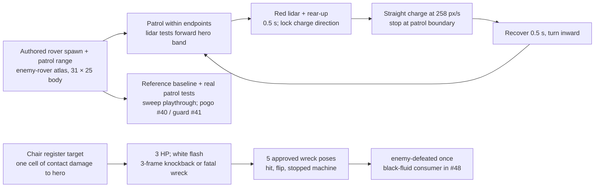

# 05 – Enemies and bosses

<!-- nav:start -->
[← 04 – World and levels](04-WORLD-AND-LEVELS.md) · [Design docs](README.md) · **5 / 16** · [06 – Visual direction →](06-VISUAL-DIRECTION.md)
<!-- nav:end -->

Every enemy is a real **autonomous** machine from THD – things that already drive, walk or fly by themselves. The anomaly takes over their autonomy: no pilot, no remote, just a self-driving stack that now wants you gone. When one is defeated it stops dead and leaks black fluid, which Dexter absorbs later.

## Regular enemies

| Enemy | Source | Size | HP (chair hits) | Behaviour | Tell | Counter |
| --- | --- | --- | --- | --- | --- | --- |
| **Rover** | THD's autonomous vehicle project (ultrasonic + lidar), yellow wheels | Knee-high (≈ 25 px) | 3 | Patrols a deck. Spots you with its lidar, then charges in a straight line | Lidar turns red, rears up for 0.5 s | Jump over the charge and hit it from behind; guard works |
| **Crab** | Autonomous six-legged hexapod robot | Waist-high, wide (≈ 40 px) | 4 | Creeps toward you; rears up and stabs with its front legs; can walk under decks | Front legs raised for 0.6 s | Step back, then punish; up-attack when it's on a deck above |
| **Drone** | Large autonomous quadcopter | 1 m span (≈ 45 px), flies at head height | 8 (chair) / 3 (tray) | Hovers out of reach and drops screws or sparking batteries; dives when you're under it | Red eye flashes and it tilts | **Avoid it** in Region 1 (hide under girders). Kill it later with the tray. Coming back for drones is intended backtracking |
| *In the game (P7):* | `enemies/rover.ts`, `crab.ts`, `drone.ts`, drawn by `rovers.ts` from the collision spawns | | | Rovers on the decks you walk (rc-0-0: rover-1, -4, -5; rc-1-0: rover-2, -3, -6; rc-2-0: rover-7); crab-1 on the high route, drone-1 over the low route | Crab and drone flash red and play their servo / hum during the tell | |
| *Later:* Mutant plant | Toxic Garden | – | – | Stationary, spits sap | Mouth swells | Down-slam its head |

All of them: contact damage 1 cell (never while knocked back by a hit or going down), white hit flash, 3–4 frame knockback, a small screen shake per landed hit and a scrap burst when they go down, and they stop dead and leak black fluid when defeated. Rovers and crabs idle 0.3 s at a patrol end before they turn. The rover's tell plays its motor revving up under the red lidar. A crab that spots you creeps in and rears up only once its stab would reach (70 px), instead of stabbing the air from its spot range.

### Rover controller plan (#45)

Use only `kind: rover` spawns and their translated `patrol` endpoints.
The standing `enemy-rover:idle-00` alpha bounds are 31 × 25 px, feet at
the atlas pivot. The approved charge poses lower the mast (18–21 px
visible height); keep their native pixels and the standing collision box.
Patrol tuning is half the documented walking speed (75.25 px/s); charge
uses the documented running speed (258 px/s). Lidar checks one walking
second ahead (150.5 px), within the hero's 76 px height band. These are
initial controller tuning, with the fixed 0.5 s tell and 3 HP above.
The tell holds red-lidar `charge-00`, then reared `charge-01`; moving
charge alternates poses 02/03. A normal hit knocks half a rover width
(15.5 px) over three authored 12 fps frames. A boundary ends a charge
with another 0.5 s recovery; it never homes on a jumping hero.
The red lidar points left and dust trails right in the approved charge;
mirror these poses for rightward motion.

The development `rover-test` URL starts three hero body widths behind the
real tutorial spawn, on its deck, without changing the annotation.
Guard, pogo and the shared fluid effect are verified when #41, #40 and
#48 reach this stack; keep their integration criteria open until then.

## Boss – Jenny, the self-driving race car (Region 1)

Jenny is **Fast Forest**'s car – THD's Formula Student team, founded 2008. Every car they build is called Jenny; the current one is **Jenny 16GDX** (rolled out 22 May 2026), carbon-black with lime-green, teal and blue stripes. Fast Forest has worked on a **driverless** Jenny since 2017: a camera finds the track's cones and the car steers itself (sources: fast-forest.de, PNP 12 Oct 2023). In the game the cockpit is empty, the blue autonomous-status light on the roll hoop flashes, and the anomaly is doing the driving. 30 chair hits, three phases. The pattern comes straight from the brief: she tries to run you over, crashes into things, sheds parts you have to dodge, slows down, you hit her, she charges up again, and it repeats.

Lex's read (A14), which the fight follows: Jenny is a **shielded** enemy. Her nose is armoured and chair hits bounce off the front. You jump over her charge and hit her **from behind** or while she is stunned. She crashes into the rusted pillars and throws scrap, so there is a ranged threat too. You meet her once before the fight: in clean Rusty Creek she rams you on the bridge, and that is what turns the creek.

| Phase | HP | Pattern |
| --- | --- | --- |
| 1 | 30→20 | **Rev** (1 s, engine shakes, exhaust) → **charge** across the arena → **crash** into the far wall → 3 parts fly out in arcs (spring, bolt, wing shard) → **stunned** 3 s (hazard light blinking): hit her → reboot with green sparks → repeat |
| 2 | 20→10 | Same, but she **charges twice** (at the wall she stops, turns and revs a shorter 0.5 s tell) and drops a loose **wheel** that rolls along the floor |
| 3 | 10→0 | She jumps: the charge launches off a ramp in an arc. Jump under it or guard. 5 parts per crash. Stun lasts only 2 s |

- **Charge** does 2 cells. **Parts** do 1. Guarding a charge breaks the guard.
- The arena is the Rusty Creek boss clearing: one flat girder floor, two walls, the creek below. Falling in is a hazard (−1 cell).
- **Death:** she stalls, smokes and leaks black fluid. Dexter appears and absorbs it.
- **In the game** (`enemies/jenny.ts`, `enemies/jennyBoss.ts`, #57): the arena comes from collision, not code: the `boss-gate` box's right edge is the left wall, which closes behind you once you're through, and the floor line under her `jenny` spawn ends at the right wall. Her hit box is the car body under the cockpit, 250 × 56 px inside the ~290 × 134 px sprite, and her charge speeds (540 / 600 / 660 px/s) are tuned so a standing full jump (96 px) lets her pass under in the arena (`jumpable()` is unit-tested). Only her charge hurts, and only with her front half: a revving, crashed, stunned or rebooting Jenny never hurts on contact, and a hero at her tail as she pulls away (or dropping onto her back after a jump) is not run over. While she fights, a second wall closes the far end of her floor, so her ram never throws you out of the arena; both walls are drawn as rusted hazard-striped barriers while closed. **Start (playtest 24 Oct):** the fight starts as soon as the hero stands inside the arena, from whichever side or height he came in (not only through the gate box), and opens with a 2.2 s rev facing him (`INTRO_REV_SECONDS`) while a red strip on the floor shows her path to the wall. **One hit, not a chain:** after her charge hits, the hero cannot be hurt again for 2 s (`RAM_GRACE`), so one charge costs at most 2 of 5 cells. **Dazed:** while stunned, stars circle over her and the whole car glows. Parts are drawn larger (`PART_SCALE` 0.45) and cast a shadow on the floor where they will land.
- **What reads (P8, Alexander's playtest):** the **rev** shakes her, puffs exhaust from the tail and flashes her headlight – that is the tell. Her **charge** never passes through you without consequence: you are thrown up (520 px/s) and the way she drives, play the hurt clip, get the usual second of invulnerability, and she brakes to a third of her speed for 0.25 s with a hit-stop and a screen shake. Her **open back** glows orange at the tail – faint while she drives (hits from behind count), bright and pulsing while she is stunned, with the hazard light blinking over it. Her **crash** into the wall shakes the screen hard, smokes at the nose and plays the crash sound; the hazard light blinks twice as fast in the last 0.7 s of a stun, and the **reboot** throws green sparks. Every chair hit that lands flashes her white, rocks her 4 px, shakes the screen a little, sparks and chips off debris (the last hit shakes harder); a hit on the **armoured nose** clanks, throws grey sparks and bounces you back. **Parts** bounce up to twice, then lie on the floor as hazards for 2.5 s and blink before they vanish. Clip lengths come from `boss-jenny*.anims.json`. Beating her emits `boss-defeated`, and the `Ending` scene takes over. Dying resets the fight. Dev: `?boss-test` spawns you at the gate.
- What we took from Terraria's Wall of Flesh: one huge shape crossing the whole screen, very readable, and you know exactly what to do after seeing it once.

## Later bosses

| Region | Boss | Idea |
| --- | --- | --- |
| 2 | **Drone swarm queen** | The quadcopter at full size; tray-only damage; small drones orbit it |
| 3 | **The Lunch Rush** | The Mensa itself: trays fly, the Leberkäse roll rolls across the lane and stops, exposed |
| 4 | **Mutant planter** | A corten planter with a mouth; the floor turns into sap |
| 5 | **Dexter, the mascot (8.5 ft)** | Final boss. The costume moves like a mascot doing a show – waves, dances, high-fives – and every move is an attack; black fluid sprays from the joins when he's hit; glitch attacks copy your own moves (the mimic idea) |
| Secret | **Professors** (replay) | Giant, Moon Lord-scale joke bosses after one completion |

<!-- nav:start -->
[← 04 – World and levels](04-WORLD-AND-LEVELS.md) · [Design docs](README.md) · **5 / 16** · [06 – Visual direction →](06-VISUAL-DIRECTION.md)
<!-- nav:end -->
