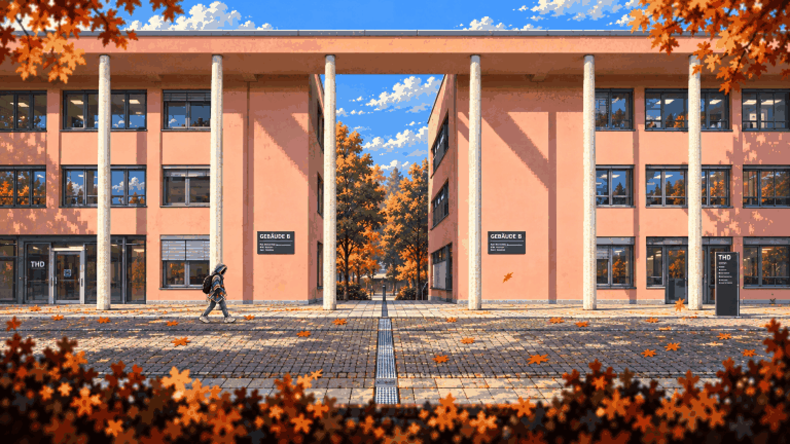
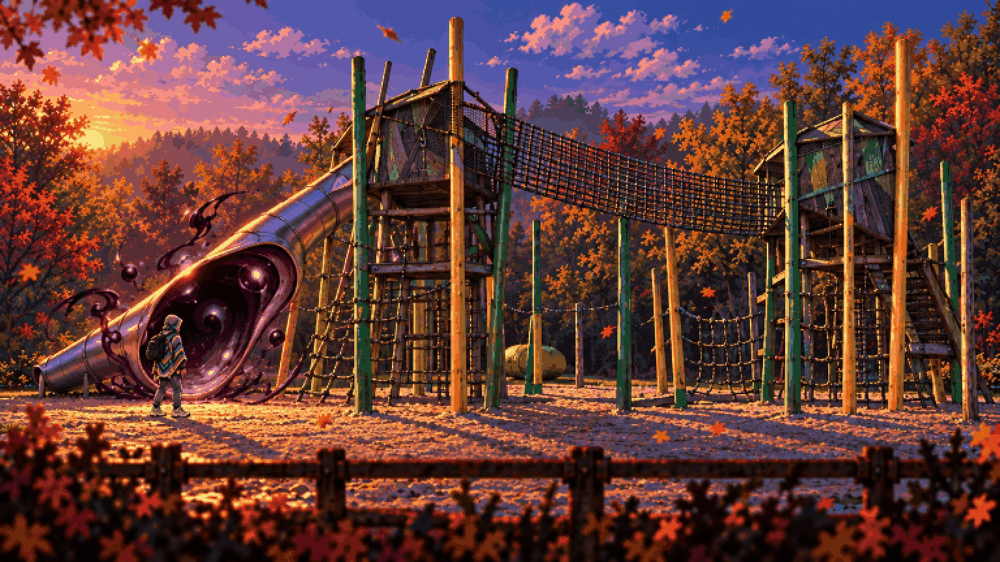
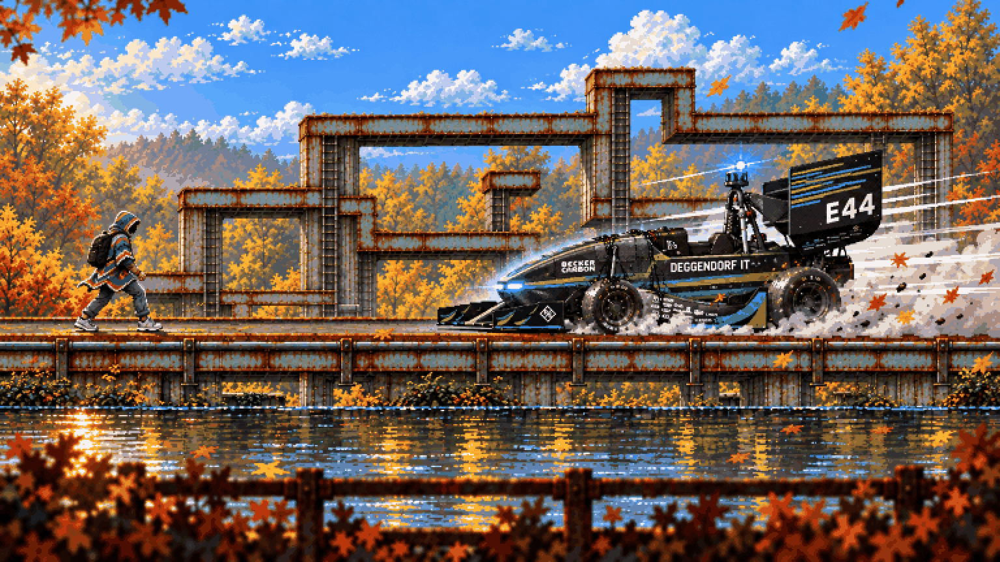
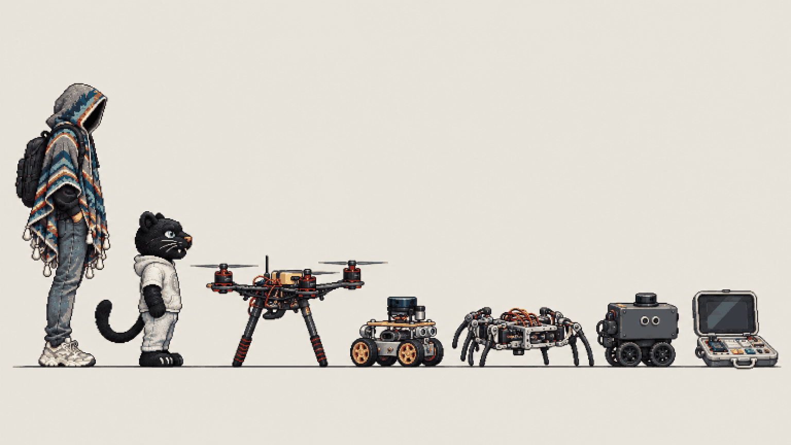
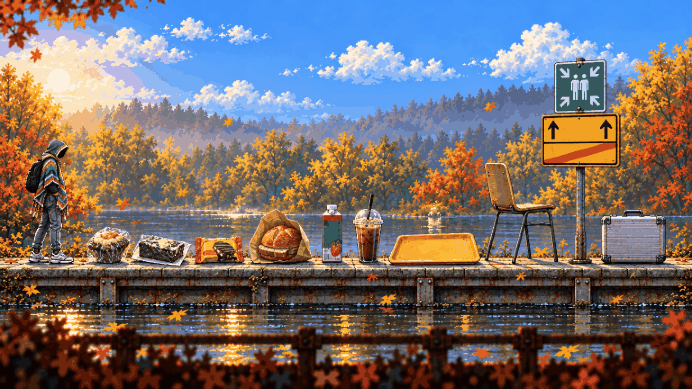

# 06 – Visual direction

<!-- nav:start -->
[← 05 – Enemies and bosses](05-ENEMIES-AND-BOSSES.md) · [Design docs](README.md) · **6 / 13** · [07 – Asset manifest →](07-ASSET-MANIFEST.md)
<!-- nav:end -->

**The look in one sentence:** Planet of Lana's small figure in a wide, layered world, drawn as hi-bit pixel art with warm autumn light, Hollow Knight-clear silhouettes, and a world that glitches like a computer when the anomalies are near.

Everything in the game must look like it belongs in the **style master** above. It is our real Rusty Creek stage plus the approved hero, finished as one in-game screenshot. Every other image in the [visual-direction pack](../art/direction/README.md) was drawn with the style master as its first input.

## The pack

| | |
| --- | --- |
|  **Hidden Garden** – prologue, the wrong reflection |  **Lost in the Green** – grass screens, secret paths |
|  **Campus** – the scaffolded Mensa facade |  **Mensa** – the coffee machine save point |
|  **Toxic Garden** – the greenhouse |  **Playground** – the slide anomaly |
|  **Boss – Jenny** |  **Dexter** – plush to final form |
|  **The machines** – enemies and companion |  **Style master** |
|  **Combat** – the chair |  **Anomalies** – how the world breaks |
|  **HUD** and pocket computer |  **Props and pickups** |

**Owner review, 23 Oct 18:40:** perfect – style master, Hidden Garden ("a masterpiece"), Dexter stages, Lost in the Green, HUD; good – Jenny, cast, Mensa, props. Redone after feedback: combat, Toxic Garden (outdoors, collage palette), Playground, the crash frame (cheap: sprites + one window), Campus.

**Stages:** the pack sets the look; the playable places are the [stage concepts](../art/locations/README.md) – each region clean and after its anomaly – built into layered chunks ([09](09-ART-PIPELINE.md)).

**Reviewed 23 Oct:** 14 images; 12 approved, 2 with notes (Jenny's livery, the machines lineup). Seven needed a second or third take; every image's page says what changed and why. The two lessons that fixed it: the hero sheet always goes in as the second input, and "copy the style, not the composition".

## Rules

**Pixels.** Fine 2-pixel grain on a 720 px stage. No anti-aliased blur, no smooth vector gradients, no chunky 8-bit. Everything is crushed by the same script (box downscale ×2, 96 colours), so all art shares one grain.

**Scale.** The hero is 80 px of the 720 px stage, about 1/8 of the screen. Size tables are in [04](04-WORLD-AND-LEVELS.md). The world is the spectacle; the hero is a small, readable figure in it.

**Depth.** Seven layers per stage: sky/far trees (hazy, slow) → rear structure → bank → water → traversal structure → near rails → near foliage (dark, fast). The foreground belongs to the location: leaves in gardens, rails at the creek, scaffold poles at campus. Never paste the same leaf band everywhere.

**Light and palette per region.**

| Region | Light | Palette | Accent |
| --- | --- | --- | --- |
| Hidden Garden | Late afternoon, still | Golden reeds, deep green, sky blue | One cyan glitch patch |
| Rusty Creek | Low warm sun | Gold and orange trees, slate-teal steel | Rust orange |
| Lost in the Green | Sun through birches | Straw, pampas cream, olive | The rover's red lidar |
| Campus | Dusk | Pink render, warm lit windows, steel grey | Yellow sign |
| Mensa | Night interior | Red counters, granite, deep blue shadow | Warm coffee-machine glow |
| Toxic Garden | Sickly diffuse | Acid green, magenta-red foliage, corten | Glowing pods |
| Playground | Purple dusk | Timber, green and yellow poles, sand | The black slide mouth |

**Light.** God rays come from a sun that sits off to one side, so the shafts fall at an angle. They are not a perfectly vertical fan as if the sun were straight overhead (Vatsal, A14). Falling leaves drifting past as you walk stay; the team liked them.

**Silhouettes.** Characters and enemies get a thin warm rim light and read as clean shapes against any background (Hollow Knight). The hero's hood is solid black inside, always.

**The anomaly language** (the one way the world breaks):

1. **Image cut** – a rectangle of scenery shifted sideways and repeated.
2. **Pixel stretch** – a column of scenery smeared into vertical streaks.
3. **404 void** – flat grey nothing with a broken-image icon; torn edges.
4. **Crash dialog** – old-desktop error window, red X, OK button. It is the region transition. Its text is real game text, never drawn into art.
5. **Black fluid** – glossy, slow, seeping from seams and joins: panel gaps on machines, the costume joins on Dexter. Never splattered, never red.

**UI.** Minimal and diegetic where possible: 5 battery cells for health, a 3-segment glitch meter, no minimap. The map lives on the pocket computer's green-on-black CRT screen.

**Secret horror:** every scene is pretty and calm first; it carries exactly one wrong detail for a careful player to notice. **Never:** gore or blood, jump-scare spam, text baked into art, real people's faces, brand logos other than THD's own, photographic perspective (everything is a flat side elevation).

## What each reference game gives the look

Hollow Knight: silhouettes, rim light, HUD restraint · Planet of Lana: scale, layers, soft hills (Lana is hand-painted, not pixel art – we take its framing and layering, not its rendering) · Dead Cells: Toxic Garden greenhouse, hit impact · 9 Years of Shadows: pixel richness · Kingdom Two Crowns: water reflections, goo · Children of Morta: concentrated colourful FX · Little Nightmares: the hooded silhouette · Terraria: boss size and readability · Monkey Island (classic): small funny details in scenes.

<!-- nav:start -->
[← 05 – Enemies and bosses](05-ENEMIES-AND-BOSSES.md) · [Design docs](README.md) · **6 / 13** · [07 – Asset manifest →](07-ASSET-MANIFEST.md)
<!-- nav:end -->
