# 09 – Art pipeline

<!-- nav:start -->
[← 08 – Tech stack and where things live](08-TECH-STACK.md) · [Design docs](README.md) · **9 / 16** · [10 – Jam plan →](10-JAM-PLAN.md)
<!-- nav:end -->


One rule above everything: **every image comes from real references through a rerunnable script and a config.** No hand-saved images from a chat window, and no text-only prompts. The configs live next to their outputs (`art/**/*.json`), and every image has a Markdown page with its brief, inputs and review.

```
photos (Drive, outside Git) ──┐
approved art (art/)          ─┼─▶ config + brief ─▶ scripts/*.py ─▶ tmp/ raw ─▶ review ─▶ crush / split / verify ─▶ art/ (committed)
reference games (references/)─┘                                          ▲            │
                                                                         └── redo ◀───┘ (rejected takes stay in tmp/…/rejected)
```

## The order – never skip a step

| # | Step | Output | Tool |
| --- | --- | --- | --- |
| 1 | **Collage** – our photos of the real place | `references/campus/` | earlier pass |
| 2 | **Direction** – the look, one style master, everything drawn from it | `art/direction/` | `make_boards.py --config art/direction/direction.json` |
| 3 | **Stage concept** – the region in its clean and anomaly states, with routes up and down | `art/locations/` | `make_boards.py --config art/locations/locations.json` |
| 4 | **Lex's route sketch** on top of the concept: chunks, branches, secrets, enemies, boss room | sketch + chunk list | by hand |
| 5 | **Chunks** – a clean side-view banner per chunk, then neighbours left, right, up, down | `art/stages/<region>/sources/` | generation + `stage_art.py prepare/apply` |
| 6 | **Layers** – split the composed chunk into the registered layer stack ([04](04-WORLD-AND-LEVELS.md)) | `art/stages/<region>/images/` | `creek_layers.py`-style script per region |
| 7 | **Annotation** – walkable lines, slides, ledges, climb zones, solids, hazards, interactables, spawns | `<chunk>.<state>.collision.json` | by hand in Tiled (Lex), then `collision_from_tiled.py` |
| 8 | **Sprites** – boards per character/enemy/item, drawn with the hero sheet and the style master | `art/sprites/` | `make_boards.py` |
| 9 | **Export** – atlases and plates the game loads | `game/public/assets/` | `export_atlas.py` |

## World pipeline

The single way every zone is made (24 Oct). The concepts in `art/locations/` and `art/direction/` set the **look and the vocabulary**, never the layout or the scale; the lore sets what each room is (docs/03: TH Deggendorf's campus, the quantum experiment's overlap, possessed campus robots, Dexter – and no caves: underground is built campus space). Scale, room kinds and storytelling rules: [16 – Zone design](16-ZONE-DESIGN.md). A zone is a **grid of 2160×720 chunks in four directions** that **grows out of approved art** – never painted from nothing, never from a whole stage or concept passed as a "style" input (the model copies its layout).

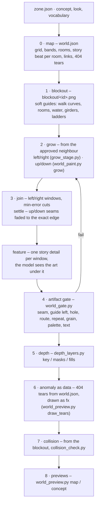

| # | Stage | Command | Writes |
| --- | --- | --- | --- |
| 0 | Map | `python scripts/world_map.py art/zones/<zone>` (seeded) or a zone script such as `scripts/zones/hidden_garden_proof.py` (authored frame) | `world.json` |
| 1 | Blockout | (same) | `blockout/<id>.png`, `collision/` |
| 2 | Grow | `python scripts/world_paint.py grow art/zones/<zone> <from> <up\|down> <new>` · sideways `grow_stage.py` | `tmp/zones/<zone>/grow/` |
| 3 | Join, settle | `world_paint.py join … --only left-right --row N` · `world_paint.py settle … --row N` | `tmp/zones/<zone>/join/` |
| – | Feature | `world_paint.py feature … <id> --box x0,y0,x1,y1 --brief "…"` (refuses a window the model left empty) | `tmp/zones/<zone>/join/` |
| 4 | Gate | `world_paint.py accept …` then `python scripts/world_gate.py art/zones/<zone>` (exit 1 on any FAIL) | `images/`, `previews/gate.json` |
| 5 | Depth | `depth_layers.py key / masks / fill` per chunk (as below) | `layers/`, `masks/`, `fills/` |
| 6 | Anomaly | tears in `world.json` → `world_preview.draw_tears` (the game ports it) | fx |
| 7 | Collision | `collision_check.py` | – |
| 8 | Previews | `python scripts/world_preview.py map art/zones/<zone> --state anomaly --grid` · `… concept …` | `previews/` |

**Proven on the Hidden Garden (24 Oct, `art/zones/hidden-garden/`):** the shipped prologue row (`hg-2-0` … `hg-4-0`, composed from its plates without the near strip and the lens) on top, and grown under it, one row deeper: the garden cellar under the shed (the first archive note), the campus storm drain under the boardwalk (the game's *IT* room: the mascot, the water, the drain) and, under the jetty, the wrong reflection – girders hanging upside down from the water. 3 × 2 chunks, 8 image calls; the gate passes on all six; `previews/vs-concept.png` sits next to the concept.

What the proof taught (rules now):

- **Grow from the art, not the concept.** The first take painted a chunk from its guide with the concept as a reference and got the concept back; a guide alone gets generic fantasy. Grown from an approved neighbour's edge, the model continues the place and follows the guide's rooms.
- **A neighbour's edge never includes the lens.** The near strip and the blurred foreground are layers; growing from a picture that has them continues the blur.
- **Up/down seams are texture, not colour:** after joining, `settle` fades each lower chunk into the exact bottom row of the one above (48 rows) – the gate's seam check failed at 29 until it did.
- **Measure a band against its own concept:** an underground chunk is checked against the anomaly concept (the only one with an underground), not the sunny clean one.
- **Small story details are props, not repaints:** asked for eyes in a drain pipe, the model painted the pipe out. Details that should blink, appear or vanish (the eyes, the balloon, the paper boat) go to the sprite pipeline.
- **Not done yet:** the band above the pond (girders, the torn sky route), depth layers for the grown chunks, their collision and the clean ⇄ anomaly swap of the lower row.

## Growing a stage in four directions

What Codex's runs proved on Rusty Creek, generalised:

1. **Scene first, then masks.** Generate the whole chunk as one picture, repair it, and only *then* derive the layers from it by masks. Each layer redrawn on its own drifts (Codex's first combined study did exactly that and was replaced).
2. **Neighbours from the edge.** A new chunk starts from the neighbour's edge band as context (same 2160×720 size): a right neighbour sees the left chunk's right band, an upper neighbour sees the chunk's top band, and so on. The original chunk is never redrawn.
3. **Repair only the join.** `stage_art.py prepare` cuts a join window across the seam (512 px), the model repairs only that band, and `apply` copies back just that band and checks that every protected pixel outside it is unchanged. Left/right join windows are implemented today; **up/down join windows** use the same code on rotated bands (an issue on the board).
4. **Stable chunk IDs, recomputed origins.** Chunks are addressed by grid ID (`x,y`); inserting one in the middle recomputes positions, never the source images.
5. **Shared scenery is stored once.** Layers that repeat (sky, far trees, water) are aliases, not copies.
6. **Transition chunks** join different spaces – surface to underground, outside to the Mensa inside. They are generated with *both* neighbours as context and blend the two layer stacks over their height.
7. **Clean and anomaly share everything they can.** The anomaly state replaces only the layers that change (on Rusty Creek, only the structure layers). Masters are rebuilt from the plates and verified pixel-exact (`creek_layers.py`).

## Growing a region chunk by chunk – grow, feature, join, trace

`scripts/grow_stage.py` makes a region longer from an approved chunk, one 2160×720 chunk at a time, so a level is one continuous place instead of separate pictures ([#50](https://github.com/THD-AI/WinCS/issues/50), first used on the Hidden Garden prologue).

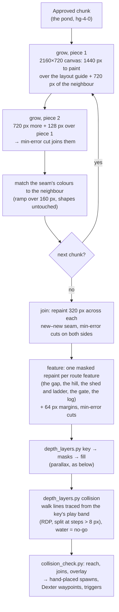

**What made it work** (24 Oct, the boardwalk chunk took five tries):

| Tried | Happened | Rule now |
| --- | --- | --- |
| One canvas wider than 3:1 | The API refuses: at most 3:1 | Every call is 2160×720 |
| A wider canvas padded with sky to 3:1 | The model reframed it and moved the whole picture 60–90 px; the path came out 47 px too high | Never pad; grow in two pieces of 1440 + 720 px |
| The neighbour's band pasted back over a single painted canvas | A hard seam (colour step 45 against 8 inside the art) | Seam colours matched over a ramp; pieces overlap 128 px and join along a min-error cut |
| The route as numbers in the brief, or as a separate guide image | Ignored: a stone bridge instead of a gap | The guide is the image being edited, under the mask |
| The route's features in the same call as the scenery | Smoothed away: the path stays flat and continuous | Grow the scenery first, then one `feature` repaint per feature, with a short concrete brief |

## Parallax layers from a depth key

Painted chunks are one picture. To give them depth without hand masks or redrawing each layer (which drifts), the model repaints the finished chunk as a **depth key**: the same shapes, one flat colour per depth band. The masks come from that key, and a second pass paints what each slow layer has behind the faster ones ([#142](https://github.com/THD-AI/WinCS/issues/142), first used on the Hidden Garden).

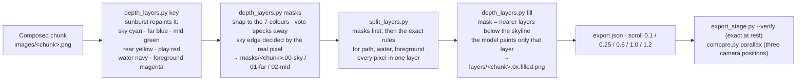

- **The key only says which band, never which pixel.** It drifts a few pixels at fine edges, so near the sky the real pixel decides: open sky is ≈ (40–60, 120–140, 240) and hazy far treetops ≈ (80, 120, 180), so "sky" means blue above 200. Path, water and foreground keep their exact rectangles and colour rules, which run after the masks and win.
- **Fills never change the picture at rest.** A fill is kept only under the nearer layers, and the layer's own pixels are copied from the art, so `--verify` still rebuilds the chunk exactly. The camera only ever reveals painted scenery.
- **Several chunks: one plate per slow layer for the whole region.** Per chunk, plates at scroll *s* < 1 overlap by 2160 × (1 − *s*) and cut each other off with hard vertical edges; at *s* > 1 (the foreground) they spread apart and leave gaps. `depth_layers.py region` quilts each layer marked `"region": true` in `export.json` from the chunks' own plates (`"rest"`): chunk *i* at *i* × 2160 × *s*, each next plate taking over along a min-error path in a 192 px band and only where it has pixels; a foreground gap is filled with the earlier plate's edge mirrored. The first chunk carries the plate, so it lands at x = 0 under any placement rule, and `--verify` still rebuilds every chunk at rest from its own plates. The Hidden Garden's mid plate is 6992 px wide, in four 2160 px tiles. Rusty Creek's distance (0.2), rails (1.1) and foliage (1.15) are quilted the same way ([#150](https://github.com/THD-AI/WinCS/issues/150)); shared plates ("= left") resolve through its aliases. `python scripts/compare.py parallax art/stages/<region>` shows any region as the game draws it.

### Every plate complete – the hot dog (docs/15 P2, P3)

Masked and moved, a cut-out shows: holes where a nearer layer stood, a canopy that ends in a straight line, a mid plate that stops in steps. Alexander's playtest (24 Oct) asked for every layer **rendered complete**, stacked like a hot dog from the far background to the blurred leaves at the lens, with grass in front of the trail that covers the feet. The steps after `masks` and `split`:

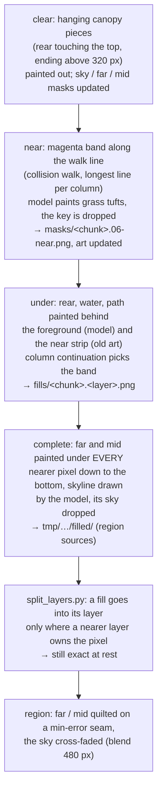

- **Bands, back to front** (z · scroll): sky 0 · 0.1 → far forest 1 · 0.25 → mid trees 2 · 0.6 → rear (reeds, walls, sheds, big trees) 3 · 1 → water and its reflections 4 · 1 → the trail 5 · 1 → **near strip** 6 · 1 (over the actors, `NEAR_DEPTH` 120 in `depth.ts`) → foreground leaves 7 · 1.2 (blurred, `FOREGROUND_DEPTH` 200). The trail's geometry never moves, so its collision stays valid.
- **A fill never shows at rest.** It lives under nearer pixels only; `split_layers.py --check` and `export_stage.py --verify` still rebuild every chunk exactly. Fills are committed (`fills/`), their paintings stay in `tmp/boards/<region>/` (`--reuse` cuts again without the API).
- **The model leaves big holes white sometimes** (four of fifteen complete paintings): white counts as sky and is dropped, so check how deep the painting reaches before trusting it; a far plate only needs to reach below the mid skyline.
- **Magenta key for new plants.** Asked to paint grass on the art directly, the model repaints the whole band and nothing is separable; on flat magenta it keeps the key, and tinted edge pixels take the colour of the nearest clean plant pixel.

## Prompting lessons (23 Oct, all runs)

| What we tried | What happened | Rule now |
| --- | --- | --- |
| Style text before the brief | Painted a scene instead of a sheet | Brief first, style after |
| A whole stage plate as a "style sample" | Redrew the stage | Never pass a full scene as a style sample |
| `gpt-image-2.5-flare` | Ignored layouts | `sunburst` only |
| Pose photos with people, no hero sheet first | Drew the photographed teammate | Hero sheet is always first (sprites) or second (scenes) |
| A collage as the main input | Redrew the collage – panels, labels, perspective | Use the raw photos, plus an approved flat image as format anchor |
| A direction image as input for a background | Copied its characters | Backgrounds: no character images as inputs |
| A title line ("BOARD: …") in the prompt | Printed it into the image as a sign | No titles in prompts |
| "No perspective" alone | Corridors and paths still receded | Say "architect's elevation, everything parallel to the screen" |
| Wallpaper extension of strips | Looked like repeated wallpaper, no gameplay | Grow chunks only where Lex's route needs them, via join repairs |
| Many figures in one lineup | Wrong scales, missing figures | At most ~5 figures per image |
| 15-min timeout, key on the command line | Timeouts; the key printed in a traceback | 30-min limit, key via a header file |
| Photorealistic mannequin collages (Codex) | Pointless for sprites | Pixel art from the start, our hero in every pose |
| Perspective repaints of photos (Codex) | Rejected | Flat side elevation only |

## Sprite boards

`art/sprites/boards.json`: the hero sheet (locked) comes first, the pose or object photos follow, and the style master goes last. The model draws on a flat magenta key. `crush` keys the magenta at full size, downscales ×2 with premultiplied alpha (so no purple fringes), quantises to 96 colours, and writes a transparent 1× PNG plus a readable preview. Chair photos are split into **block**, **overhead/up-down** and **side** sequences by file name. Every board stays "to do" until the direction is approved; see [07](07-ASSET-MANIFEST.md).

Every animation board gets an `atlas` entry when it is drawn, because the review preview is cut with it. Export into the game only once its Design review is **Approved**. `rows` lists the board's rows of sprites from top to bottom: the animations in each row, left to right, with their frame counts from [07](07-ASSET-MANIFEST.md), or `"skip"` for a row that isn't exported (close-ups, scale lineups). `height` is the game height in pixels of the tallest frame of the first animation; the hero's is 76, in an 80 px frame. When the first animation has no standing pose (a jump), `"ref": "jump-08"` names the frame that is 76 px instead. An animation may continue at the start of the next row (death 6 + 6: list it again with the rest of its frames). `"even": true` keeps a row's specks and cuts it along seams without the weight check, for frames that break into dust. `"float": true` on an animation drawn in the air (jump, fall) puts each frame's lowest pixel on the baseline, because the game already lifts the body. `fps` defaults to 12 and `loop` to true. A sheet holds at most about 30 frames in four rows; the model miscounts bigger sheets, so split them (`hero-move`, `hero-run`, `hero-idle`). Open every brief with the magenta background and the no-text rule: put later in the brief, the model sometimes draws on paper with captions.

### How a sprite board is made

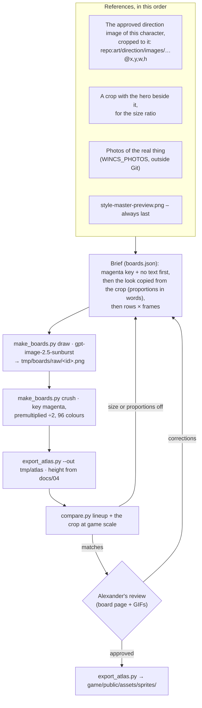

**Proportions come from the crop, sizes from the measurement.** A character with its own approved direction image is drawn from a crop of it, with a second crop that shows it beside the hero, and the brief says its proportions in words (Dexter: "a big round head about 45 % of his height, stubby limbs, shorts"). The export height is measured in that image against the hero (547 px there = 76 px in the game) and written into docs/04 with the measurement. Without the crop the model drew Dexter as a slim cat on two legs, and the 1.5 ft maths put him at 20 px: both were wrong ([#139](https://github.com/THD-AI/WinCS/issues/139)).

| Board | First reference (crop) | Size from | Game height |
| --- | --- | --- | --- |
| `hero-*` | the hero sheet | docs/04 | 76 px |
| `chair-*` | the hero sheet + chair photos | the hero's frame | 76 px |
| `dexter`, `dexter-acts` | [Dexter stages](../art/direction/dexter-stages.md), the plush, and the plush beside the hero | measured there: 191 / 547 of the hero | 27 px |
| `enemy-rover`, `-crab`, `-drone` | photos + [cast](../art/direction/cast.md) | docs/05 (the cast's machine sizes carry review notes) | 25 / 46 / 47 px |
| `fx` | [cast](../art/direction/cast.md) | – | 20 px |
| `boss-jenny`, `-2` | [Jenny](../art/direction/boss-jenny.md), cropped to the car | the approved direction (Alexander, 24 Oct) | ≈ 270 px long |

```json
"atlas": {"height": 76, "rows": [
  [{"anim": "idle", "frames": 6}],
  [{"anim": "walk", "frames": 8}, {"anim": "idle-walk", "frames": 2, "loop": false}],
  "skip"]}
```

`export_atlas.py` cuts each row into frames at the empty columns, or along winding seams where neighbours overlap (a foot under the next poncho). It **stops** if a row has more or fewer figures than its config lists, so a model that drew 7 walk frames instead of 8 is caught before the game sees it. It scales the whole board by one factor, puts every frame's feet on the bottom row of its cell (frames drawn in the air keep that height unless the animation floats), centres the pivot under the torso so walk and run cycles don't slide, and writes the atlas, its JSON and `<board>.anims.json` into `game/public/assets/sprites/` ([13 – contracts](13-PRODUCTION-PIPELINE.md#5--the-other-hand-over-contracts)). `--preview` adds a looping GIF per animation, at twice game size, to `art/sprites/previews/` for the review page; before approval, export with `--out tmp/atlas` so only the previews are kept.

## Smooth, not rubbery

The team's open question in A14: how do generated frames move without looking like rubber hose animation? The rubber look comes from in-betweens that morph one pose into the next. We avoid them like this:

1. **Poses, not in-betweens.** Each sheet is drawn as distinct key poses (contact, down, passing, up for a walk; anticipation, swing, follow-through, recoil for the chair) in **one** generation, so the proportions, palette and pixel size match. We never ask the model to interpolate between two frames.
2. **Stepped timing.** Play on twos at 12 fps, and hold the strong poses longer (anticipation, impact). Pixel art reads crisp when it snaps, not when it slides.
3. **Transitions at matching poses.** Idle→walk, walk→run and run start are short bridge clips that start and end on poses shared with the loops. The controller only switches on those frames (on a contact frame, the feet match).
4. **Smears instead of blends** for fast motion: one stretched smear frame on the chair swing and the knockback, as in Spider-Verse. No motion blur or warp.
5. **One grid, one palette.** Everything is crushed to the same pixel scale and 96-colour palette, and the feet are anchored to one baseline row, so frames don't wobble.
6. **Preview before approval.** Every sheet gets a looping preview at game size on its review page. A frame that pops is redrawn on its own against its neighbours as inputs.

## The crossing (no animation budget)

The region crossing uses only sprites the hero already needs (hit, knockback) plus one UI window the game renders with real text: **"THD.exe has stopped responding."** See the [crash frame](../art/direction/anomaly-language.md).

## Reference fidelity – the loop for everything on screen

The rule for every agent ([AGENTS.md](../AGENTS.md#reference-fidelity--every-agent-every-change-you-can-see)); the HUD below is the worked example.

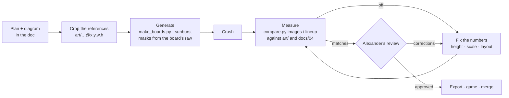

**What the first audit found** (24 Oct, `python scripts/compare.py lineup …`, [the lineup](../art/sprites/previews/scale-lineup.png)): the hero's idle and walk, the rover and the jump were right. Three were off and are fixed in the export config, without redrawing:

| Sprite | Measured | Documented | Fix |
| --- | --- | --- | --- |
| `hero-run` → `run` | 62–63 px, head and body smaller than walk | the walk's figure, leaning (≈ 70 px) | `"scale": 1.12` on the animation |
| `enemy-crab` | idle 33 px | waist-high, ≈ 40 px ([05](05-ENEMIES-AND-BOSSES.md)) | board `height` 38 → 46 |
| `enemy-drone` | 17 px span | 1 m span, ≈ 45 px ([05](05-ENEMIES-AND-BOSSES.md)) | board `height` 18 → 47 |
| `dexter`, `dexter-acts` (second audit, [#139](https://github.com/THD-AI/WinCS/issues/139)) | 20 px, slim, small head | 27 px, chunky toy with a big head, measured in the approved Dexter stages | redrawn from crops of that image; `height` 20 → 27 |

`"scale"` on one animation corrects a row the model drew at another size than the rest of its sheet; `height` on the board sets the whole sheet. The cast direction image's machine sizes carry review notes, so the docs' numbers win for the machines; the cast image still sets each machine's proportions.

## UI sprites – HUD and pocket computer

The approved [HUD direction](../art/direction/hud.md) ("magnificent") is the target: battery cells, the glitch meter and the pocket computer's green CRT map. Until these are approved, the game draws placeholders in code (`ui/Hud.ts`, `ui/PocketComputer.ts`). The UI boards go through the same pipeline as sprites, with three differences: **crops of the approved direction image are the references**, one board is a **masked edit**, and the map pieces are keyed on the **screen colour** instead of magenta.

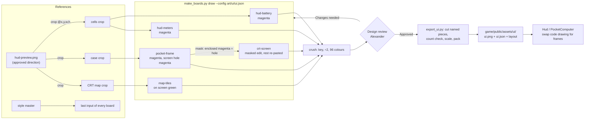

**The boards** (`art/ui/ui.json`, raws in `tmp/boards/ui/raw/`):

| Board | Rows (left to right) | Key | Game size |
| --- | --- | --- | --- |
| `hud-battery` | full · cracked · empty / crack animation, 4 frames | magenta | cell 36 px tall |
| `hud-meters` | glitch segment empty · charged glow, 3 frames / boss bar frame · fill · Jenny icon | magenta | segment 28 px, bar 560 px wide |
| `pocket-frame` | the handheld case: rusted aluminium, handle, bolts, antenna, screen area flat magenta | magenta | about 800 px wide |
| `crt-screen` | the screen glass only, painted into `pocket-frame`'s hole | masked edit | same as the frame |
| `map-tiles` | room visited · current · unexplored / corridor H · V · junction / icons: leaf, gear, ladder, grass, mountain, waves, cup, player dot × 2 | screen green | room 44 px tall |

**Generation steps:**

1. **Crop the references.** An input written `repo:art/direction/images/hud-preview.png@x,y,w,h` is cropped before upload, so the model sees only the cells, only the case or only the map – never the whole screenshot (a full scene as input makes the model redraw the scene).
2. **Draw the magenta boards** (`hud-battery`, `hud-meters`, `pocket-frame`) like sprite boards: brief first with the magenta and no-text rule, crop second, style master last. One element per cell, evenly spaced, same scale.
3. **Masked edit for the screen** (`crt-screen`, `"edit": "pocket-frame"`). The base image is the `pocket-frame` raw. The mask is built from it: magenta that touches the image border is background and stays; **the largest region of magenta enclosed by the case is the screen hole** and becomes transparent in the mask – the only area the model may paint. Smaller enclosed regions (inside the handle, behind a latch) are openings and stay see-through. The OpenAI edit treats the mask as guidance, so after the call every pixel outside the hole is pasted back from the base and checked unchanged (as `stage_art.py apply` does for seams).
4. **Map pieces on the screen colour** (`map-tiles`, `"key": "#0B2418"`). Glowing green on magenta leaves purple halos when keyed. The pieces are drawn on the CRT's own dark green instead, keyed on that colour with a tolerance, and composed back onto the same green in the game, so the glow edges blend.
5. **Crush** as usual: key at full size, box-downscale ×2 with premultiplied alpha, 96 colours. `crt-screen` keeps only the hole (everything else transparent), so it lies exactly under the frame.
6. **Review.** `make_boards.py pages --config art/ui/ui.json` writes a page per board; `export_ui.py --out tmp/ui --preview` adds a contact sheet at game size with the HUD and the open map composed over a Rusty Creek frame. Alexander sets **Design review** on the board.
7. **Export after approval.** `export_ui.py` cuts each row into pieces at empty columns (like `export_atlas.py`) and **stops if a row has more or fewer pieces than its names**. Frames of one animation share a cell size (bottom-centred) so they don't jitter. Each row is scaled to its game height, everything is packed into one atlas `game/public/assets/ui/ui.png` + `ui.json`, and `ui-layout.json` records the screen hole inside the frame (where the map is drawn).
8. **Game.** `Hud` and `PocketComputer` load the atlas and use the frames; the code drawing stays as the fallback when the atlas is missing.

**Masks in one line each:** the mask is a PNG the size of the first input; transparent = may change, opaque = keep. It always comes from a board's own raw (never hand-painted), and protected pixels are re-pasted after the call.

## Atmosphere – a stage that moves (atmosphere.json)

The plates stay exactly as painted; `game/src/stage/render.ts` (`drawStage`) brings them to life from `art/stages/<region>/atmosphere.json`, which `export_stage.py` publishes next to `stage.json` (with every file in its `assets`). Nothing is placed by hand: each layer's anchors and waterline are read from its own alpha at load, the leaf colours from its own pixels.

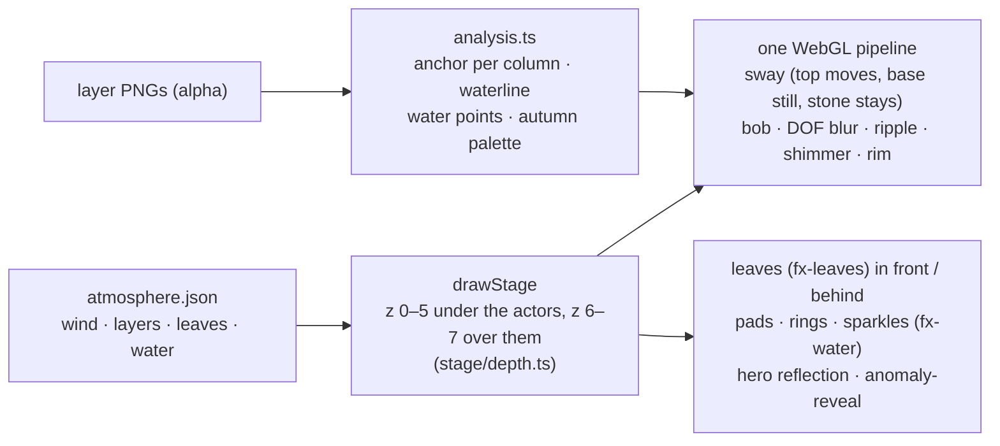

| Key | Meaning |
| --- | --- |
| `wind` | `base` steady sway share (0–1), `gust` extra lean (0–2), `gustSpeed` px/s, `gustLength` px between fronts, `frequency` Hz, `direction` −1 left / 1 right |
| `defaults` | a layer without its own entry: `sway` × scroll² (nearer moves more), `reach`, `anchor`, `foliage`; foreground (z ≥ 6) also gets `bob`, `blur` |
| `layers.<id>` | `sway` px at full weight · `reach` px from the anchor to full weight · `anchor` `"base"` (lowest opaque row per column: trees, foreground plants) or `"top"` (surface top: grass on the path) · `foliage` saturation under which pixels never move (stone, wood) · `bob` px vertical · `blur` px depth of field · `ripple` px · `shimmer` 0–1 (water) |
| `leaves` | `palette` (`[]` = sampled from the art) · `fall` `"down"` / `"up"` · `front` / `behind`: `every` ms, `scale` [min, max], `scroll` parallax, `alpha`, `tint`; `null` turns one off. Uses the `fx-leaves` sheet, pixel leaves drawn in code without it |
| `water` | `layer` id (waterline from its alpha) · `reflect` {`alpha`, `tint`} for actors (`null`: none) · `pads` per 1000 px · `padTint` · `padScale` · `ripples` / `sparkles` mean ms (0: none) · `wrong` {`image`, `alpha`}: the picture `anomaly-reveal` flickers in the pond |
| `assets` | extra images in the region folder (published by the export, loaded with the stage) |
| `states.<state>` | section-wise overrides for a state (the anomaly's leaves rise) |

A bad field is reported in the console and replaced by its default; `{}` (no file) gives the defaults. The Hidden Garden's [atmosphere.json](../art/stages/hidden-garden/atmosphere.json); `wrong-reflection.png` there is a flipped, feathered crop of Rusty Creek's `after-center.png`.

| | |
| --- | --- |
| 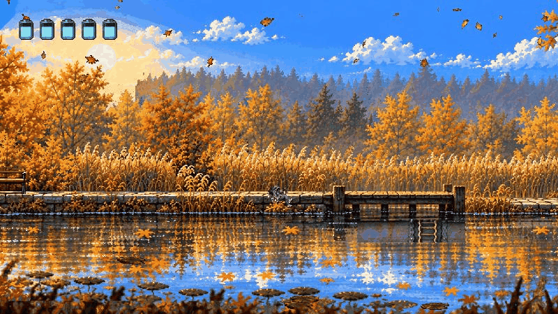 | 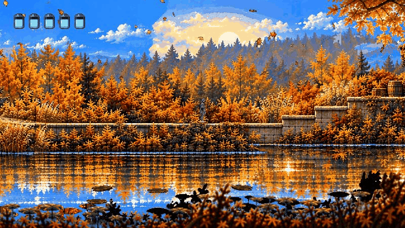 |
| 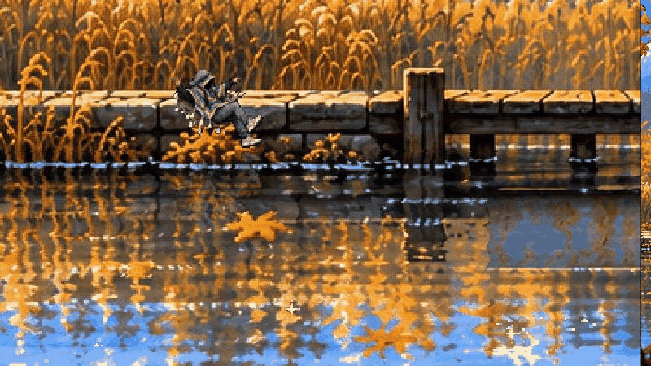 | 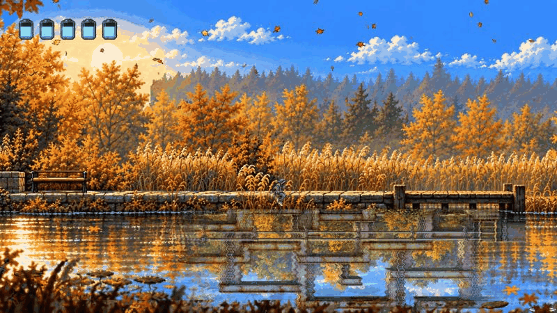 |

## One asset system (assets.py, #158)

`art/inventory.csv` is the plan: every asset the slice needs, with its measured size, animations, sources and status. `scripts/assets.py` checks it against the repo, so the sheet can't drift from the files:

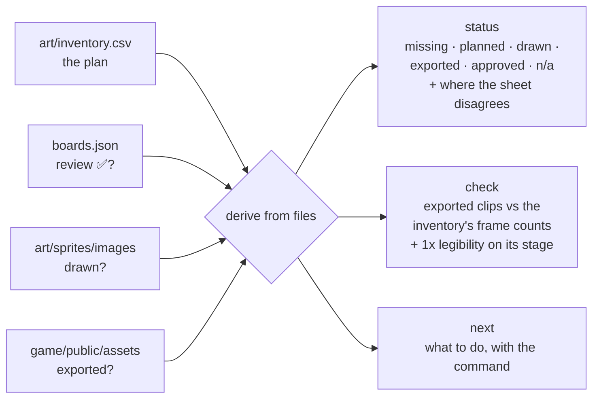

`python scripts/assets.py status [--strict]` · `check <id>` · `next`. A new asset starts as a row in the sheet; `next` then names the step that moves it on (draw → export for review → Alexander's ✅).

`check <id>` also scores every clip of the atlas at 1x on the stage where it appears (`scripts/readability.py`, #159): the contrast of its fill and its outline against the background right behind it. A clip under 24 on both is LOW and is scored again with the game's actor rim (`ACTOR_RIM` in `pipeline.ts`); only a clip that stays low even then fails the check and needs a redraw. `python scripts/readability.py --all --out art/sprites/previews/readability-audit.png` draws the whole audit.

## Commands

```bash
python scripts/make_boards.py draw  [ids] [--redo] [--config …]   # generate (skips existing raws)
python scripts/make_boards.py crush [ids] [--config …]            # rebuild committed images offline
python scripts/make_boards.py pages [--config …]                  # Markdown page per image + index
python scripts/export_atlas.py <ids> [--preview]                  # approved board -> Phaser atlas + anims
python scripts/export_ui.py [--out tmp/ui] [--preview]            # approved UI boards -> ui atlas + layout
python scripts/compare.py images REF[@crop] OURS[@crop] --out …  # reference above, ours below, one grid
python scripts/compare.py lineup atlas:frame … --out …          # frames vs documented heights
python scripts/creek_layers.py [--build]                          # Rusty Creek layers: verify / rebuild
python scripts/collision_check.py [--overlay]                     # collision: schema, reach, overlays
python scripts/stage_art.py prepare --config art/stages/rusty-creek/stage.json --out tmp/stage-art/next --band 512
python scripts/split_layers.py art/stages/<region> [--check]      # composed chunk -> z0–z7 layers, exact
python scripts/export_stage.py [--verify]                        # art/stages -> game stage.json + plates (generated)
python scripts/navigation.py && python scripts/check_docs.py
```

## What gets committed

- ✅ configs, briefs, crushed images and previews, stage plates, routes, collision data
- ❌ photos, audio, raw API output and rejected takes (`tmp/`), contact sheets, HTML viewers

<!-- nav:start -->
[← 08 – Tech stack and where things live](08-TECH-STACK.md) · [Design docs](README.md) · **9 / 16** · [10 – Jam plan →](10-JAM-PLAN.md)
<!-- nav:end -->
