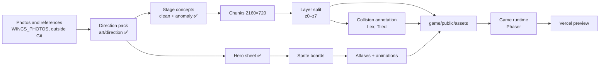
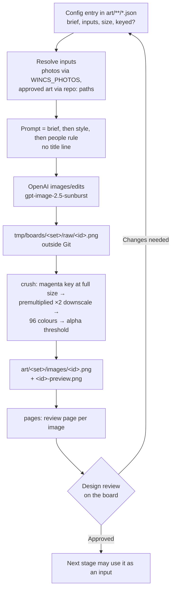
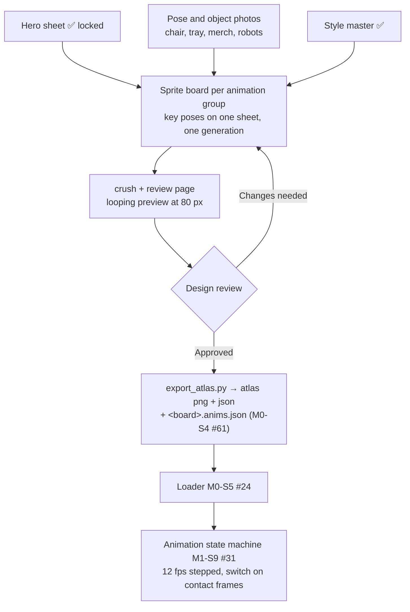
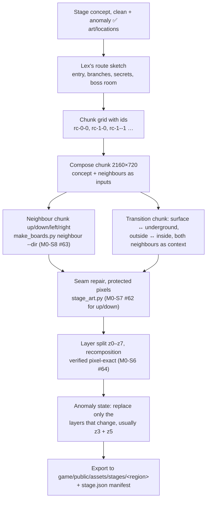
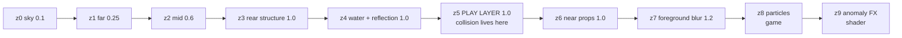
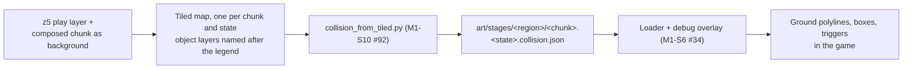
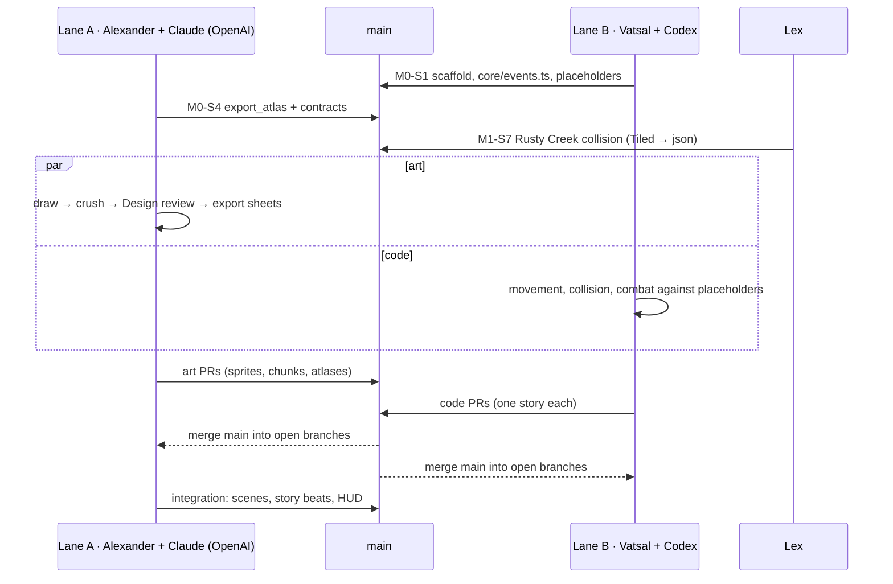
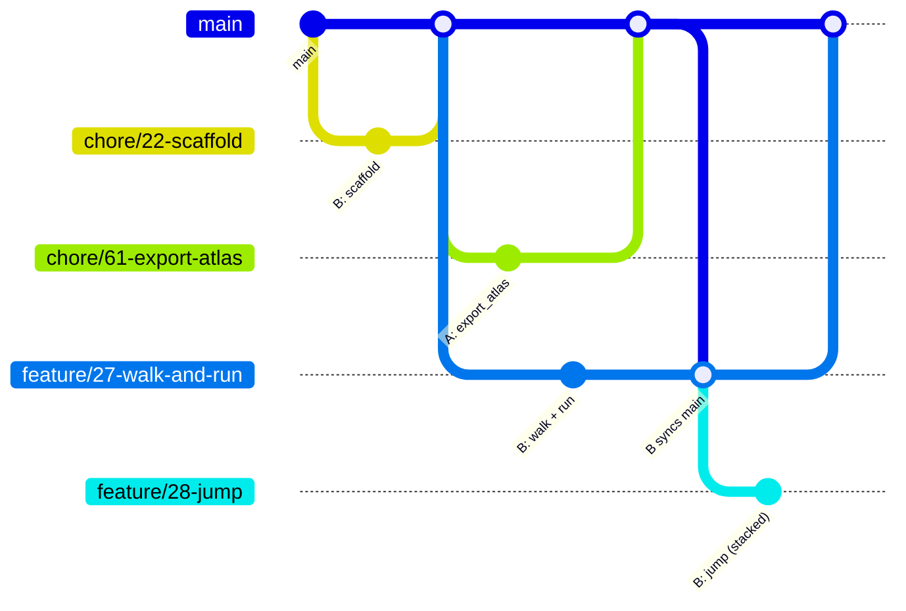
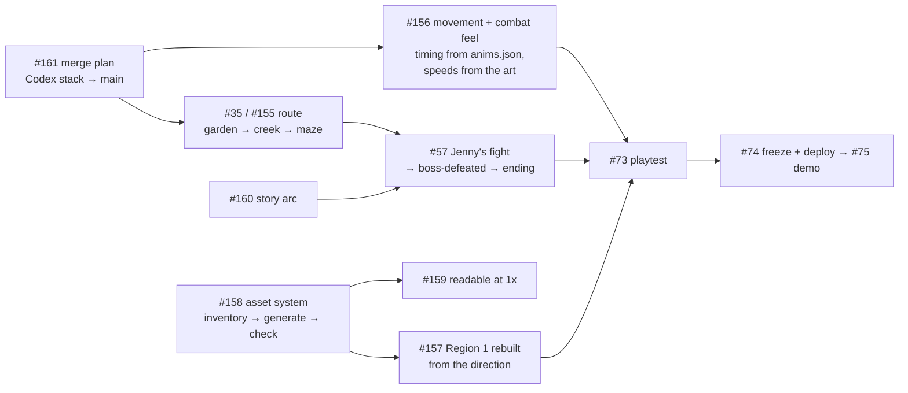

# 13 – Production pipeline

<!-- nav:start -->
[← 12 – Team workflow](12-TEAM-WORKFLOW.md) · [Design docs](README.md) · **13 / 16** · [15 – The prologue slice (rebuild) →](15-PROLOGUE-SLICE.md)
<!-- nav:end -->

How every image, layer, sprite, animation, stage and collision box gets from a photo to the game, and how two AI agents build it in parallel without stepping on each other. The *what* is in [07 – Asset manifest](07-ASSET-MANIFEST.md) and the *how to prompt* in [09 – Art pipeline](09-ART-PIPELINE.md); this page is the order of work, the hand-over formats and the lanes. Every box in the diagrams names the issue that delivers it.

## The two lanes

> **Since 24 Oct, one owner** ([decision 42](11-DECISIONS.md)). Codex has stopped (no credits left); Alexander + Claude own both columns below, which stay as the map of modules and folders. Codex's stack #111 → #149 is the base for the systems and is reworked on top where it misses the art ([#156](https://github.com/THD-AI/WinCS/issues/156)); the merge plan is [#161](https://github.com/THD-AI/WinCS/issues/161). The rules in §6 about not touching the other lane's stacks no longer apply.

| | Lane A – art and integration | Lane B – game code |
| --- | --- | --- |
| Person | Alexander ([arudaev](https://github.com/arudaev)) | Vatsal ([Vatsal2005](https://github.com/Vatsal2005)) |
| Agent | Claude, **with** the OpenAI API (`OPENAI_API_KEY` in `.env`) | Codex, **without** an OpenAI key |
| Owns | `scripts/`, `art/`, `game/public/assets/`, `game/src/scenes/`, `game/src/story/`, `game/src/ui/`, `game/src/fx/` (atmosphere, anomaly effects), deploy | `game/` scaffold and config, `game/src/core/`, `game/src/player/`, `game/src/combat/`, `game/src/enemies/`, `game/src/stage/` |
| Makes | Every image: direction, concepts, chunks, layers, sprite sheets, atlases | Every system: movement, collision, combat, enemies, bosses, region swap |
| Never | Pushes to lane B's open stacks (finished work may be corrected – [AGENTS.md rule 6](../AGENTS.md#reference-fidelity--every-agent-every-change-you-can-see)) | Generates or commits art; edits `art/` or `scripts/make_boards.py` |

**Both lanes follow [reference fidelity](../AGENTS.md#reference-fidelity--every-agent-every-change-you-can-see):** plan with a diagram, measure every size, ratio and position against `art/` and the docs' numbers, and prove it with a `scripts/compare.py` comparison in the PR.

**Lex** owns collision and encounters: the Tiled files and `*.collision.json` in `art/stages/`, and the beat placement. **Only lane A generates art.** One generator, one style master and one review keep the game in one style; Codex's own image generation would drift from the approved direction. Lane B uses **placeholders** until the real art lands: coloured rectangles at the documented sizes, loaded through the same contracts, kept in `game/public/assets/placeholder/` and never in `art/`.

## The whole pipeline



Nothing moves right until its stage is approved: direction before sprites, concepts before chunks, Design review before export.

## 1 · Image generation and processing (lane A)

One loop for every image, whether it is a direction image, a stage concept, a chunk or a sprite board ([09](09-ART-PIPELINE.md)).



```bash
python scripts/make_boards.py draw  <ids> --config art/sprites/boards.json   # lane A only (API)
python scripts/make_boards.py crush <ids> --config art/sprites/boards.json   # offline, anyone
python scripts/make_boards.py pages --config art/sprites/boards.json         # offline, anyone
```

`draw` is the only step that needs the API key. `crush` and `pages` rebuild every committed image from raws offline, so lane B can always regenerate what it sees.

## 2 · Characters, attacks and animations



Every sheet, in the order the game needs them:

| Sheet | Animations (frames) | Issue | Unblocks |
| --- | --- | --- | --- |
| `hero-move`, `hero-run`, `hero-idle`, `hero-air` | idle 6 + 3 variants · walk 8 · run start 3 · run 8 · idle→walk 2 · walk→run 2 · jump 9 · fall 3 · hard landing 4 · ladder 4 | [M1-S8 #60](https://github.com/THD-AI/WinCS/issues/60) | movement feel, M1 |
| `hero-hurt`, `hero-death` | hit 8 · knockback 3 · death 12 · interact 3 · pick up 4 · look at device 3 | [M2-S12 #83](https://github.com/THD-AI/WinCS/issues/83) | damage, the THD.exe crossing |
| `chair-side`, `chair-overhead`, `chair-block` | sweep A 8 · sweep B 8 · recoil 2 · up 6 · slam 7 · pogo 4 · guard up 4 · hold 3 · impact 4 · break 4 | [M2-S10 #81](https://github.com/THD-AI/WinCS/issues/81) | combat |
| `enemy-rover`, `enemy-crab`, `enemy-drone`, `fx` | rover 4/6/4/5 · crab 4/8/5/5 · drone 4/3/5/3 · black fluid 6 | [M2-S11 #82](https://github.com/THD-AI/WinCS/issues/82) | enemies |
| `mensa-food`, `mensa-drinks` | food 4 × 1 frame, 13–18 px (sparkle in code) · drink icons | [M2-S13 #84](https://github.com/THD-AI/WinCS/issues/84) | healing |
| `coffee-machine` | idle 3 · pour 4, 80 px | inside [M4-S4 #52](https://github.com/THD-AI/WinCS/issues/52) | save points |
| `dexter`, `dexter-acts` | idle 3 · hop 4 · walk 6 · point 3 · shove 4 · beckon 3 · bow · sweat · proud · creepy shadow · absorb 4 | [M3-S5 #86](https://github.com/THD-AI/WinCS/issues/86) | prologue, Region 1 beats |
| `boss-jenny`, `boss-jenny-2` | rev 4 · charge 4 · crash 4 · stunned 3 · reboot 2 · debris ×5 | [M4-S6 #87](https://github.com/THD-AI/WinCS/issues/87) | the boss |
| `pocket-computer` | bob 4 · open 3 (screens: UI atlas) | inside [M4-S4 #52](https://github.com/THD-AI/WinCS/issues/52) | menu, map |

Frames are drawn as **key poses**, never interpolated by the model; transitions are short bridge clips that start and end on poses shared with the loops ([09 – Smooth, not rubbery](09-ART-PIPELINE.md#smooth-not-rubbery)).

## 3 · Stages: chunks, layers, four directions



The layer stack every chunk follows ([04 – Layers](04-WORLD-AND-LEVELS.md#layers--what-goes-over-what)):



z0–z7 are painted PNGs; z8 and z9 are made by the game. Shared layers (sky, far trees, water) are stored once and aliased.

## 4 · Collision, interactables, ladders and stairs (Lex)



Draw every object in **stage pixels** on top of the 2160×720 chunk, one Tiled object layer per kind:

| Layer | Shape | Draw it for |
| --- | --- | --- |
| `walk` | polyline | ground and gentle slopes ≤ 40°, girder tops you stand on |
| `slide` | polyline | slopes > 40° you skid down |
| `one-way` | polyline | decks, planks, scaffold boards: jump up through, ↓ + Jump drops |
| `climb` | box + `kind` | **ladders, vines, scaffold** – stairs are flat walk treads (rises ≤ 16 px are stepped; docs/04 terrain model), never slopes and never steps of boxes |
| `solid` | box | walls and ceilings |
| `no-go` | box | out of bounds, deep water: reset without damage |
| `hazard` | box + `damage` | current, sap, sparks |
| `interact` | box + `kind` + `id` | coffee machine, pickup, Dexter, sign, **the anomaly**, boss gate, chunk exit |
| `spawn` | point + `kind` + `id` | player, rover, crab, drone, item, Dexter |
| `ledge` | point | reserved (pull-up is cut for the jam) |
| `glide-lift` | box | reserved (glide is Region 2) |

### Contract: `collision.json`

```json
{
  "chunk": "rc-0-0",
  "state": "anomaly",
  "size": [2160, 720],
  "walk": [[[0, 612], [340, 600], [520, 560]]],
  "slide": [],
  "oneWay": [[[700, 420], [960, 420]]],
  "climb": [{"id": "ladder-1", "kind": "ladder", "x": 980, "y": 300, "w": 26, "h": 300}],
  "solid": [{"x": 2140, "y": 0, "w": 20, "h": 720}],
  "noGo": [],
  "hazard": [{"x": 1200, "y": 690, "w": 300, "h": 30, "damage": 1}],
  "interact": [{"id": "coffee-1", "kind": "coffee-machine", "x": 1500, "y": 520, "w": 40, "h": 80}],
  "spawn": [{"id": "player", "kind": "player", "x": 120, "y": 600}, {"id": "rover-1", "kind": "rover", "x": 760, "y": 410}],
  "ledge": [],
  "glideLift": []
}
```

Coordinates are integers in stage pixels, origin top left; polylines run left to right; `kind` values are lower-case with dashes. Adding a field is fine; renaming one needs both lanes to agree in an issue.

Optional `terrain` (docs/04 terrain model): `[{"x": [x0, x1], "y": [y0, y1]?, "kind": "ground|step|stair|plank|ledge|wall|log|obstacle|slide", "material": "<surfaces.json material>", "note"?}]` – chunk-local ranges, first match wins, every walk/oneWay/slide segment covered. Solids take an optional `kind` (`wall`, `log`, `obstacle`), no-go boxes `kind: "water"`. A chunk with `terrain` was re-authored by hand: `depth_layers.py collision` keeps its floors.

## 5 · The other hand-over contracts

Lane B codes against these from day one, with placeholders; lane A fills them with real art. Neither lane changes a contract alone.

| Contract | Path | Shape | Made by → used by |
| --- | --- | --- | --- |
| Atlas | `game/public/assets/sprites/<board>.png` + `.json` | Phaser JSON hash; frame names `<animation>-<nn>` from `00`, one cell size per board; pivot at the feet (0.5, 1) | `export_atlas.py` (A) → loader (B) |
| Animations | `game/public/assets/sprites/<board>.anims.json` | `{"walk": {"frames": 8, "fps": 12, "loop": true}, …}` – names and counts as in docs/07 | `export_atlas.py` (A) → state machine (B) |
| Stage manifest | `game/public/assets/stages/<region>/stage.json` (generated by `scripts/export_stage.py`, not committed) | `{"region", "chunkSize": [2160, 720], "chunks": [{"id": "rc-0-0", "x": 0, "y": 0, "states": {"anomaly": {"layers": [{"id", "z", "scroll", "file"}], "collision": "rc-0-0.anomaly.collision.json"}}}]}`. Draw the layers **in list order** (Rusty Creek's soft water goes last); `z` names the docs/04 role. Files sit next to the manifest | stage export (A) → loader (B) |
| Collision | `art/stages/<region>/<chunk>.<state>.collision.json`, chunk ids `<prefix>-<column>-<row>` | above; checked by `collision_check.py` | A (Tiled + converter, or by hand) → loader (B) |
| Region swap | `game/src/stage/swap.ts` | `swapRegion(scene, { region, state, spawn? })` emits `region-turned` and reloads the stage; the slice starts at `START` (Hidden Garden, clean) | story (A) calls it on a crossing's cut |
| Game events | `game/src/core/events.ts` | typed events: `enemy-defeated`, `player-hit`, `player-died`, `region-turned`, `boss-defeated`, `save`, `trigger-entered` (the hero entered an `interact` box) | combat and enemies (B) emit → story and UI (A) listen |
| Placeholder sizes | – | hero 28×76 body in an 80 px frame; Dexter 27 px; rover ≈ 25 px; crab ≈ 40 px; drone ≈ 45 px; Jenny ≈ 270×95 (body; wing and beacon above) | docs/04 scale table |

## 6 · Two agents, one repo



The rules both agents follow:

1. **Start from an issue assigned to your person.** Read it, this page, and the doc sections it links. No issue, no branch.
2. **Stay in your lane's folders** (table at the top). Need something in the other lane? Comment on its issue or open a new one with the bug or task form – don't edit it.
3. **Branch** `<type>/<issue>-<slug>` from `main`; open a **draft PR** at the first push with `Closes #<issue>`.
4. **Stack** only inside your own lane: `[1/3] …` on `main`, `[2/3]` on the branch below, and so on ([CONTRIBUTING – Stacked PRs](../CONTRIBUTING.md#stacked-prs)). Never base a PR on the other lane's branch; wait for it to reach `main`.
5. **Sync with `main`** after every merge you see on the board: `git fetch && git merge origin/main` into each open branch, bottom of the stack first. Merge, don't rebase, once a PR is open.
6. **Shared files** – `game/package.json`, `game/src/main.ts`, `game/src/core/events.ts`, the contracts above – change only in a small PR of their own, titled `chore(shared): …`, merged before anything that depends on it.
7. **Art enters the game only through `export_atlas.py` and the stage export**, never by copying images into `game/`.
8. **Merging** is done by a person, bottom of each stack first, after someone played the Vercel preview. Agents never merge, never push to `main`, never `/take`.



## Who does what next

From 24 Oct everything is Alexander + Claude ([decision 42](11-DECISIONS.md)). The order to the jury (Sat 11:30), each an issue on the board:



<!-- nav:start -->
[← 12 – Team workflow](12-TEAM-WORKFLOW.md) · [Design docs](README.md) · **13 / 16** · [15 – The prologue slice (rebuild) →](15-PROLOGUE-SLICE.md)
<!-- nav:end -->
