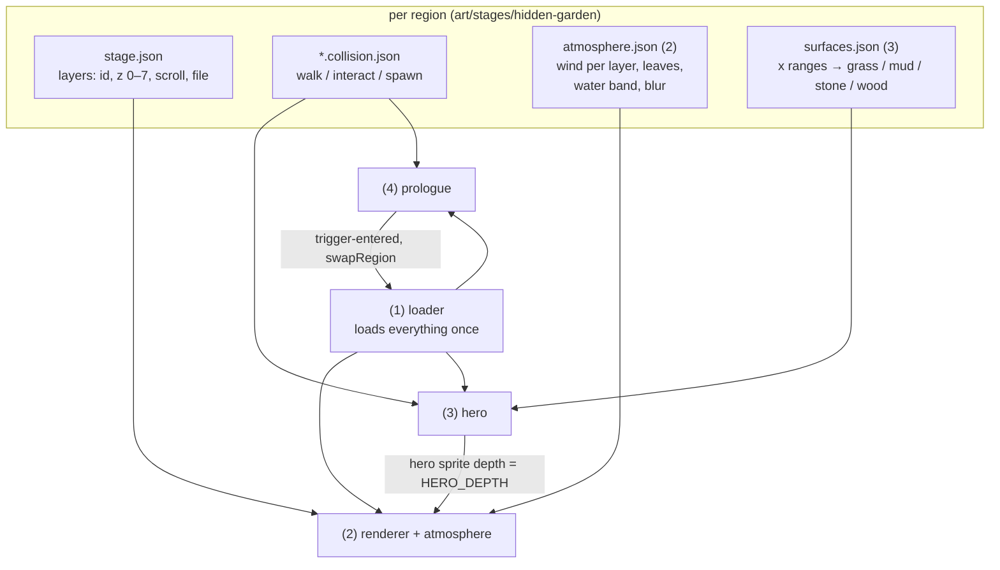
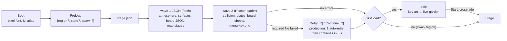

# 15 – The prologue slice (rebuild)

<!-- nav:start -->
[← 13 – Production pipeline](13-PRODUCTION-PIPELINE.md) · [Design docs](README.md) · **14 / 15** · [Meetings and voice notes →](meetings/README.md)
<!-- nav:end -->

Alexander, Sat 24 Oct ~04:30: the game must run, look and feel like `art/`, from the menu through the Hidden Garden prologue into the anomaly – as one system that works the same locally and in production, not a set of hardcoded scenes. This page is the plan and the contract every workstream builds against. Integration branch: **`slice/prologue`** (main + #154 + #164). Every workstream branches from it and opens a draft PR **into it**; Claude reviews, plays and merges there; `slice/prologue` reaches main on Alexander's word. Progress lives in [prologue-tracker.csv](prologue-tracker.csv).

## What the player gets

```mermaid
flowchart LR
  L["loading<br/>art-directed, progress,<br/>never stalls"] --> M["menu<br/>DEGGSTER.EXE over the garden,<br/>Start / Credits"]
  M --> G["Hidden Garden, clean<br/>wind in grass and leaves,<br/>falling leaves, pond reflections,<br/>blurred foreground over the hero"]
  G --> Q["first quest<br/>Dexter sits on the bench;<br/>walk up – he hops off and<br/>waddles ahead, looking back"]
  Q --> W["follow Dexter<br/>waypoints 1–5: birch, oak crest,<br/>terrace roof, gap;<br/>secrets behind grass"]
  W --> P["the pond<br/>Dexter points at the water,<br/>the reflection is wrong"]
  P --> S["the shove<br/>Dexter pushes you in"]
  S --> E["404<br/>the frame tears, a 404 void opens,<br/>THD.exe – 404, you are pulled in"]
  E --> A["the anomaly<br/>land in Rusty Creek (clean)"]
```

## Quality bar (Alexander's list)

| Area | What "done" means |
| --- | --- |
| Loading and menu | An art-directed loading screen with real progress; a menu in the game's style over the garden art; no stall, no race, the same on Vercel as on `npm run dev` |
| Layers | Every exported layer drawn in its order and scroll: sky, far, mid (region plates), rear, water, play, foreground |
| Foreground | Layers nearest the camera (07) are slightly blurred (depth of field) and **pass over the hero** |
| Wind | Grass, leaves and trees sway – the nearer, the more – with gusts; backgrounds drift; nothing is static |
| Leaves | Falling leaves in front of and behind the hero, in the garden's autumn palette |
| Water | The pond reflects the scene and the hero, with ripples and a shimmer; lily pads bob |
| Grounding | The hero stands *in* the ground, not on top of it: feet sink 2–4 px by surface (grass, mud, stone, wood), dust or leaves kicked up by steps and landings |
| Motion | Every animation smooth: stride-paced walk and run (#164), clean transitions, no pops, steady camera |
| Story | Wordless (A14): the first quest, Dexter, the pond, the shove, the 404, the pull into the anomaly |
| System | Data-driven: stage.json, collision.json, anims.json, a surfaces file and an atmosphere file per region – no region names or coordinates in code |

## Workstreams

| # | Workstream | Owns (only these files) | Delivers |
| --- | --- | --- | --- |
| 1 | **Boot, loading, menu** | `game/src/boot/` (new), `Boot` + `Preload` moved out of `game/src/core/scaffold.ts`, `game/src/ui/Title.ts`, `game/src/stage/assets.ts` | one manifest-driven loader (no scene loads on its own), loading screen, menu, fade into the garden |
| 2 | **Stage renderer and atmosphere** | `game/src/stage/render.ts`, `game/src/stage/atmosphere/` (new), `game/src/fx/atmosphere*.ts`, `art/stages/<region>/atmosphere.json` (new) | layer drawing, foreground blur + occlusion, wind sway, falling leaves, water reflection and ripples |
| 3 | **Hero feel and grounding** | `game/src/player/`, `game/src/stage/camera.ts`, `art/stages/<region>/surfaces.json` (new) | feet sink by surface, step / land FX, smooth transitions, camera |
| 4 | **Prologue story** | `game/src/story/` (new `Prologue*.ts`, `Flow.ts`, `Crossing.ts`), the `interact` and `spawn` entries of `art/stages/hidden-garden/*.collision.json`, docs/03 prologue | the first quest, Dexter's walk, the pond, the shove, the 404 and the pull |
| 5 | **Art** | `art/sprites/`, `art/ui/`, `scripts/make_boards.py` configs, `game/public/assets/sprites|ui/` exports | every missing sprite (falling leaves, ripples, dust, Dexter's missing poses, menu and loading art), readability fixes, the asset inventory |

`game/src/core/scaffold.ts` (`Stage`) and `game/src/main.ts` are shared: change only the lines your workstream needs, keep them small, and say so in the PR.

## Contracts between workstreams

- **Depth bands** (Phaser depth, `game/src/stage/depth.ts`, owned by 2): layers z 0–5 below `HERO_DEPTH = 100`; actors 99–110 (props 99, hero 100, NPCs 101–105); z 6–7 foreground layers at 200+; screen FX and HUD above. In code: `PROP_DEPTH 99`, `HERO_DEPTH 100`, `NPC_DEPTH {101–105}`, `ACTOR_FX_DEPTH 110`, `LEAVES_BEHIND_DEPTH 90`, `LEAVES_FRONT_DEPTH 150`, `FOREGROUND_DEPTH 200`, `SCREEN_FX_DEPTH 1000`. A layer's depth is its band plus its region-wide rank (`layerRanks`), so a chunk that lists fewer layers stacks like the others.
- **Stage handles** (2): `drawStage(scene, manifest, state, atmosphere?)` returns `{ images, layers, atmosphere, leaves, animated, waterlineAt(x), reflect(sprite), reveal(position, ms), destroy }`. `reflect` mirrors an actor in the water (Stage does it for the hero); `addRim(sprite, colour?, strength?)` (`stage/atmosphere/pipeline.ts`) gives any sprite a 1 px warm inner rim (Dexter on the dark hedge). On `anomaly-reveal` the water shows `atmosphere.water.wrong`; `stage.data.get('water-reveal')` is true when it will. Schema: [docs/09 – Atmosphere](09-ART-PIPELINE.md#atmosphere--a-stage-that-moves-atmospherejson).
- **Loader** (1): `Preload` loads every atlas in `BOARDS` plus the region's stage, collision, atmosphere and surfaces files, then starts `Stage` with `{ manifest, state, collisions, atmosphere, surfaces, spawn }`. Story and UI scenes never load assets themselves; they create animations lazily (`story/atlases.ts`).
- **Events** (`game/src/core/events.ts`): `trigger-entered`, `region-turned`, `save`, `enemy-defeated`, `boss-defeated`; the prologue adds `quest` events if it needs them – a new event goes in a small separate commit.
- **Region swap**: `swapRegion(scene, { region, state, spawn? })` (`stage/swap.ts`).
- **Dev handle**: `window.game` in dev builds for checks.

## The loader contract (workstream 1)

`game/src/boot/` holds the only two scenes that load files. **Boot** draws the pixel font in code and loads the UI atlas + `ui-layout.json`; **Preload** loads a region behind the loading screen and starts **Title** (first load) or **Stage** (a region swap).

- **What loads:** every atlas in [`game/src/stage/boards.json`](../game/src/stage/boards.json) (`required` falls back to a placeholder, `optional` may be absent) – add a board with one line there; the region's `stage.json`, its collision files and plates; the optional `atmosphere.json` and `surfaces.json` from `game/public/assets/stages/<region>/` (absent → `{}`; `scripts/export_stage.py` must copy them from `art/stages/<region>/`); every region's `stage.json` for the map (`map-stage-<region>`); `ui/menu-key.png` (optional).
- **What Stage receives** (`game/src/boot/contract.ts` `StageData`): `{ manifest, state, collisions, atmosphere, surfaces, spawn? }` – `atmosphere` and `surfaces` are plain objects, parsed by their owners (2, 3).
- **Caches:** atlases by board id (`dexter`, `fx-leaves`, …), clips in the JSON cache as `<board>.anims`, plates as `<region>:<file>`, UI as `ui` / `ui-layout`. Scenes read these; they never call `this.load`.
- **Never hangs:** JSON requests time out after 20 s, a dev server's HTML fallback counts as missing, a wave with no byte moving for 25 s gives up, and every failure lands on screen. A region swap reloads only what the new region adds.
- **Dev checks:** `window.game.scene.getScene('Preload').tracker.summary()`; `?skip-menu` goes straight to the stage.

| Loading | Menu (key art) | Menu (live garden) |
| --- | --- | --- |
|  |  |  |

## Rules for every workstream

- Branch `feature/<issue or slice>-<topic>` from `slice/prologue`; draft PR **into `slice/prologue`**, with a mermaid diagram, before/after evidence (screenshot, GIF or `compare.py`), and how to test. Never push to main or to another workstream's branch; never merge.
- Commit as `arudaev <hlexhelftd@gmail.com>`, Conventional, no AI attribution. Before pushing: `npm --prefix game run typecheck`, `npx vitest run` (in `game/`), `npm --prefix game run build`; script tests `cd scripts && python -m pytest -q`; `python scripts/check_docs.py` (delete `game/public/assets/stages` first, then run `python scripts/export_stage.py` from `game/` again before playing).
- Art only through the pipeline: `make_boards.py` with `gpt-image-2.5-sunburst`, real references (photos in `~/Downloads/GameJam_*`, `repo:` crops of `art/direction`), magenta key, no text; `export_atlas.py`. The key is read from `.env` (copy the main checkout's `.env` into your worktree; never commit it, never put the key on a command line).
- Sizes from the art (decision 41), mechanics from the art (decision 43). Data in files, not constants in code.
- Windows: never `X.ts` next to `x.ts`; never a `node_modules` junction – run `npm ci` in your worktree.

<!-- nav:start -->
[← 13 – Production pipeline](13-PRODUCTION-PIPELINE.md) · [Design docs](README.md) · **14 / 15** · [Meetings and voice notes →](meetings/README.md)
<!-- nav:end -->
