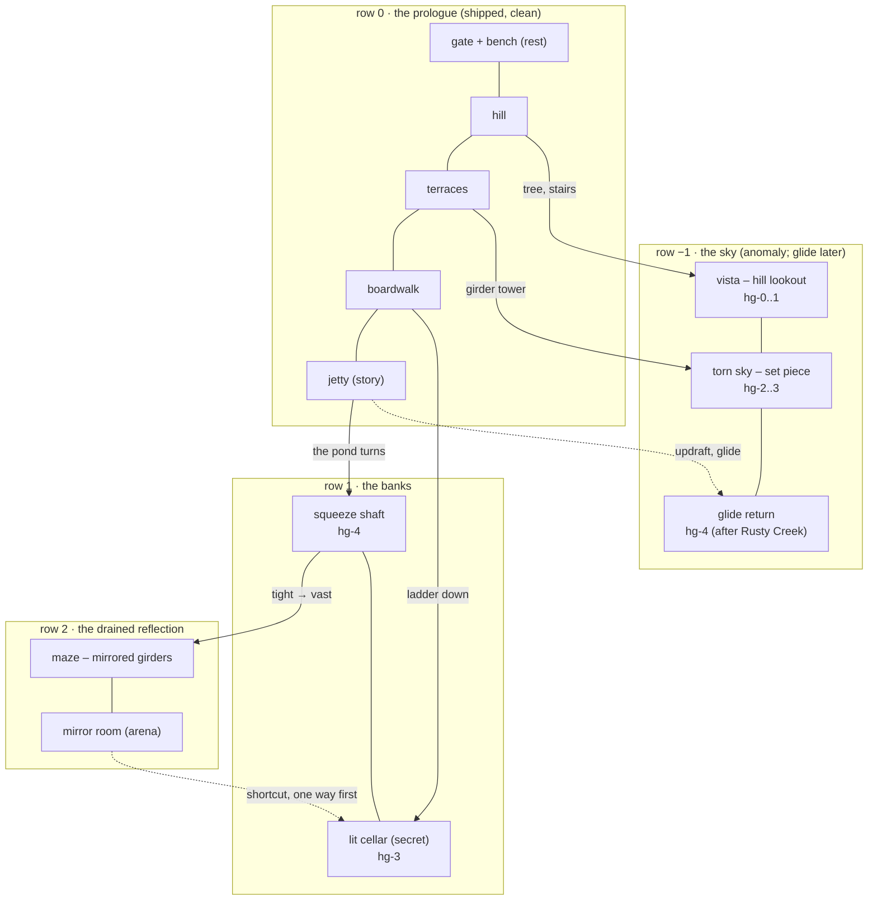

# 16 – Zone design: scale, rooms and story in the space

<!-- nav:start -->
[← 15 – The prologue slice (rebuild)](15-PROLOGUE-SLICE.md) · [Design docs](README.md) · **15 / 16** · [Meetings and voice notes →](meetings/README.md)
<!-- nav:end -->

**Draft for agreement (24 Oct, ~10:40).** Why: the first world-map draft enlarged the Hidden Garden concept into chunks, and Alexander pointed out the result is claustrophobic, not secret horror. The concepts are 2:1 *pictures*: their caves are under one hero tall and their girders a hop apart. They set the **look and the vocabulary** of a zone, never its scale. This doc sets the scale, the room kinds and the storytelling rules every zone follows, and how the [world pipeline](09-ART-PIPELINE.md#world-pipeline) builds them.

## What the reference games do – measured, not guessed

Hero height as a share of the visible screen height, measured on our own reference stills (`references/games/*/images`, ticks every 10 %):

| Game (still) | Hero / screen height | What the space does |
| --- | --- | --- |
| Hollow Knight (blue cave, white palace, crystal) | **8–10 %** | Rooms are 6–9 hero heights tall; a vertical shaft spaces its platforms 2–3 hero heights apart; most of the frame is air |
| Planet of Lana (desert, cave) | **6–12 %** | Horizon near the middle; caves are 10+ hero heights tall – tiny figure, huge place |
| Metroid Dread | ~15 % | Closer camera for combat corridors |
| Dead Cells, 9 Years of Shadows | ~20 % | Close, combat-first framing |
| **Ours** (`docs/04` scale) | **11 %** (80 of 720 px) | Right where Hollow Knight and Lana are – the camera is fine; the *rooms* were too small |

What the studios say about building the space:

- **Space first, platforms later.** Team Cherry design around the space – "a cavern with a lake on the left, a ruined tower" – not around individual platforms. Hollow Knight's rooms are freely shaped boxes, not a uniform grid; one room is loaded at a time.
- **Fixed frame, random fill.** Dead Cells hand-builds the world frame, the key locations and the room *templates* (tagged by biome, purpose, entrances); the algorithm only picks which valid template fills each slot of a per-biome concept graph – entrance and exit first, special rooms next, the rest last. Their purely procedural prototype was "chaotic and hard to read". Pacing alternates peaks and breaks.
- **Gates, loops, teases.** Silksong's Act 1 is one vertical climb where each new ability opens a few nearby locks; a later traversal ability (wind currents with the Drifter's Cloak) reopens old areas; one room that shares the next area's look teases it; benches are the breaks and the places the map fills in.
- **Camera.** Itay Keren's *Scroll Back*: a camera window sized to the jump, platform snapping on landing, about 25 % look-ahead, and cue focus that pulls the camera toward a landmark or a boss. Ours already does the window and snapping (`docs/02`).
- **Environmental storytelling.** Smith and Worch (*What Happened Here?*): props, light, composition and the world's reactions let the player assemble "what happened here" themselves. Lana: one carefully framed reveal of something huge beside something small.

## Scale rules – in hero heights (h = 80 px)

| Space | Clear height | Width | Why |
| --- | --- | --- | --- |
| Outdoor route (pond level) | sky ≥ half the frame | open | Lana: horizon near the middle, small figure in a big place |
| Squeeze (a tension beat, once or twice a zone) | 2.5–3 h | ≤ 1 screen | The only tight space – right before a reveal: tight → vast |
| Passage, tunnel, cellar corridor | ≥ 5 h (400 px) | any | Never claustrophobic by accident |
| Room (cave, cellar, girder hall) | ≥ 6 h (480 px) | ≥ 1 screen (1280) | Hollow Knight's rooms are 6–9 h |
| Vertical shaft, tower | ≥ 3 h wide | 2+ screens tall | Tiers ≤ 1 h apart without a ladder (jump 96 px), ladders beyond |
| Special room / arena | ≥ 1 screen tall (720) | ≥ 1.5 screens (1920) | Camera locks to the room (cue focus) |
| Vista | the frame itself | 1 screen | The camera eases out to show the landmark |

Every number the player feels comes from `jump.ts` (jump 52/96 px, designed to 80), `movement.ts` (run 198 px/s) and – after Rusty Creek – the glide (below). A gap is a **jump gap** (≤ 120 px), a **glide gap** (120–900 px with height to spare) or a wall.

## Shape and uniqueness – Planet of Lana's land, Hollow Knight's depth, never tiles

Alexander (24 Oct): the terrain must not turn blocky or sharp-edged – not Apple Knight, not Terraria. The morning's generator built ground from flat runs and 24–48 px steps: a staircase, against docs/04's own rule ("no staircase blocks"). The rules now:

1. **Landforms, not steps.** A walk line is a smooth curve built from landforms – long swells, hills, swales, banks, overhangs – in the game's polyline collision. Walkable up to 35°, a slide from 40° (docs/02), a cliff only where a jump or a ladder is meant to be.
2. **Built things are straight, grown things never are.** Girders, decks, stairs and cellar walls may have straight edges and right angles; earth, rock and plants never do.
3. **The guide is soft.** Only the walk line is exact. Earth is a blurred mass and rooms are rounded volumes, so the painting owns the silhouette: grass lips, roots, overhangs, as in `art/`. Hard rectangles in a guide come back as blocks.
4. **No tiles anywhere.** Terraria's look comes from a 16 px tile grid and Apple Knight's from one reused tileset. Here every chunk is painted whole and grown from its neighbour; nothing is stamped. The gate's repeat check fails a repeated block.
5. **Every room has its own landmark.** An authored, one-of-a-kind set piece per room (the big tree, the girder tower, the jetty, the shifted beam). The seed varies the land between landmarks, never the landmarks.
6. **Complexity from layering, not density.** Hollow Knight and Metroid Dread feel complex because routes nest in depth – a tunnel under a hill under a girder bridge, an overhang over a drop, foreground cover – and dense rooms carry two or three route heights. Lana's quiet stretches sit between them.
7. **Checked, not hoped for.** The blockout fails any right angle on earth; the gate adds a **blockiness** check (long axis-aligned edges outside built things) next to route, repeat and grain.

## The room kinds – drawn from the concepts, clean and anomaly

| Room | Purpose | Hidden Garden instance (clean → anomaly) |
| --- | --- | --- |
| **Rest** | Break after a peak; the map fills in here | The bench (clean) – still there, too calm (anomaly) |
| **Story room** | Evidence before explanation | The jetty: the reflection shows the girders (clean) → the girders stand in the reeds (anomaly) |
| **Vista** | Framed reveal, tease of the next region | The hill lookout under the big tree: the whole pond, the 404 tear, and through it a glimpse of Rusty Creek's rails |
| **Tower / shaft** | Vertical traversal, tiers and ladders | A girder tower grown out of the reeds, two screens tall |
| **Set piece** | The anomaly as a place you move through | The torn sky: a girder bridge under the grey cut, stretched trees, a beam shifted sideways (the concept's "path cut and shifted") |
| **Secret** | Reward for looking; lore | A lit cellar in the bank: chest with the first archive note (the "mascot-shaped containment vessel" clue) |
| **Maze** | Disorientation without cramp | The drained reflection under the pond: the sky's girders hanging upside down from a water surface overhead |
| **Arena** | A peak; camera locked | The mirror room in the reflection: a flat 2-screen hall – a mimic of the hero (the documented doppelganger idea), or a puzzle |
| **Shortcut** | Loop back after a peak (one way first) | A ladder kicked down from the cellar into the reflection |
| **Glide return** | Old place, new reading (after Rusty Creek) | An updraft off the pond to the torn sky; a far glint only a glide reaches |

## Storytelling in the space – the rules

1. **Beauty first, wrong on a second look.** Every zone's clean state is calm and pretty; the anomaly keeps the same landmarks (bench, jetty, big tree) so the player *recognises* what changed.
2. **Evidence before explanation.** The reflection shows the girders before they exist; a stretched tree is in the frame before the sky tears.
3. **What happened here.** Traces, never text: black fluid drips along the way to the cellar; a plush-sized dent in the grass where Dexter sat; crates stacked against a door from the inside.
4. **Light means safety.** Warm lanterns = refuge (cellars, bench); grey 404 cuts and cold water light = wrong. Never mix them in one room.
5. **Tight → vast.** The one squeeze in a zone sits right before its biggest space (the shaft into the reflection hall).
6. **Tease forward, reward back.** A vista shows the next region; a glide gap shows a reward you can't reach yet.
7. **Peaks and breaks.** No two peaks (fight, puzzle, arena) without a break (rest, vista) between them.

## The Hidden Garden zone – the plan

The prologue row already shipped (`hg-0-0` … `hg-4-0`, clean) **is the zone's level row**. The zone grows out of that approved art in four directions, so its look and alignment are `art/`'s own; and returning to the garden after Rusty Creek *is* the metroidvania return (same place, new reading).

**First proof (3 × 3, around the pond):** columns `hg-2`…`hg-4`, rows sky / pond / banks – three shipped chunks and six grown ones. The reflection row follows once the banks pass the gate.

## How the pipeline changes (docs/09 "World pipeline")

| Stage | Before (this morning) | Now |
| --- | --- | --- |
| 0 map | Seeded graph over a uniform grid | **Fixed frame + seeded fill** (Dead Cells): the zone's rooms and their links are authored in `zone.json` (kinds above, sizes in hero heights); the seed only places the connective routes, platforms and decoration inside the rules |
| 1 blockout | Guides and collision from the generated map | Same, plus the **shipped collision** for the prologue row is fixed input, and the rooms' clear heights are checked against the table above |
| 2 paint | Each chunk painted from its guide (the first one copied the concept) | **Grow from approved art only**: left/right as `grow_stage.py` does, up/down the same way – two pieces (480 + 240 rows), 128 px overlap joined on a min-error cut through rows, seam colours matched. Never a whole stage or concept as a "style" input |
| 3 join | Left/right windows | Left/right and up/down windows (`world_paint.py join`) |
| 4 gate | – | `world_gate.py`: seam, guide left, route, repeats, grain, palette, text |
| 6 anomaly | 404 as fx data | Clean is painted first; the anomaly's girders are `feature` repaints into a copy – the pixels that changed **are** the anomaly layer (docs/04: only structure layers swap); the reflection row exists only in the anomaly; the 404 tears stay fx |

## Glide – proposed numbers (Lex, after Rusty Creek)

Hold Jump in the air: fall at 70 px/s, keep run speed (198 px/s) – about 2.8 px across per px down, so a 300 px drop carries ~850 px. Updrafts (`docs/04` legend, pale blue lift boxes) rise at 150 px/s. The zone is complete without it; with it, two secrets and the glide return open.

## Open for agreement

1. The prologue row as the zone's level row, grown in four directions (instead of a new layout).
2. Fixed frame + seeded fill (instead of a fully random map).
3. The scale table and the room kinds above.
4. Glide numbers and whether glide content ships in this zone now (as data) or later.

Sources: [Scroll Back (Itay Keren)](https://www.gamedeveloper.com/design/scroll-back-the-theory-and-practice-of-cameras-in-side-scrollers) · [The level design of Dead Cells (Sébastien Bénard)](https://deepnight.net/tutorial/the-level-design-of-dead-cells-a-hybrid-approach/) · [The world design of Silksong (GMTK)](https://gmtk.substack.com/p/the-world-design-of-hollow-knight) · [Team Cherry on designing Silksong's world](https://gonintendo.com/contents/53066-team-cherry-walks-through-the-unique-way-they-designed-hollow-knight-silksong-s) · [What Happened Here? (Smith, Worch, GDC 2010)](https://gdcvault.com/play/1012647/What-Happened-Here-Environmental) · [Planet of Lana's origin image](https://en.wikipedia.org/wiki/Planet_of_Lana)

<!-- nav:start -->
[← 15 – The prologue slice (rebuild)](15-PROLOGUE-SLICE.md) · [Design docs](README.md) · **15 / 16** · [Meetings and voice notes →](meetings/README.md)
<!-- nav:end -->
