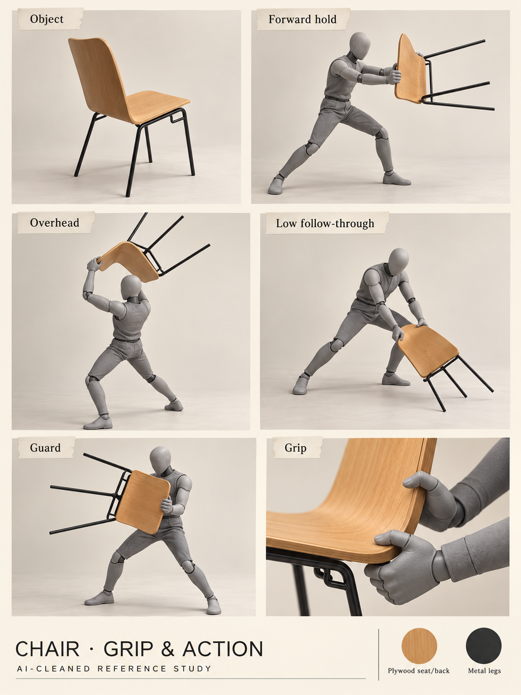

# From a familiar campus to something uncanny

[← Transcript library](transcripts/README.md) · [Open visual review](../../references/campus-objects/viewer.html) · [Updated proposal →](../proposal/campus-game.md)

**Three new recordings · 50 minutes · 23 October 2026.** [A11: team meeting](transcripts/A11.md), [A12: Lex discussion](transcripts/A12.md), [A13: travel clarification](transcripts/A13.md). Each has a complete readable OpenAI API transcript and its own summary. Speaker names are not inferred from the filenames or voice recognition. This synthesis excludes unrelated personal tangents; the transcripts preserve context.

## Shared direction expressed in discussion

- Familiar, initially comfortable campus life gradually becomes **uncanny psychological horror**, with jokes and mundane objects. Gore and an apocalypse were explicitly rejected in the discussion.
- A **quantum-computing field experiment** is a positively received fictional explanation for dimensional anomalies. It is a story seed, not a scientific claim or a report about the university.
- Finish **one character and one complete level** first; only add another after measuring the actual workload. Rusty Crossings and Toxic Garden attract interest. Hidden Garden remains a possible arrival scene; no final first-stage vote is recorded.
- Lex is asked for **authored level-design sketches**, with asymmetric routes, rooms, secrets, encounters, hills and possible underground sections. This is a requested contribution, not a promise of unlimited availability or six finished levels.
- Stage-art generation should follow the reviewed sketches. Annotate solid surfaces, one-way platforms, ladders, occluders, hazards and triggers separately; a mask or a visually connected maze does not prove playability.

## Mechanics and story: keep the alternatives visible

| Thread | What was discussed | Status / dependency |
| --- | --- | --- |
| Reflection travel | Pond touch, brief crash/damage-spin, safe arrival in another area | Cheap transition preferred over an elaborate cinematic; exact role still open |
| Reflection purpose | Main conduit to discover areas/upgrades **or** fast travel | A13 explicitly leaves both alternatives; not necessarily literal mirrored terrain |
| Playground slides | Mutating slide entrance, short controllable tunnel with authored background lore | Alternative travel presentation; not a checkpoint and not a required cinematic |
| Dexter | Plush guide/trader absorbs defeated anomalies; becomes more humanoid and possibly betrays the player | Shared story interest; reveal timing and final encounter not locked |
| Dexter's presence | Attached companion with three charge levels **or** intermittent trader who collects unlooted anomalies | Conflicting versions, not one combined requirement |
| First weapon | Ordinary plywood campus chair, initially weaker than later options | A12 proposes chair first; prototype one readable strike before directional variants |
| Tray | Later returning throwable weapon that enables kiting; photographed holds/guard provide shape references | Returning flight is discussed, not photographed or implemented |
| Drones | Initially hard to defeat; avoid/hide, perhaps return with better equipment | Enemy proposal; not a demand for a separate stealth system |
| Devices / map | Portable experiment case or tablet-like item may unlock map/information | No permanent minimap requested; input and map behavior need a decision |
| Food and props | New Mensa food, drinks, signs, robots, garments and poses provide a vocabulary | The food-boss brief comes from Alexander's current request; no complete food-boss encounter was settled in these recordings |

## Matters that must not be silently decided

**Rules:** A11 reports the theme as “spooky outside.” It also contains conflicting remarks about generative AI being disallowed and using a freestyle track. Treat this as participant-reported context; obtain the organizer's actual track/AI/pre-work terms before competition production. No permission is inferred from a recorded joke.

**Controls and scale:** left/right/up/down plus two action buttons is a proposed accessibility target, not proof of support on every device. Jump, attack, guard, interaction and map need a concrete binding plan. Lex correctly raises resolution/pixel-density consistency: pixel-style generated images still need a shared character height, world scale and export density.

**Names:** game title, logo and short catchphrase are requested but not selected. Disposable candidates: **Office Hours: Out of Bounds** (“Familiar. Faulty. Outside.”), **Mensa.exe** (“Lunch. Learn. Leave.”), **Pond Not Found** (“Touch. Turn. Trespass.”). No availability/uniqueness check has been performed. WinCS remains the repository name; Poncho Goblins is the social/team proposal, with registered spelling still unconfirmed.

**Reference recollections:** Little Nightmares character names and some game/history claims are misremembered in speech. Preserve them as evidence, not verified lore. Newly mentioned Ori, Bastion, FNAF, DDLC, Poppy Playtime and Infinity Train are comparison leads, not accepted mechanics or a new research/shipping backlog.

**Workflow:** A11 discusses a future board and tools. Recorded discussion is context, not authorization to recreate issues, install integrations or disclose credentials. The written gate remains: conclude the technical design document first. [Team handoff](../delivery/team-workflow.md).

[← Transcript library](transcripts/README.md) · [Visual boards](../../references/campus-objects/README.md) · [Proposal →](../proposal/campus-game.md)
