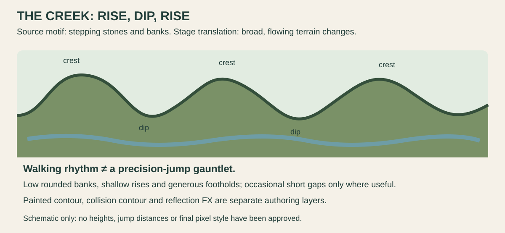

# One visual system · scenery, characters, motion and sound

[← Current proposal](../proposal/campus-game.md) · [Home](../../README.md) · [Next: layered workflow →](layered-stage-workflow.md)

**Current direction:** original pixel art with flowing terrain silhouettes, authored horizontal compositions and separated depth. The photographic boards supply real motifs; the [Lana study](../../references/games/planet-of-lana/layers-and-motion.md) supplies depth/contour/process references. Neither is a runtime asset pack. Final pixel style awaits a small team-reviewed test.

## Agree the design system on one small scene

| Decision | Proposed starting point | Review evidence |
| --- | --- | --- |
| Scale | 640×360 logical viewport; student 24–32 pixels tall as a test range | Feet, hands and props read at actual camera scale |
| Pixel language | Consistent cluster size and edge treatment across characters, scenery and FX | No isolated smooth asset against a coarse pixel world |
| Terrain | Broad rising/falling contours, authored cliffs/ledges where useful | Continuous walking rhythm; no obligatory square-tile staircase |
| Depth | Distant low-contrast masses; one clear play plane; sparse front framing | Player, interaction and landing points stay visible |
| Palette / light | Shared palette roles and one light direction, with local material families | Garden greens/water, campus plaster, crossing rust and Toxic Garden growth still belong together |
| Corruption | One consistent fault vocabulary; exact 404 look awaits owner screenshots | Normal/corrupted pairs remain aligned and readable |
| Character shape | Original student garment/proportions, distinct from source characters | Idle, movement and one action remain recognizable in silhouette |

The viewport and sprite height are proposals, not separate competing resolutions to adopt automatically. A full palette or color count is not locked by a collage. Modular props can be reused inside an authored contour; reuse does not require procedural stage assembly.

## Expand scenery and animation in the same order

Reference board → one scale/style test → greybox and horizontal master → clean plates/layers → one state pair → selected action poses → in-betweens → motion proof → next bounded addition. The [production workflow](layered-stage-workflow.md) explains each step. Keep the accepted master and export contract stable while filling gaps.

| Pack | Minimum useful states / parts | Add only when |
| --- | --- | --- |
| Student movement | Idle, walk, jump/fall, land and interaction | All feet/pivots agree; controller and camera work |
| Lake touch | Approach/ready → contact → transition → safe arrival | Named anchors, cooldown and reset are defined |
| One rail traversal | Mount → over/along → dismount; reuse poses where they truly fit | The crossings state-change route is selected and reachable |
| One weapon | Anticipation → active strike → recovery | Combat is selected; range, hit event and cancel/reset rules exist |
| One enemy | Idle/patrol → tell → attack → recovery; hit/defeat | It replaces another scoped task; no enemy roster by default |
| Robot item | Uncollected, collected and a short feedback effect | Collection never blocks completion |
| Environment | One water shimmer region, one reed loop, sparse leaves | Clean plates exist; effects do not obscure play |
| Stage state pair | Normal art/collision + corrupted art/collision | Same origin, safe staging and a stable exit work |

For generated in-betweens, provide the two approved endpoint poses, frame canvas, body proportions, facing, foot/hand anchors and intended timing. Check the sequence for sliding feet, changing costumes, extra limbs and prop drift. A convincing isolated picture is not proof of animation continuity. Do not generate a huge sprite sheet before one action works.

Animation timing and hit events are authored separately from image appearance. A repeated generation cannot decide invulnerability, damage, collision or an enemy's behavior. Store state names, pivots and frame durations beside eventual runtime assets; no production sheet is claimed today.

## Keep the kinds of masks distinct

- **Alpha cutout:** what is drawn; requires real transparency and padding.
- **FX region:** where water/glitch/light can animate; requires clean pixels beneath it.
- **Interior reveal:** aligned exterior/interior plates with a trigger, for an optional playground section.
- **Terrain-state replacement:** a normal/corrupted composition pair whose collision/state changes with its art.
- **Collision geometry:** what can support, block or harm the player; authored and tested independently of painted grass.

The same scene origin links these outputs. Names, dimensions, pivots, state IDs, source/approval records and a proof composite prevent expansion from becoming a pile of incompatible masks. [Technical contracts](../technical/layered-stage-contract.md).

## Sound supports the visible rule

Candidate cues: water/contact, a brief failed-operation sound, foot/landing response, an item beep and a clear success/restart cue. Keep ambient water/vegetation quiet enough for action cues; use original or licensed audio. Important progress never depends on sound alone. Mute, pause and reduced decorative motion must preserve the game's state.

The pun should also be playable: “Path not found” can accompany a vanished path and a discoverable alternative. Exact dialogue, final story, music and voice performance remain discussion material.

## What counts as ready to expand

One route plays from start to ending and restarts; the art recomposes correctly; camera seams and alpha edges are clean; both terrain states match their collision; the selected action sequence has stable pivots and timing. Then add one strip, mask, prop or action pack and repeat the same review. All shipped media needs source/rights/AI provenance; the reference library stays outside exports.

[← Current proposal](../proposal/campus-game.md) · [Home](../../README.md) · [Next: layered workflow →](layered-stage-workflow.md)
