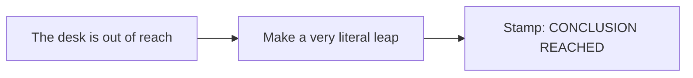
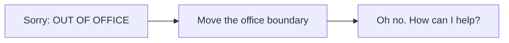
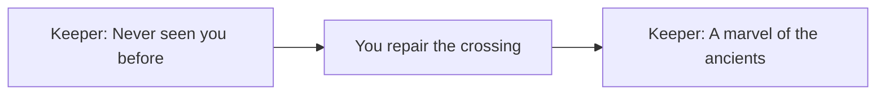

# The pun drawer

[← Previous](../../references/comparison.md) · [🏠 Home](../../README.md) · [🖼️ Visual library](../../references/README.md) · [Next →](../proposal/game-proposal.md)

**A joke you can play beats a paragraph explaining why the game is funny.**

These are original conversation starters, not an approved premise, promised mechanics or a replacement for Vatsal's direction. The earlier [game proposal](../proposal/game-proposal.md) and [mechanics sketch](../proposal/mechanics-and-level.md) stay available. We are allowed to try sillier ideas before choosing.

## Look at the situation, then imagine the mischief

| A strange place to explore | One object, unexpected behavior | Immediate, readable chaos |
| --- | --- | --- |
|  |  |  |

*Existing-game references only: Team Cherry, Shared Memory and ChillyRoom respectively. These are not illustrations of the ideas below. Click through for sources. Borrow a quality, then invent the situation.*

## 1 · Jumping to conclusions

**The setup:** a tiny bureaucrat refuses to accept your perfectly reasonable explanation. The only way to reach the “CONCLUSION” desk is to jump there. Naturally, this counts as evidence.

**The playable joke:** each safe landing gets an increasingly absurd approval stamp: “plausible,” “probably,” “close enough.” The final platform is labeled “a bit of a leap.”

**What could make it fun:** a short physical route with a visual payoff to your own movement. Try one jump and one reacting sign/character first; no dialogue tree or paperwork inventory. If the leap is not enjoyable without text, the puns are not fixing it.

## 2 · Out of office

**The setup:** a goblin receptionist cannot help because they are “out of office.” You can see them standing three pixels outside the office outline.

**The playable joke:** slide a wheeled office partition around the receptionist. They are now in office and, with visible disappointment, must help. Later they try to sneak outside again.

**What could make it fun:** seeing a rule work literally, then turning it against its author. Test one draggable or pushable prop and one clear state change. It would replace the traversal-unlock system, not become an extra system on top of it. A second sneaking animation is optional.

## 3 · Long time, no sea

**The setup:** a goldfish checkpoint keeper greets you like a stranger every time. Your increasingly ridiculous repairs stay in the world; the keeper takes credit for all of them.

**The playable joke:** on the return trip, the keeper solemnly explains your own improvised bridge to you: “Ancient architecture. Very mysterious.” A tiny bucket sits on a pedestal: “The oldest sea in the building.”

**What could make it fun:** a familiar place changes, and the joke rewards noticing it. Keep the player's progress and memory intact. Start with one changed prop and two greetings; no memory-reset mechanic, timer or punishment. “Memory of a goldfish” remains an optional title seed, not a commitment.

## References without copying

We can enjoy a familiar genre convention, a wink or a shared cultural joke while writing our own words, characters and situations. A dramatic “boss” turning out to be a tiny office supervisor is a broad comic setup; it does not need someone else's boss design, recognizable character, ripped sprite or copied catchphrase. Keep deliberate references in a short note so the team can tell homage, coincidence and actual borrowed material apart. Licensed third-party assets need their own permission/provenance, regardless of whether someone would personally prefer to reuse them.

## A ten-minute laugh test

Each person pitches one ridiculous **situation → action → payoff**. Mime it, draw three boxes or move paper pieces around. Let someone else try it without explaining the joke. Keep the one that makes them curious enough to act and amused when the rule responds. If nobody laughs, change the setup or payoff rather than adding more lore.

Pick one central gag and at most a couple of small callbacks. Leave space for physical comedy, timing and the team's spontaneous jokes. Depth can arrive as a warm final callback; it does not have to turn the whole game solemn.

[← Visual library](../../references/README.md) · [Existing proposal →](../proposal/game-proposal.md) · [Home](../../README.md)

[← Previous](../../references/comparison.md) · [🏠 Home](../../README.md) · [🖼️ Visual library](../../references/README.md) · [Next →](../proposal/game-proposal.md)
