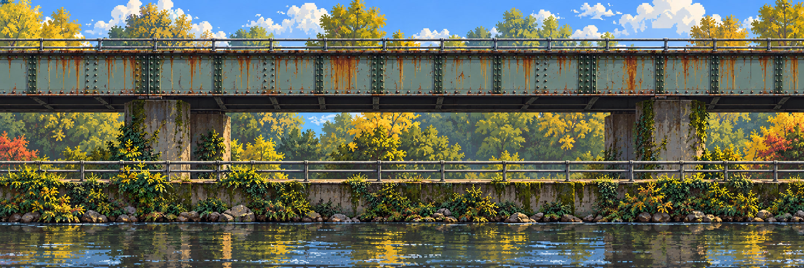
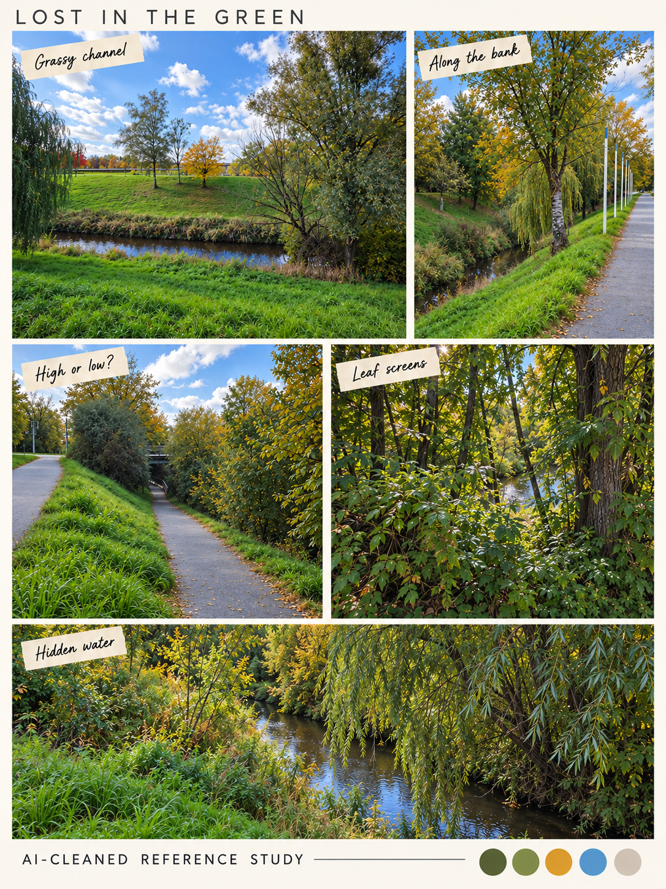
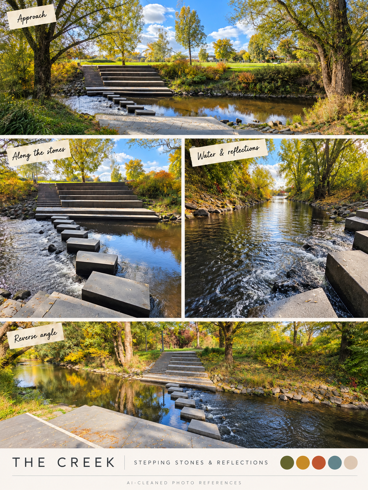

# A campus that has clearly failed its sanity check

[← Ten-recording direction](../brief/voice-notes.md) · [Location boards](../../references/campus/README.md) · [Scene-first workflow →](../design/layered-stage-workflow.md)

**Current proposal · 23 October 2026.** An original pixel-art exploration/action game: a student touches a lake reflection and enters a familiar campus whose images misbehave. The environments carry the influence of fictional secret university villains. Rusty Crossings becomes an algorithm-inspired maze of rusted horizontal/vertical bars, turns, branches and shafts. The surrounding gardens keep flowing natural contours.

The image above is the **clean center of a three-banner side-scroller study**, before traversal or corruption. It redesigns the photo motifs into flat side elevation: no receding paths, diagonal bridge perspective or vanishing point. Recognizable steel, creek, moss and railings matter; the photographed layout is not copied. [See all banners, staggered joins and seven depth trials](../../references/production/crossings-strip/README.md). These are not an approved level or final palette. Vatsal remains creative lead; Poncho Goblins remains the proposed team name. [Earlier scope options](game-proposal.md) remain available.

## The important distinction: the image can fail while the game still works

Corruption comes **after the clean strip and layers**, not in the initial location render. The [earlier smear study](../../references/production/master-first/README.md) illustrates an effect family; its free-standing maze is superseded as the location direction.

**Default corruption is visual:** cut a background band, stretch its pixels, offset/repeat a strip, sample the wrong region, briefly show a missing-image/404-like presentation or distort a scene-aligned FX region. These can convey a villain's influence without building an elaborate spreading organism or changing the physics world for every error.

The normal and smeared examples are two full-image generation results, not a verified runtime transition. Their canvases match, but regeneration changes pixels outside the target too. The [production trial](../../references/production/master-first/README.md) records that limitation. A small renderer effect on the accepted master/background region is the practical runtime target; collision remains unchanged for visual-only faults.

**Proposed reveal beat:** enter the stage → sudden expansion/reveal → pushed back → parkour. This latest owner idea needs a safe telegraph, displacement, reachable route, control recovery and reset if selected. Removing a floor, changing a maze lane or teleporting between anchors likewise needs a separately authored mechanic. Visual corruption does not automatically change physics. Exact Voyager 404 styling still awaits owner references.

## See the places in the proposed world order

Lake approach → touch / inexpensive crash-spin → **Hidden Garden → campus → Lost in the Green → Rusty Crossings → stepping-stone creek → Toxic Garden**. This is a fictional route, not real campus geography. Playground is an optional detour; the robot is an item. The full route is expansion material.

| 1. Hidden Garden / lake | 2. Campus architecture | 3. Lost in the Green |
| --- | --- | --- |
|  |  |  |
| Soft banks, water entry and layered reeds. | Ledges, passages and recognizable building rhythms. | Grassy channels, high/low routes and vegetation screens. |

| 4. Rusty Crossings | 5. Stepping-stone creek | 6. Toxic Garden |
| --- | --- | --- |
|  |  |  |
| Angular bar maze; pathfinding-like route choices. | Irregular rising/falling contours, water and reflection motifs. | Plants, rocks and rust-edged passages; greenhouse influence. |

**Preferred play direction:** exploration, movement and possible combat inspired by Hollow Knight / Dead Cells-like action. Gardens and creek are not locked into quiet walking or stealth-only stages. Hiding and line-of-sight puzzles remain an alternative for team discussion. The terrain language stays flowing and authored; procedural level assembly is not required.

## Why these errors exist · the secret-villain premise

**Owner's story direction:** errors, corruptions and mutations reflect the secret villains at the university. This is fictional campus mythology, not a claim about real people. An antagonist's subject can influence a stage's visual language, routes, encounter pattern and cheap visual errors.

| Known seed | World / gameplay connection | Still open |
| --- | --- | --- |
| AI / algorithms-and-data-structures professor as a personal secret-villain seed | Rusty Crossings: orthogonal branches, loops, dead ends, search/pathfinding imagery; perhaps a brief search-front highlight or wrong image sample | Boss identity/art, dialogue, exact attack/encounter and whether a search visualization is used |
| Other degrees and secret villains | Their influence can supply different imagery/errors in the gardens, campus, creek or later stages | No unprovided professor, degree-to-biome mapping or villain roster is invented |

Do not turn every visual motif into a new algorithm or simulation. The maze can be one hand-reviewed authored route; a search-front visual can be a short predetermined animation. Earlier notes put comic replacement bosses after one completion. Reconcile that reveal/replay timing with the broader villain premise in the team's recorded discussion; causation in the world does not require fighting every villain in the jam.

## How Codex and image generation actually produce the art

**Latest follow-up:** broad blue-green riveted structures, substantial concrete shafts and a full-height branching maze are the preferred traversal language. Thin bars under one long bridge are superseded. [Actual per-layer seam repairs and expandable chunk pipeline](../technical/stage-art-pipeline.md) now have executable offline tooling and a separate [visual study](../../references/production/seam-pipeline/README.md). The clean location and maze remain separate studies awaiting final composition, not a completed layered level.

**Clean center → same-width left/right extensions → two staggered join windows → dress the strip → five-plus layers → individual grabs/rigs → recompose → motion/corruption.**

| Pass | Visible result |
| --- | --- |
| 1. Clean location | Newly designed flat side-scrolling banner based on collage landmarks/materials |
| 2. Extend and join | Left/center/right span 3W; two W-wide windows straddle the joins like staggered bricks |
| 3. Dress in place | Add route bars, ladders and plants onto the accepted composition; repair added-route joins |
| 4. Separate depth | Far scenery, rear structure, bank, water, traversal/interactables, near rails and front plants |
| 5. Extrapolate/grab | Recover hidden parts of each needed bar, ladder or plant; retain source offsets, IDs and pivots |
| 6. Recompose and animate | Clean static duplicates/holes; verify alignment, then add limited water/plant/actor motion and effects |

A shared coordinate space is bookkeeping for an image that already exists. Full-canvas plates inherit `[0,0]`; cropped sprites retain their crop offset from the master. The default is not manual x/y placement of newly generated trees, bars and rocks. [Practical workflow](../design/layered-stage-workflow.md) · [Minimal technical contract](../technical/layered-stage-contract.md).

The [current trial](../../references/production/crossings-strip/README.md) includes three clean banners, two overlap candidates, three traversal passes and seven center depth plates. Native dimensions vary slightly; seams and the generated recomposition have **not passed**. Some cutouts drift or retain fringe pixels. Wing decomposition and every-object grabs/rigs remain future production work. Five-plus depth roles are the requested direction; a flat approved strip is a delivery fallback if time expires. Generation does not guarantee exact extraction, a rig, collision or a solvable route.

## Buildable jam recommendation

**One complete short scene first**, with Hidden Garden/lake still the first location candidate. The Rusty Crossings master demonstrates the production method rather than replacing that priority. After theme reveal, Vatsal chooses the actual scene and signature action.

Proposed action/exploration slice: walk/jump → touch the lake and arrive at a safe anchor → traverse an authored route → experience one visual error → reach a clear payoff/exit → restart. If combat is selected, budget one simple melee action and one enemy with a clear tell/recovery. Choose that instead of adding a separate stealth system. A robot pickup is optional after the loop works.

| Gate | Concrete result | Cut if it slips |
| --- | --- | --- |
| First 45 minutes | Choose theme fit, controls, scene, action/combat choice and ending | Extra locations and villain encounters |
| First two sprint hours | Controller, collision, interaction, retry, ending and export work with rough art | Extra movement verbs, enemy variants |
| Friday evening | Full rough playthrough plus one approved whole-scene image | Long maze, additional rooms and props |
| Art integration | Accepted master; one visual effect; only proven derived plates | Failed extraction/parallax, elaborate terrain mutation |
| Final block | Outside playtest, geometry/readability fixes, credits, fresh export and submission buffer | Unreviewed polish rather than core completion |

The advertised 24-hour event has [18 scheduled sprint hours](../delivery/jam-plan.md), before individual rest/support limits. A complete small game with one master and a few consistent animations is the target. The six-stage route, weapon tiers, boss roster and every secret reveal are later expansion candidates.

## Characters, tone and references

Original small student in an oversized hoodie/poncho; original campus-object actions and a cute robot item. Little Nightmares contributes character shape only. Morta contributes pixel design/magic; Terraria means Wall of Flesh/Moon Lord bosses only. Duck Season contributes future mascot/endings ideas. Infinity Blade contributes partly understood advanced remnants presented as ancient machinery or magic. [Reference comparison](../../references/comparison.md).

**Optional writing seed:** a student seeks an orientation stamp while the campus image buffer increasingly disagrees with reality. “Path not found” fits the algorithmic maze, while an ordinary task supplies the ending. The secret-villain influences can connect the places without a long lore exposition. Final story, names and degree mappings await discussion.

## Evidence and review

A01 supplies local geography, student/weapon/enemy seeds; A02/A10 supply scene/layer/animation iteration; A03 supplies reference collection; A04 supplies the chair-action seed; A05 preserves Vatsal's ownership and the clarified worldbuilding interest; A06 supplies Playground; A07/A09 supply lake travel/crash-spin; A08 defers secret-boss extras. [Timecoded digest and source hashes](../brief/voice-notes.md).

The latest written corrections require recognizable photo-inspired locations redesigned in flat side elevation, a three-banner strip with staggered joins, multi-pass dressing and five-plus depth roles. Visual bugs and subject-linked villains remain. New art, mechanics and jokes are proposals, not transcript quotes. Photos, commercial references and generated trials have distinct provenance and are not automatically runtime assets.

Review the scene language, action/exploration choice, villain connection and one-scene budget; record the agreed game technical design document before creating issues/board/workflows. AI/pre-work rules still require organizer confirmation. The scheduled watcher remains paused.

Earlier schematic ideas · retained as optional exploration, not the current visual brief

The three simplified diagrams are kept following the later “do keep this” clarification. They are removed from the primary visual story. Their physical terrain faults, bridge interpretation and fault families are unapproved earlier alternatives; the current maze and visual-only-error approach supersede their baseline assumptions.

[Earlier route map](diagrams/route-overview.svg) · [Earlier creek fault alternatives](diagrams/terrain-rhythm.svg) · [Earlier bridge cascade](diagrams/crossing-change.svg)

[← Ten-recording direction](../brief/voice-notes.md) · [Location boards](../../references/campus/README.md) · [Scene-first workflow →](../design/layered-stage-workflow.md)
