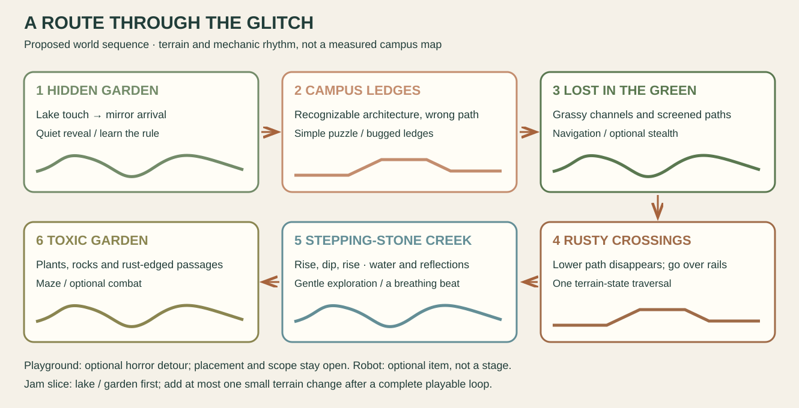

# A campus that has clearly failed its sanity check

[← Voice-note direction](../brief/voice-notes.md) · [Visual boards](../../references/campus/README.md) · [How we make it →](../design/layered-stage-workflow.md)

**Proposal for team discussion, 22 October 2026.** A student touches a lake reflection and enters a familiar campus whose geometry keeps misbehaving. The player learns to read the faults: follow a misleading reflection, cross a soft rise and dip, or take the upper railing when the normal path glitches away. Funny, curious and sometimes unsettling; the controls themselves remain dependable.

The ten [voice recordings](../brief/voice-notes.md), followed by Alexander's written clarifications, are the design source. Vatsal remains creative lead. **Today’s deliverable is a reviewable visual direction and proposal**, not a game, finished story or approved runtime art. Poncho Goblins is the proposed team name. [Earlier scope options](game-proposal.md) remain alternatives.

## See the places; read them in route order

| 1. Hidden Garden / lake | 2. Campus architecture | 3. Lost in the Green |
| --- | --- | --- |
|  |  |  |
| Touch the lake, arrive in mirror space; soft banks and a quiet reveal. | Familiar colonnades and ledges begin to break their own rules. | Grassy channels and screened high/low routes invite observation. |

| 4. Rusty crossings | 5. Stepping-stone creek | 6. Toxic Garden |
| --- | --- | --- |
|  |  |  |
| A failing lower path redirects the player over the rails. | Broad up/down contours, generous footholds, water and reflections. | Plants, rocks and rusted enclosures support a compact maze or encounter. |

**Proposed sequence:** ordinary lake approach → touch / crash-spin → Hidden Garden → campus ledges → Lost in the Green → crossings → creek → Toxic Garden. It is a fictional world route, not a claim that the real places connect this way. The full sequence is an expansion vision; the jam starts with a complete short slice.

[Playground](../../references/campus/playground.md) is an optional horror detour, supported by the [supplied animation trailer study](../../references/animation/playground/README.md); placement stays open. The [robot](../../references/campus/campus-robot.md) is an optional collectible character, not another stage or an assumed companion simulation.

## The common rule: a fault changes how a place is traversed

**Look → notice a mismatch → try one clear action → see the geometry/state change → traverse → reach a stable checkpoint.** The same rule links the environments, so each place can vary its emphasis without becoming a separate game.

| Place | Candidate emphasis | One small authored change | Extra system only if selected |
| --- | --- | --- | --- |
| Hidden Garden | Exploration / reflection puzzle | Touch water and appear at a named safe arrival point | A second physical world is optional |
| Campus | Ledge navigation / visual puzzle | A known passage or ledge shifts to reveal another route | No arbitrary climbing system |
| Lost in the Green | Observation / navigation | A familiar landmark or reflection reveals the useful high/low path | Stealth needs sightlines, detection and reset |
| Crossings | Deliberate parkour | Lower path disappears; upper rail route becomes necessary | Choose one climb/mantle verb, not every movement ability |
| Creek | Gentle terrain rhythm / reflection clues | Reinterpret a water/shore clue while following rises and dips | No mandatory precision-jump gauntlet |
| Toxic Garden | Maze / possible combat | A rust-edged passage opens or changes the encounter space | Combat needs tells, attack/hurt/recovery and hit rules |

These are candidate variants, not six mechanics automatically approved for the jam. Stealth, puzzles and combat can be composed around the same art/state contract; their behavior and testing still cost work. Dead Cells-like combat is an option from the latest clarification, while its greenhouse remains the material reference. Random level assembly is not the proposed method.

### The under-bridge change, made concrete

1. Let the player see the ordinary lower path **and** an attainable upper route.
2. From a safe staging area, show a local glitch tell: displaced contour, missing patch or interrupted reflection.
3. Commit one authored normal/corrupted state pair. Change artwork, collision and interaction targets together.
4. The lower path is gone; the player climbs over the railing and reaches stable ground.
5. Retry restores a coherent checkpoint state; the player never reloads inside a vanished floor.

The 404/glitch idea comes from Alexander's account of Voyager. **Exact visual styling is pending his screenshots**; no Voyager asset or unseen effect is claimed as inspected. A whole-screen filter alone would not deliver this terrain-change mechanic. [State/reset contract](../technical/layered-stage-contract.md).

## Soft terrain is a design constraint

The stepping-stone photos are a rhythm and shape reference, not instructions to build a block grid. The creek should flow through broad crests, shallow troughs, low banks and occasional small gaps. Give walking room and breathing space after the crossing's more deliberate climb. Distinct cliff/ledge breaks remain possible where they serve the route; they should not make every surface a square-tile staircase.

Our pixel treatment will translate the contour/depth qualities admired in [Planet of Lana](../../references/games/planet-of-lana/layers-and-motion.md). That original uses a painted hybrid pipeline; our target is original pixel art with similarly flowing composition. Hollow Knight supplies exploration/character readability and possible combat qualities without dictating our terrain construction. Classic [Monkey Island](../../references/games/secret-of-monkey-island/visual-reference.md) provides complementary curved pixel-contour references.

## One visual system, expanded in a controlled order

| Make first | Depends on | Accept it when |
| --- | --- | --- |
| Location boards and this proposal | Ten recordings + photographs + explicit corrections | Places, route and mechanic relationships are understandable |
| One player-scale style test | Agreed contour language, palette roles, light and pixel density | Student, bank, tree, water and one prop belong together |
| Greybox and horizontal master | Stable camera, reachable profile, entry/exit and interaction anchors | One complete short route works at the intended scale |
| Depth layers and clean plates | Accepted master and shared scene coordinates | Recomposition matches the master; moving objects reveal no holes/duplicates |
| One normal / corrupted terrain pair | Safe staging point and tested alternate route | Both visual and physical states work, including retry |
| Character / item / weapon packs | Selected verbs, fixed canvas/pivots and timing | Poses, transitions and hit events are consistent at gameplay scale |
| More strips, masks and effects | Proven export names, seams, source records and a complete loop | Each addition joins the accepted world without style or state drift |

**Iterate → review → fill the gap → recompose → playtest.** A missing in-between pose is requested between two approved endpoints, with fixed proportions, feet/pivot, facing and frame canvas. Review the whole transition, not only the new frame. For attacks, anticipation/active/recovery and the hit event are authored timing decisions; image generation does not infer a correct hitbox or guarantee coherent animation.

Use the [art workflow](../design/layered-stage-workflow.md) as the production order and the [art/animation brief](../design/art-and-audio.md) as the shared design contract. Layers and masks enable expansion after the baseline works; they do not remove controller, collision, enemy behavior or integration costs.

## A complete jam slice before the full route

**Proposed minimum:** ordinary lake approach → touch / comic crash-spin → Hidden Garden traversal → one clear changed-route reveal → stable exit, playful payoff and restart. Use walk, jump and interact. Make one small terrain-state change only after the basic route is complete; a distinct rail-climb module is an expansion candidate, not assumed to be free.

The main lake transition now leads **into** the mirror space. Returning to the original shore can be an ending option, not a requirement imposed on every stage. If a second collision layout is unstable, use paired safe anchors on one authored route while preserving the reveal. Do not advertise a full mirror world when only a teleport was built.

| Gate | Evidence before expansion |
| --- | --- |
| Theme / first 45 minutes | Vatsal chooses core action, intended joke, route, scale and ending |
| First two sprint hours | Movement, lake interaction, safe retry, win/restart and browser export work |
| Friday evening | One full rough playthrough; one approved style frame integrates |
| Next content increment | One master, bounded layers, one state pair and stable scene transitions |
| Final block | Outside playtest, seam/collision fixes, credits, clean export and submission buffer |

The event's [published agenda](../delivery/jam-plan.md) contains 18 sprint hours inside its advertised 24-hour format; support availability and rest further limit production time. Expand a proven slice rather than planning all environments, weapon tiers, enemies and bosses as baseline deliverables.

**Cut order:** replay bosses → extra locations / optional detours → extra weapons / enemies → companion behavior → stealth/combat → extra terrain-state variants. Keep the chosen signature reveal, clear controls, reliable collision, retry, ending and export. If necessary, make the one changed route shorter instead of removing its visual identity.

## Characters, tone and story seeds

A small original student in an oversized hoodie/poncho is the current character candidate. [Little Nightmares](../../references/games/little-nightmares/README.md) informs proportions/garment silhouette only; it does not set ambience. [Morta](../../references/games/children-of-morta/README.md) informs pixel design and magic/effects. [Terraria](../../references/games/terraria/README.md) means Wall of Flesh/Moon Lord boss references only. [Duck Season](../../references/games/duck-season/README.md) informs future mascot escalation and contrasting endings.

A chair swing, tray/shield, bottle and shrinking computing-device chain are preserved item/weapon seeds from A01/A04, not a required inventory. One selected action needs original art, reach, timing, hit rules and feedback. The cute robot may simply beep when collected. Professor/campus gag bosses and plush-to-humanoid Dexter remain future replay ideas after one completion; source portraits stay out of Git.

**Optional writing seed: Introduction to Getting Lost.** A student needs an orientation stamp; the map insists the route is fine while the campus rearranges itself. “Path not found” becomes a situation the player solves, not only a label. A found robot supplies an extremely official beep. The eventual task and ending are open for the team's recorded discussion.

[Infinity Blade](../../references/games/infinity-blade/README.md) contributes the post-technological civilization idea: enormous advanced remnants are partly understood and treated as ancient machinery, ritual or magic. A ceremonial lake gate responding to a mundane student ID is one disposable original seed. This does not finalize the lore or make replay its defining contribution.

## Source trail and next review

| Source | Direction carried into this proposal |
| --- | --- |
| A01 | Local terrain, student/weapon/enemy seeds, layered nature, future joke bosses |
| A02 / A10 | Reference → composed art → masks/layers → animation/in-between iteration |
| A03 | Reference collection; no implied mechanic |
| A04 | Chair action and animation-state work if selected |
| A05 | Vatsal's ownership, one stage first, Infinity Blade worldbuilding clarified in writing |
| A06 | Playground horror reference and interior reveal |
| A07 / A09 | Lake touch, reflection travel and inexpensive crash-spin transition |
| A08 | Secret-boss extras deferred beyond the jam |
| Latest written clarification | Separate Lost in the Green from the stone creek; route order, soft rises/dips, disappearing lower path and rail traversal |

Recording names, time ranges, transcription uncertainties and hashes remain in the [voice digest/index](../brief/voice-notes.md). New schemas, jokes and diagrams are proposals, not invented transcript quotes. Photographic boards, game screenshots and original schematics have different evidence roles; none are runtime assets.

**For the team review:** agree the route/rhythm, choose the first slice and one signature change, compare the pixel-style test, then record mechanics/asset limits in the game technical design document. Future recorded discussions can revise this draft. Issues, board creation and their automation remain deferred until that document is concluded and there is a game.

[← Voice-note direction](../brief/voice-notes.md) · [Visual boards](../../references/campus/README.md) · [How we make it →](../design/layered-stage-workflow.md)
