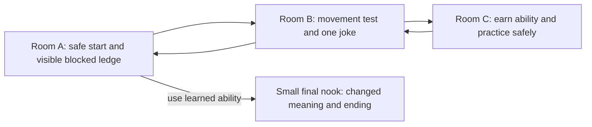

# Mechanics, dependencies and level storyboard

[← Previous](game-proposal.md) · [🏠 Home](../../README.md) · [🖼️ Visual library](../../references/README.md) · [Next →](../design/art-and-audio.md)

Status: proposed option A. Substitute if Vatsal chooses another loop.

> This earlier route sketch stays as an option. The loop still needs a funny situation and a payoff worth discovering; [the pun drawer](../design/play-and-puns.md) offers alternatives rather than extra mandatory mechanics.

| Read a place | Try something surprising | Return and notice the change |
| --- | --- | --- |
|  |  |  |

*Existing-game visual prompts, not screenshots of our level: Team Cherry, Shared Memory and ConcernedApe. The exact scenes do not depict the proposed sequence. Click for credits; use the three beats to sketch an original joke.*

## Systems and costs

| Mechanic | Requires | Feedback / test | Cut response |
| --- | --- | --- | --- |
| Walk and jump | Input, collision, grounded state, camera limits | Immediate response; land on narrow platform without snagging | Keep; simplify slopes/platform shapes |
| One traversal unlock | Stable movement, state flag, readable pickup/tutorial space | Player practices safely immediately after pickup | Keep one ability; remove second ability |
| Ability gate | Authored level geometry, an earlier view, return connection | Cannot cross early; can cross after unlock; no softlock on return | Replace complex gate with obvious gap |
| Hazard / retry | Collision tags, reset state, invulnerability or safe spawn | Die twice, retry, still reach exit | Replace enemy AI with static hazard |
| One interaction | Range test, input edge, one dialogue/sign view | Cannot trigger repeatedly by holding key | Use a single sign or visual reaction |
| Ending / restart | Goal trigger, scene reset, input focus | Complete twice without stale state | Keep; remove cinematic |

Possible upgrades multiply costs: combat requires anticipation, attack/hurt/recovery animations, hitboxes, health, cooldowns and balancing. Loot requires inventory/economy/UI. Procedural rooms require solvability and gate validation. These are new systems, not free content.

## Room graph

The final nook belongs to A; it is not a fourth production-sized room. Use one continuous tilemap with bounded camera regions if that is simpler than scene transitions.

## Storyboard and first playthrough

| Beat | Image composition | Player action | Meaning / implementation |
| --- | --- | --- | --- |
| 0–20 s | Player silhouette against quiet background; reachable route right, blocked ledge also visible | Walk, jump | Teach with geometry; short controls line, no cutscene |
| 20–60 s | One visual absurdity on the route; hazard clearly separated from decoration | Cross obstacle, optionally read one line | Humor uses one prop/sign, not dialogue trees |
| 60–120 s | Pickup isolated with the relevant obstacle directly beyond it | Gain and practice ability | Short input cue and contrasting gate silhouette |
| 120–200 s | Familiar space now traversed differently; view to starting ledge | Return and cross gate | Reuse map/art; player recognizes their own progress |
| 200–300 s | An earlier joke/prop now has a second interpretation | Final interaction, restart available | A changed pose or short line can deliver depth cheaply |

Times are targets for testing, not a promised runtime. Allow faster and slower routes.

## Controller feel and accessibility

Prototype coyote time and jump buffering as tuning proposals, not mandatory complexity. Prefer generous safe landings and a short retry. Inputs must release on blur; pause must not break the state machine. Show keyboard controls and a visible restart. Do not make progress depend only on color, sound or a one-time text message. Avoid flashing effects and camera shake by default.

## Playtest notes template

Tester / build commit / browser / hardware; time to first movement; missed route cues; deaths and reasons; ability understood without explanation; total time; funniest/most memorable moment; blocker; resulting change. Ask what they thought they could do before telling them the intended solution.

[← Previous](game-proposal.md) · [🏠 Home](../../README.md) · [🖼️ Visual library](../../references/README.md) · [Next →](../design/art-and-audio.md)
