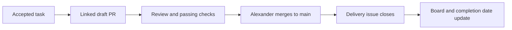

# GitHub automation – prepare now, activate after the game design

[← Workspace status](../github-workspace.md) · [Home](../../README.md) · [THD Room Finder model](https://github.com/arudaev/THD-Room-Finder/blob/main/docs/contributing/project-board.md)

**Deferred implementation.** Alexander asked on 21 October 2026 to follow THD Room Finder's issue/project organization and automation once WinCS actually has a game and the game technical design document is concluded. This document records that requirement; it does not create issues, a board, credentials or new Actions workflows now. The existing document checks remain active.

## What merging should do

The maintainer still chooses when to merge. Automating issue linkage and completion does not authorize auto-merging PRs. A PR closed without merging is abandoned work, not a delivered game change.

Use `Closes #N` for the actual deliverable in a PR targeting main. GitHub can create the link and close that issue when the PR merges into the default branch; no custom closing bot is necessary. Use `Refs #N` for background/umbrella context without closing the referenced issue. [GitHub's documented linking behavior](https://docs.github.com/en/issues/tracking-your-work-with-issues/using-issues/linking-a-pull-request-to-an-issue).

For dependent stacks, a merge into another feature branch does not complete the issue. Preserve explicit delivery references for custom synchronization, then check the final default-branch result. Never close an epic merely because one child layer merged.

## Organize chosen game work like THD Room Finder

| Part | Future WinCS convention |
| --- | --- |
| Issues | Small deliverables with player outcome, acceptance criteria, owner, verification, asset provenance where relevant and explicit dependencies |
| Types / areas | Epic, story, task, spike, bug; game areas such as gameplay, level, art/audio, tooling and delivery, selected from the accepted design |
| Hierarchy | Native parent/sub-issues for real outcomes; native blocked-by relationships for genuine dependencies |
| Status | Backlog · Ready · In progress · In review · Blocked · Done |
| Triage fields | Priority, size/time budget and milestone/phase only where useful; never invent estimates or dates |
| Dates | Start on the first observed active state; completed on real closure/merge; target only for an actual agreed deadline |
| PRs | One coherent task per branch/PR; same branch for fixes; small stacks only for real dependencies |
| Design approval | Human decision, separate from code review and delivery; an attractive mockup is not a finished feature |

Use a few focused views: **Open work** board, **Pull requests** review queue, **Milestones** with sub-issue progress, **Waiting** for blockers, and **Completed** history. Add a **Prototype/design** view only if the team needs it. Keep epics, blocked work and speculative future mechanics out of the daily active-work view. Retain completion history; distinguish merged delivery from abandoned or not-planned work.

## Automation contract for the later implementation

| Event | Expected result | Mechanism to evaluate |
| --- | --- | --- |
| Issue/PR opened | Add to the single configured private project; new work starts Backlog | Native auto-add and item-added defaults |
| Draft PR explicitly linked to a deliverable | PR and its delivery issue move In progress | Native link workflow plus metadata synchronization |
| PR ready for review | Move In review after the relevant readiness conditions | Project sync; preserve separate design approval |
| Changes requested | Return the active deliverable to In progress | Review events and current review state |
| Maintainer merges into main | Close only intended delivery issues; update cards/dates | Native closing keywords plus project sync |
| PR closed without merge | Do not close the delivery issue; return it to Ready only if no other active PR owns it | Project sync |
| Issue reopened | Clear completion date; use its active PR state, otherwise Ready | Native workflow plus sync |
| Last sub-issue completed | Label parent ready for acceptance; leave parent open for human acceptance | Sub-issue roll-up |
| PR opened/edited | Validate conventional title and explicit delivery link; apply area labels and assign author | PR conventions workflow |
| `/take` / `/drop` | Self-assign/unassign eligible issues | Issue-command workflow, if useful for this team |
| Missed/delayed event | Reconcile current state without duplicate project items or stale transitions | Manual and scheduled repair job |

Moving a card to Done must not close an issue by itself. A background `Refs` link must not claim, move or close an entire epic. Multiple active PRs for one task require considering all of them; a closed sibling must not reset active work. Ready, Blocked, priority, estimates, design approval and parent acceptance remain deliberate team decisions.

## Reuse the model, not its hardcoded settings

Reference implementation inspected in the local THD Room Finder checkout:

- [Project layout and automation contract](https://github.com/arudaev/THD-Room-Finder/blob/main/docs/contributing/project-board.md).
- [PR conventions](https://github.com/arudaev/THD-Room-Finder/blob/main/.github/workflows/pr-conventions.yml).
- [Project synchronization](https://github.com/arudaev/THD-Room-Finder/blob/main/.github/workflows/project-sync.yml) and [sync script](https://github.com/arudaev/THD-Room-Finder/blob/main/.github/scripts/project-sync.cjs).
- [Issue commands](https://github.com/arudaev/THD-Room-Finder/blob/main/.github/workflows/issue-commands.yml).
- [Sub-issue roll-up](https://github.com/arudaev/THD-Room-Finder/blob/main/.github/workflows/sub-issue-rollup.yml).

Re-read those sources when implementing; they can evolve. Adapt repository identity, new project/field IDs, areas, milestone names, permissions and the link parser to WinCS. Never copy Room Finder credentials, domain-specific phases, live issue numbers or project IDs. Native automation comes first; add custom scripts only for behavior it cannot provide.

Privileged metadata workflows must use trusted default-branch code, never execute an untrusted PR head, and use minimum permissions. Repository-token metadata operations and organization-Projects access are different permission scopes; choose a scoped GitHub App/token later, keep it in Actions secrets and fail clearly if it is missing or expired. Do not provision credentials now. Serialize updates, re-read current state and make reconciliation idempotent.

## Activation and acceptance checklist – later

1. Conclude the game technical design document and establish the game's actual implementation scope and team capacity.
2. Create the private project and chosen-game issues; configure native fields, views and workflows.
3. Implement and review the missing metadata automation in one coherent PR; no auto-merge or release automation is implied.
4. Check linking, draft/ready/review changes, default-branch merge, feature-branch stack merge, unmerged closure, reopening and multiple-PR ownership.
5. Check parent roll-up, duplicate/racing events, missed-event repair, missing credentials and trusted-code boundaries. Verify both the linked issue and the visible project state.
6. Document the actual configuration, ownership and credential rotation. Replace this deferred plan with verified operating instructions.

## PR follow-up in this chat

A chat follow-up can monitor its attached WinCS PRs for merge, closure without merge, failed checks or requested changes. This is separate from GitHub's future issue/project workflows. It reports meaningful changes rather than enabling auto-merge or creating tracking. The previous PR #11 is already verified merged; it is a baseline, not a new notification to repeat.

Use the app's scheduled-task configuration for the actual follow-up cadence; it is not a GitHub webhook or an instantaneous merge notification. Local scheduled checks need the app/computer and repository access available. [Official scheduled-task documentation](https://learn.chatgpt.com/docs/automations?surface=app).

[← Workspace status](../github-workspace.md) · [Home](../../README.md)
