# Pick a game. Follow your curiosity.

[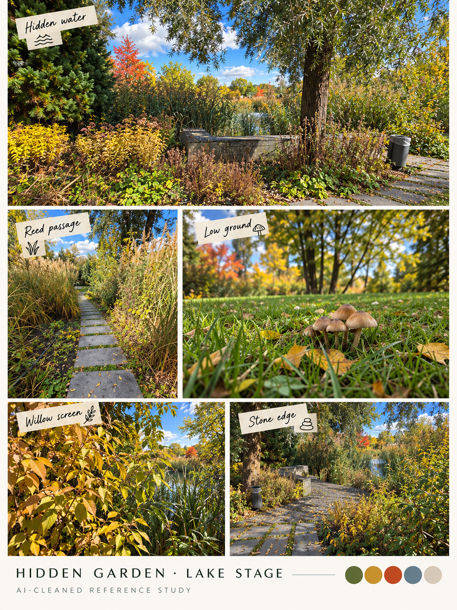](campus/README.md)

**[Eight campus location/item boards in route order](campus/README.md).** Hidden Garden → campus → Lost in the Green → crossings → stepping-stone creek → Toxic Garden; Playground/robot are optional material. [Terrain rhythm and changing-route diagrams](../docs/proposal/campus-game.md) connect the photos to mechanics. [Current proposal](../docs/proposal/campus-game.md) · [Voice notes](../docs/brief/voice-notes.md).

## Newly named in the recordings

| Reference | What to study |
| --- | --- |
| [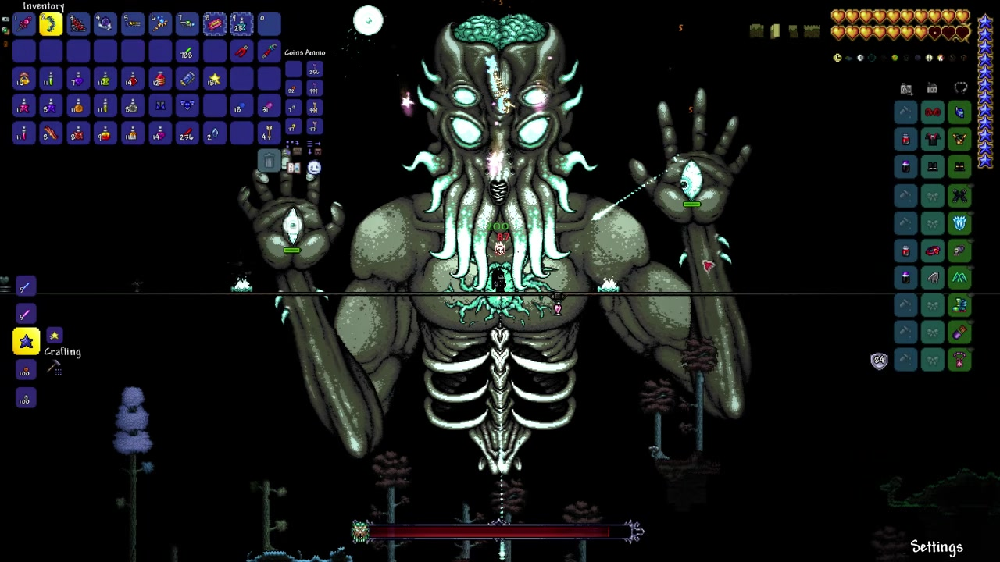](games/terraria/README.md) | [Terraria](games/terraria/README.md): Wall of Flesh and Moon Lord boss shapes/fights only |
| [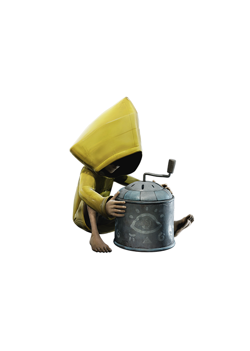](games/little-nightmares/README.md) | [Little Nightmares](games/little-nightmares/README.md): character silhouette, garment mass and proportions only |
| [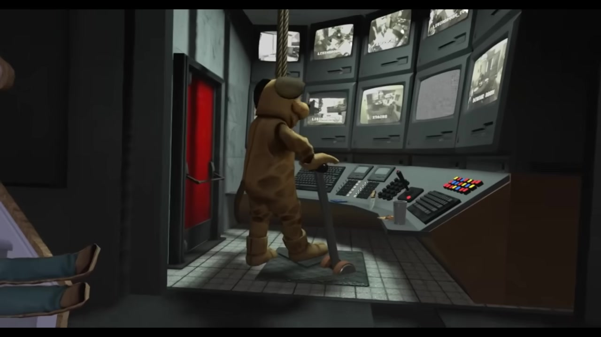](games/duck-season/README.md) | [Duck Season](games/duck-season/README.md): mascot escalation and contrasting endings |
| [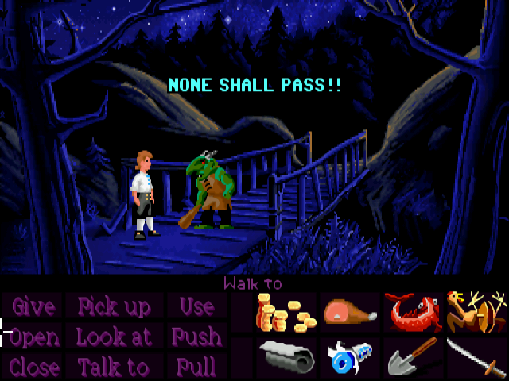](games/secret-of-monkey-island/README.md) | [The Secret of Monkey Island](games/secret-of-monkey-island/README.md): classic pixel contours, playful interactions and payoff |
| [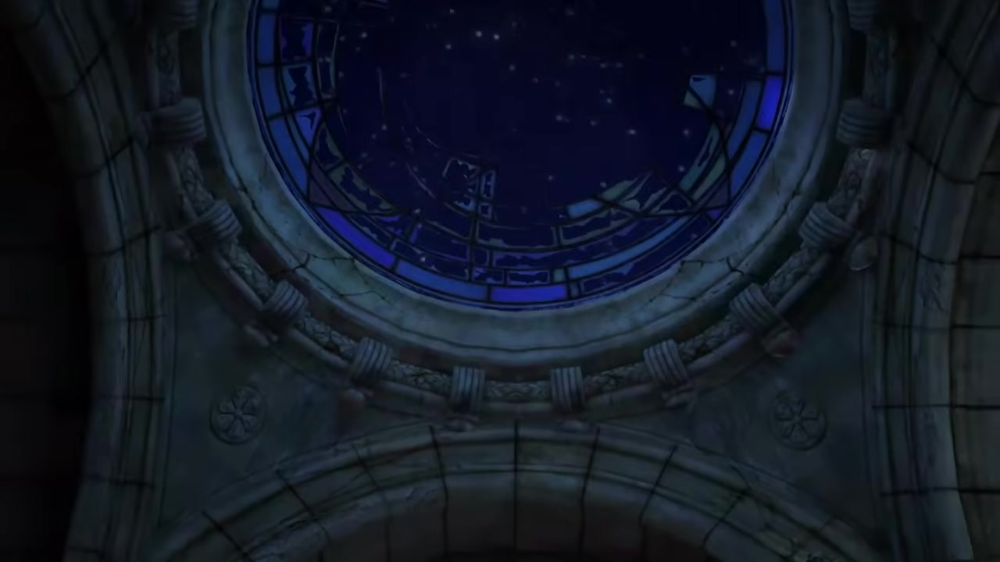](games/infinity-blade/README.md) | [Infinity Blade](games/infinity-blade/README.md): civilization built around incomprehensibly advanced remnants, read as ancient machinery or magic |

Also: [Playground trailer study with ten timestamped screenshots](animation/playground/README.md), tied to the real playground structure board. All commercial screenshots retain their rightsholders; none are runtime assets.

**Start with a picture, not a wall of text.** Click a frame to open its game study. Every study and gallery has Previous / Library / Next links at the top and bottom.

[▶ Start the guided trail: Hollow Knight](games/hollow-knight/README.md) · [🎲 The pun drawer](../docs/design/play-and-puns.md) · [🏠 Home](../README.md)

## Vatsal first, then the team’s other tastes

| Reference | What catches your eye? |
| --- | --- |
| [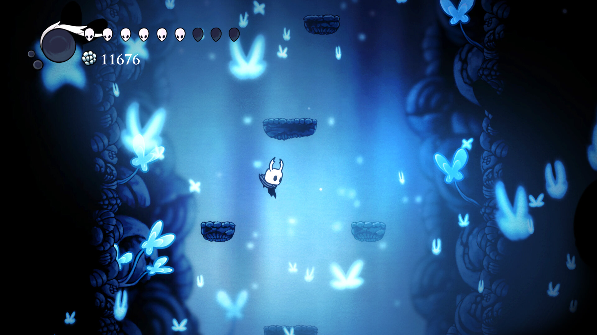](games/hollow-knight/README.md) | **[Hollow Knight](games/hollow-knight/README.md)** Vatsal’s starting point [More views + sources](games/hollow-knight/visual-reference.md) |
| [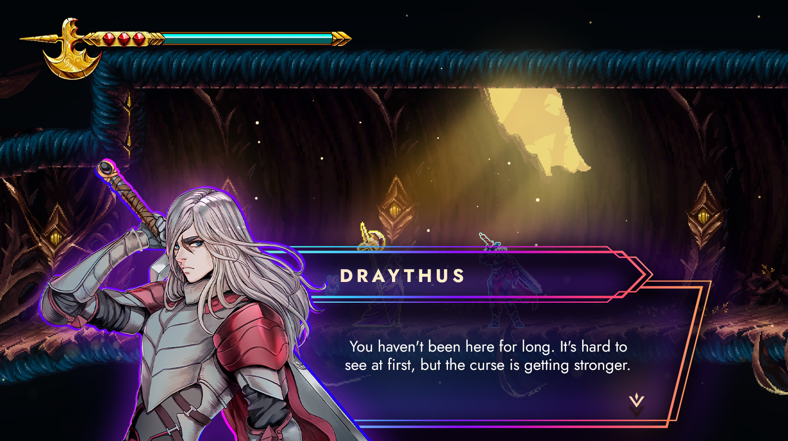](games/9-years-of-shadows/README.md) | **[9 Years of Shadows](games/9-years-of-shadows/README.md)** Pixel spectacle [More views + sources](games/9-years-of-shadows/visual-reference.md) |
| [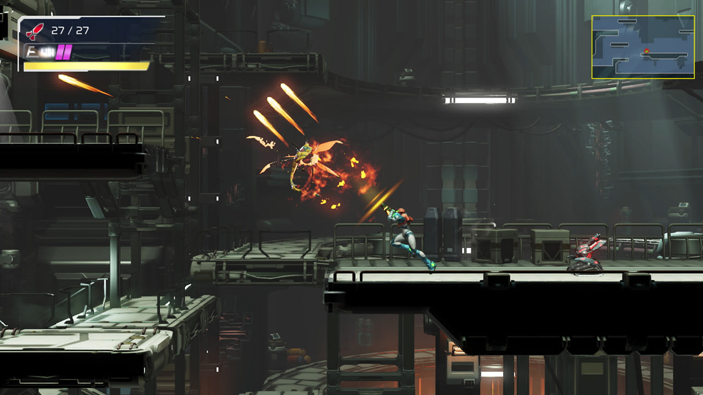](games/metroid-dread/README.md) | **[Metroid Dread](games/metroid-dread/README.md)** Learn a move, see a new route [More views + sources](games/metroid-dread/visual-reference.md) |
| [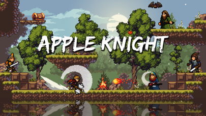](games/apple-knight/README.md) | **[Apple Knight](games/apple-knight/README.md)** Immediate platforming [More views + sources](games/apple-knight/visual-reference.md) |
| [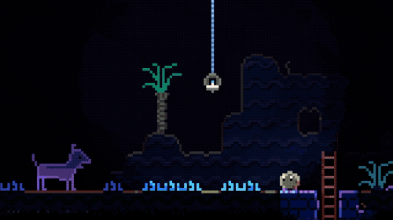](games/animal-well/README.md) | **[Animal Well](games/animal-well/README.md)** What happens if I try this? [More views + sources](games/animal-well/visual-reference.md) |
| [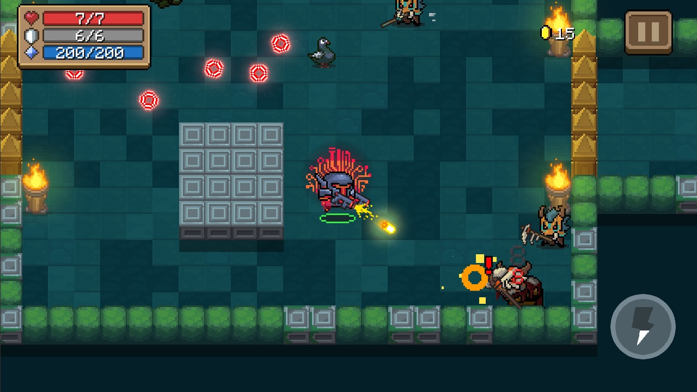](games/soul-knight/README.md) | **[Soul Knight](games/soul-knight/README.md)** A little readable chaos [More views + sources](games/soul-knight/visual-reference.md) |
| [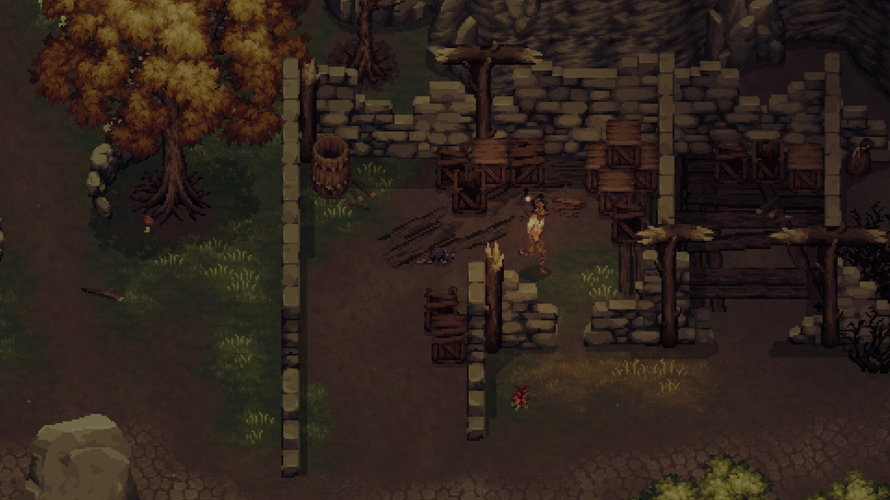](games/drova-forsaken-kin/README.md) | **[Drova – Forsaken Kin](games/drova-forsaken-kin/README.md)** A place with a life of its own [More views + sources](games/drova-forsaken-kin/visual-reference.md) |
| [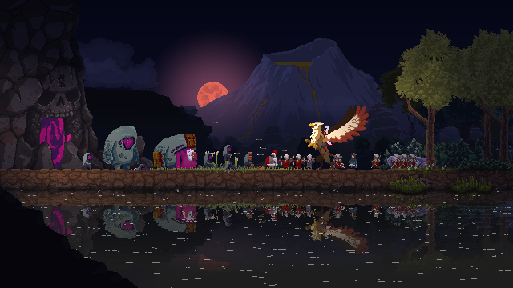](games/kingdom-two-crowns/README.md) | **[Kingdom Two Crowns](games/kingdom-two-crowns/README.md)** Tiny controls, large consequences [More views + sources](games/kingdom-two-crowns/visual-reference.md) |
| [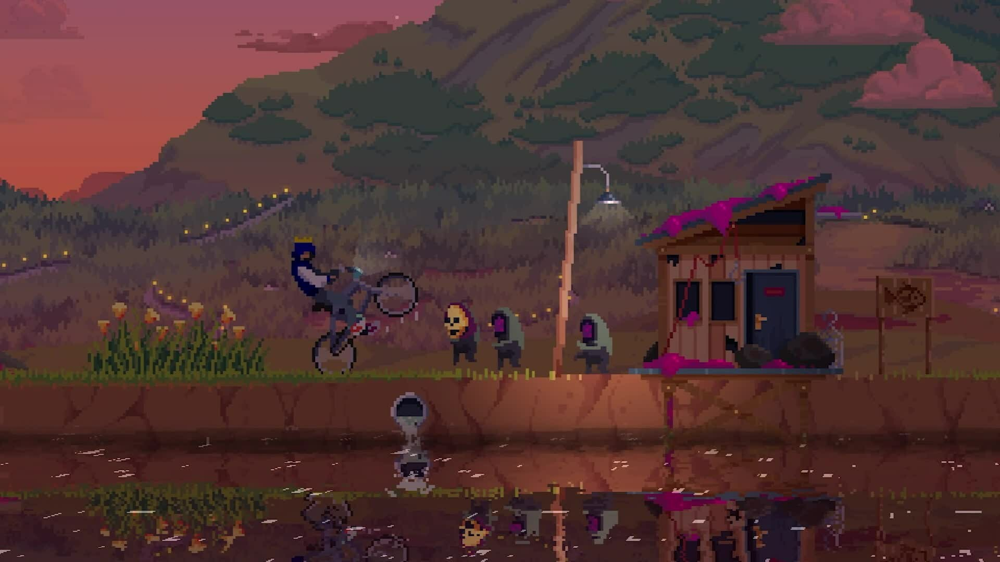](games/kingdom-eighties/README.md) | **[Kingdom Eighties](games/kingdom-eighties/README.md)** Ordinary places, strange trouble [More views + sources](games/kingdom-eighties/visual-reference.md) |
| [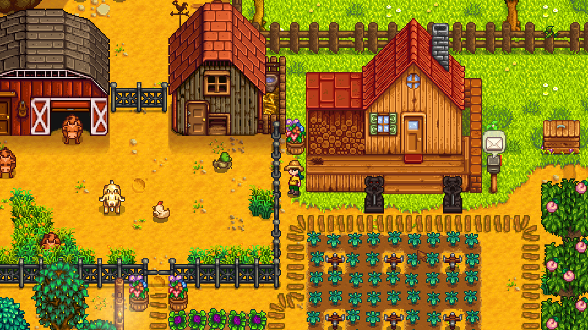](games/stardew-valley/README.md) | **[Stardew Valley](games/stardew-valley/README.md)** Small acts, visible changes [More views + sources](games/stardew-valley/visual-reference.md) |
| [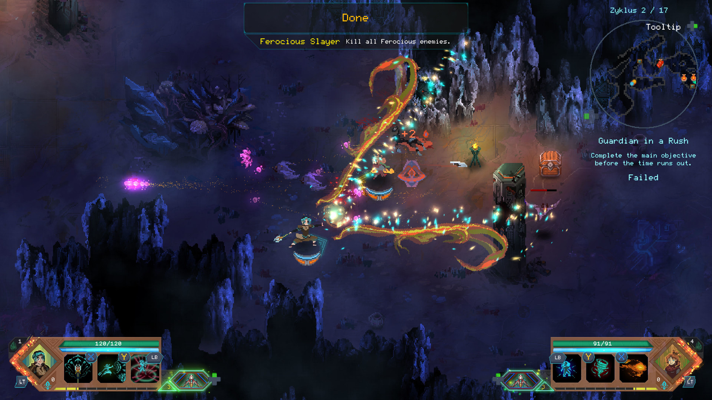](games/children-of-morta/README.md) | **[Children of Morta](games/children-of-morta/README.md)** Pixel design and magic/effects [More views + sources](games/children-of-morta/visual-reference.md) |
| [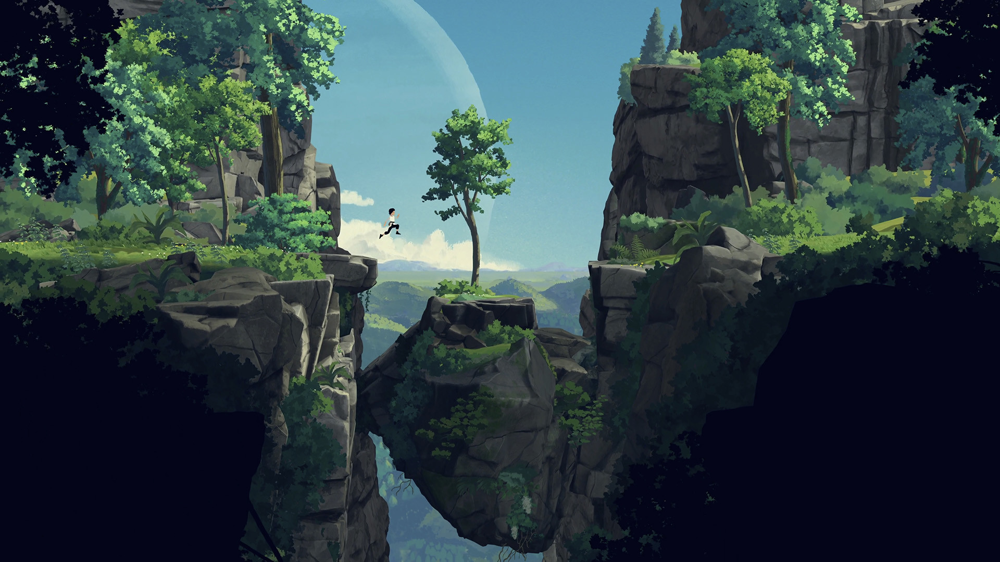](games/planet-of-lana/README.md) | **[Planet of Lana](games/planet-of-lana/README.md)** Let the picture tell it [More views + sources](games/planet-of-lana/visual-reference.md) |
| [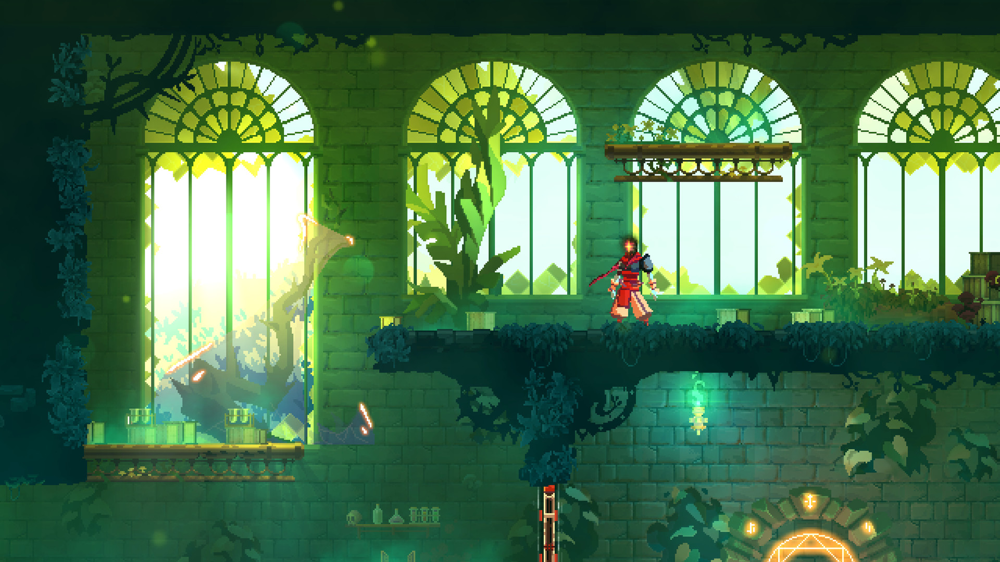](games/dead-cells/README.md) | **[Dead Cells](games/dead-cells/README.md)** Overgrown Arboretum greenhouse [More views + sources](games/dead-cells/visual-reference.md) |

## Connect the dots

[Compare mechanics and visual qualities](comparison.md) · [Keep exploring playful ideas](../docs/design/play-and-puns.md) · [Existing proposal](../docs/proposal/game-proposal.md)

Pick one moment you want to try, one detail that makes you smile, and one expensive system we can leave behind. Vatsal’s Hollow Knight reference leads; the rest offers possibilities, not a checklist to combine.

## Notes for your notebook

These are standard relative Markdown links and image embeds, with explicit backlinks. Open the cloned folder in Obsidian or Logseq, or browse on GitHub; no plugin or app-specific wiki syntax is required. Animated GIFs remain animated in readers that support them. Gameplay/trailer links are available on each game page; playback has not been verified for every source.

The library covers all 18 named games, with additional targeted galleries and two animated Lana process demonstrations. [Lana layers](games/planet-of-lana/layers-and-motion.md) and [Playground trailer frames](animation/playground/README.md) connect the pictures to the proposed stage workflow. Images here remain third-party private research references, not our game or a runtime asset pack. See each gallery for original URLs, credits and hashes, and [NOTICE](../NOTICE.md) for rights. Research collected 21–22 October 2026.

[▶ Start the trail](games/hollow-knight/README.md) · [🏠 Home](../README.md)
