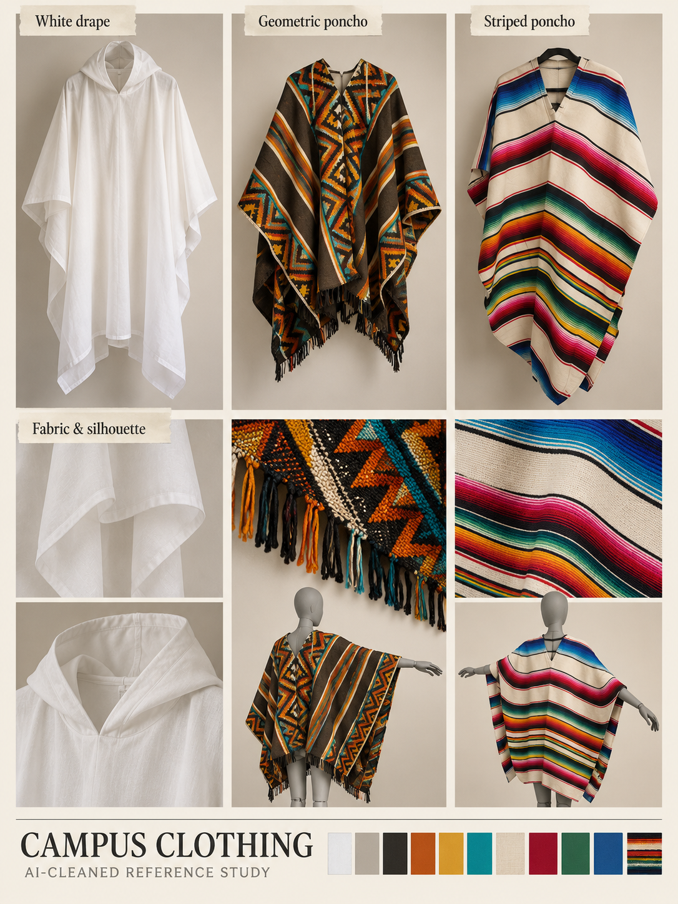

# Clothing and player silhouette

[← Previous](signposts.md) · [Library](README.md) · [Next →](chair.md)

**Three garments, one readable silhouette.** AI-cleaned photographic reference, 23 October 2026; not a runtime asset, measured model or animation sheet.

**Observed:** White draped hooded garment; geometric orange/black/turquoise poncho; striped cream/red/green/blue serape.

**Proposed use:** Candidate costume mass, hem motion and palette. The campus hoodie is discussed but not photographed. Choose one base silhouette before making animation.

**Review limits:** Generated mannequin wear and close-up fabric views are reconstructed, not photographed turnaround evidence.

Source IDs: N01, N02, N03. Every input was visually reviewed, including near-duplicate angles; the collage selects representative views rather than displaying every original. [Photo inventory](source-index.json) · [Exact prompts](prompts.json) · [Output provenance](media-sources.json) · [Meeting summary](../../docs/brief/meeting-2026-10-23.md).

[← Previous](signposts.md) · [Library](README.md) · [Next →](chair.md)
