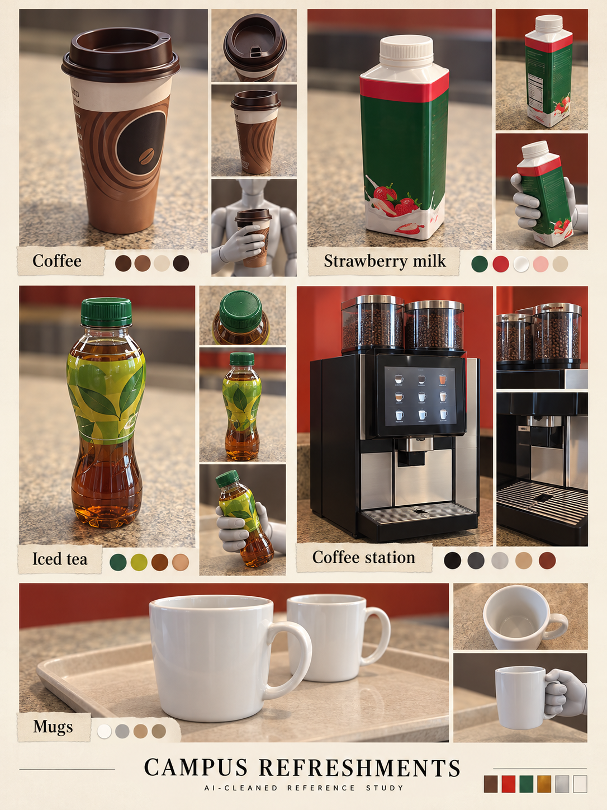

# Drinks and refreshment props

[← Previous](food-boss.md) · [Library](README.md) · [Next →](technology.md)

**A very ordinary resupply station.** AI-cleaned photographic reference, 23 October 2026; not a runtime asset, measured model or animation sheet.

**Observed:** Brown coffee cup/carton; strawberry milk bottle; green-cap iced tea; twin-hopper coffee machine; white mugs.

**Proposed use:** Possible pickup vocabulary or station prop. Choose at most one simple effect after the core loop works; no separate consumables/economy system is implied.

**Review limits:** Brand lettering is removed or abstracted. Held-product inserts and unseen packaging details are generated interpretation; drinks are not assigned health/speed values.

Source IDs: N04, N05, N06, N07, N08, N09, N10, N11, N20, N21, N22, N23. Every input was visually reviewed, including near-duplicate angles; the collage selects representative views rather than displaying every original. [Photo inventory](source-index.json) · [Exact prompts](prompts.json) · [Output provenance](media-sources.json) · [Meeting summary](../../docs/brief/meeting-2026-10-23.md).

[← Previous](food-boss.md) · [Library](README.md) · [Next →](technology.md)
