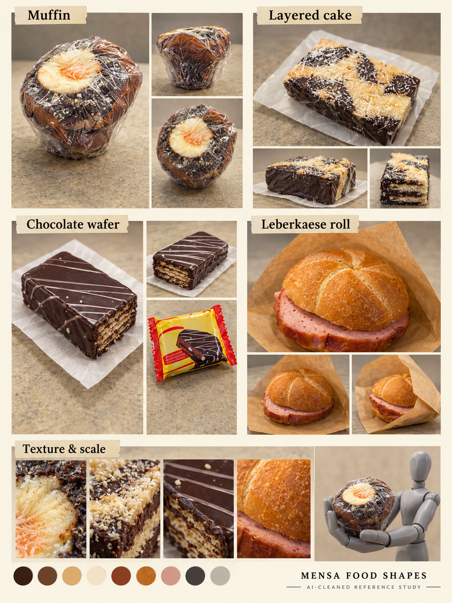

# Mensa food · pickups and boss shapes

[← Previous](robots.md) · [Library](README.md) · [Next →](drinks.md)

**Lunch can wait. Or can it?.** AI-cleaned photographic reference, 23 October 2026; not a runtime asset, measured model or animation sheet.

**Observed:** Muffin with pale center; dark/light layered cake; chocolate-coated wafer; round Leberkaese roll in paper.

**Proposed use:** Owner requests potential food-boss material. Optional original encounter seed: The Lunch Rush, a roll that winds up, rolls across a lane and pauses exposed. This is a new design suggestion, not a recorded team choice. Food pickups and defense jokes remain alternatives.

**Review limits:** No monster is fabricated inside the food reference board. Mannequin scale and reconstructed food surfaces are illustrative, not measurements. Boss silhouette, tells, hit region and budget are still open.

Source IDs: N12, N13, N14, N15, N16, N17, N18, N19, N24, N25, N26. Every input was visually reviewed, including near-duplicate angles; the collage selects representative views rather than displaying every original. [Photo inventory](source-index.json) · [Exact prompts](prompts.json) · [Output provenance](media-sources.json) · [Meeting summary](../../docs/brief/meeting-2026-10-23.md).

[← Previous](robots.md) · [Library](README.md) · [Next →](drinks.md)
