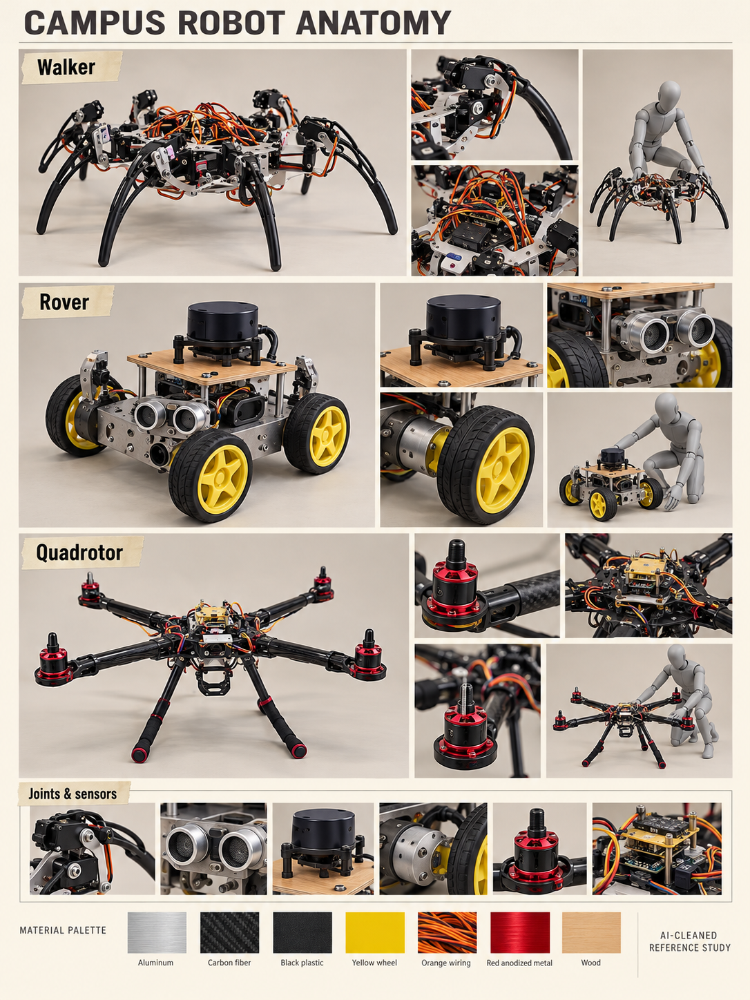

# Robots · potential enemies

[← Previous](tray.md) · [Library](README.md) · [Next →](food-boss.md)

**Walker, rover, drone.** AI-cleaned photographic reference, 23 October 2026; not a runtime asset, measured model or animation sheet.

**Observed:** Exposed six-legged walker, four yellow-wheel sensor rover and open-frame quadrotor, with wiring and joint detail.

**Proposed use:** Original enemy silhouettes can borrow mechanical vocabulary: grounded rover first, walker later, hard-to-kill drone as avoidance pressure. The earlier cute campus robot remains an optional collectible, not automatically hostile.

**Review limits:** Glass glare and cabinet clutter removed. Scale mannequins, reconstructed parts and detail crops are interpretive; no measured scale or verified joint rig. Do not copy the university projects as shipped designs.

Source IDs: N27, N28, N29, N30, N31, N32, N33, N64, N65, N66, N67. Every input was visually reviewed, including near-duplicate angles; the collage selects representative views rather than displaying every original. [Photo inventory](source-index.json) · [Exact prompts](prompts.json) · [Output provenance](media-sources.json) · [Meeting summary](../../docs/brief/meeting-2026-10-23.md).

[← Previous](tray.md) · [Library](README.md) · [Next →](food-boss.md)
