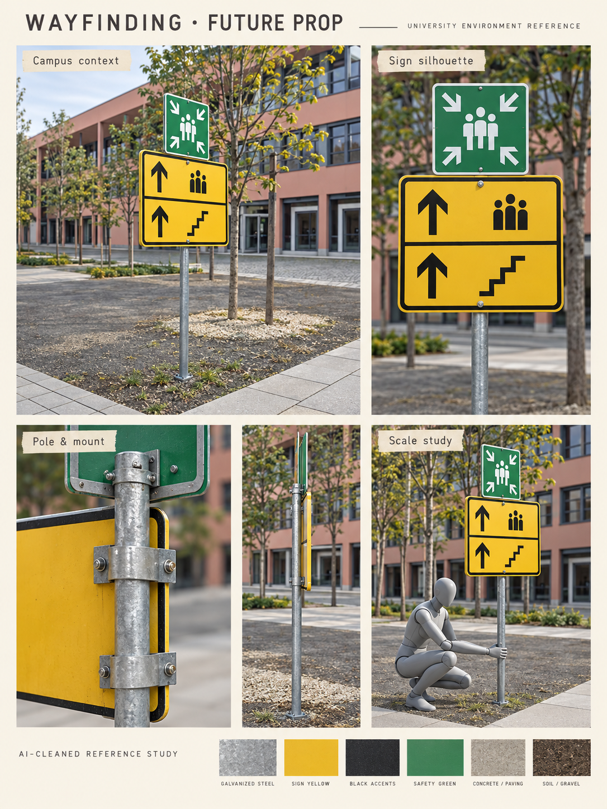

# Wayfinding and future pole props

[← Previous](technology.md) · [Library](README.md) · [Next →](clothing.md)

**Even the directions feel suspicious.** AI-cleaned photographic reference, 23 October 2026; not a runtime asset, measured model or animation sheet.

**Observed:** Slender galvanized post, two yellow outlined panels, upward arrows and green assembly-point pictogram beside campus buildings.

**Proposed use:** Possible later pole-weapon or navigation joke. Preserve the shape/material reference without adopting the original slogan or the off-topic jokes as game dialogue.

**Review limits:** Original wording is replaced with neutral arrows/glyphs; people become a mannequin or are removed. This is design interpretation, not a documentary image of campus signage or evidence of a weapon demonstration.

Source IDs: N60, N61, N62, N63. Every input was visually reviewed, including near-duplicate angles; the collage selects representative views rather than displaying every original. [Photo inventory](source-index.json) · [Exact prompts](prompts.json) · [Output provenance](media-sources.json) · [Meeting summary](../../docs/brief/meeting-2026-10-23.md).

[← Previous](technology.md) · [Library](README.md) · [Next →](clothing.md)
