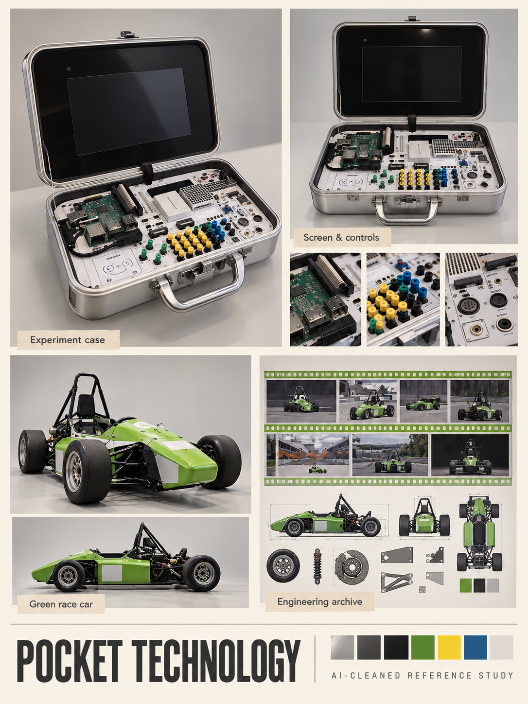

# Technology and future upgrades

[← Previous](drinks.md) · [Library](README.md) · [Next →](signposts.md)

**An experiment that fits in a suitcase.** AI-cleaned photographic reference, 23 October 2026; not a runtime asset, measured model or animation sheet.

**Observed:** Open silver experiment case with black lid screen and exposed board/terminals; green student racing-car poster motifs.

**Proposed use:** Case/map-information upgrade is discussed; transformation into a building is an unselected idea. Race-car imagery is future mechanical inspiration, not a promised vehicle or weapon.

**Review limits:** Case controls are reconstructed. Race-car views are inferred from poster pictures, not direct vehicle photographs; team faces/history are replaced by abstract graphics. Not a measured engineering model.

Source IDs: N34, N35, N36, N37. Every input was visually reviewed, including near-duplicate angles; the collage selects representative views rather than displaying every original. [Photo inventory](source-index.json) · [Exact prompts](prompts.json) · [Output provenance](media-sources.json) · [Meeting summary](../../docs/brief/meeting-2026-10-23.md).

[← Previous](drinks.md) · [Library](README.md) · [Next →](signposts.md)
