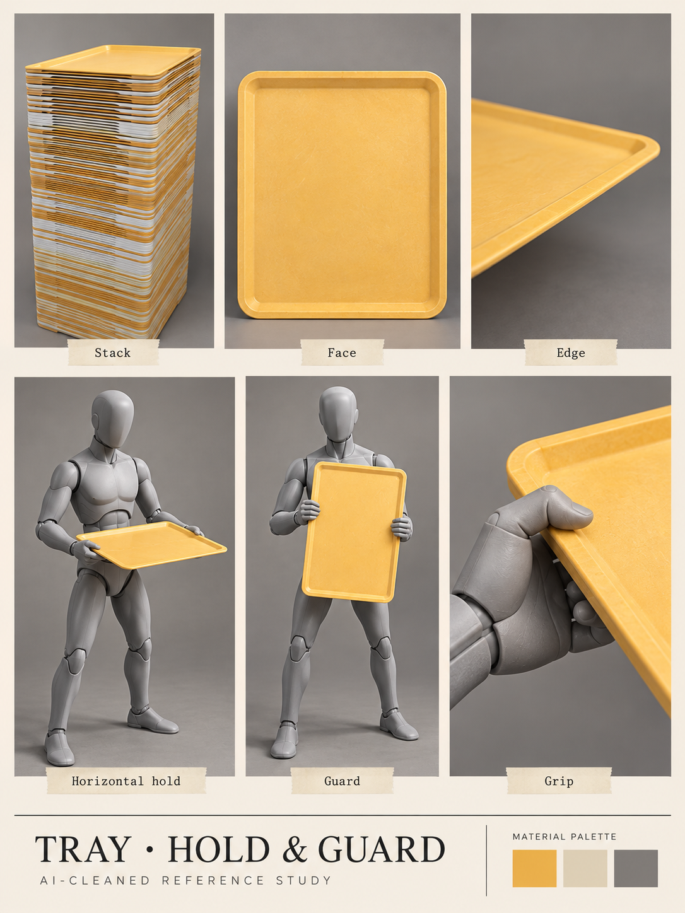

# Tray · hold and guard

[← Previous](chair.md) · [Library](README.md) · [Next →](robots.md)

**Lunch service becomes equipment.** AI-cleaned photographic reference, 23 October 2026; not a runtime asset, measured model or animation sheet.

**Observed:** Mustard-yellow shallow rectangular tray, rounded corners and raised lip; stack, face, edge and demonstrated horizontal/vertical holds.

**Proposed use:** A12 proposes a later returning throw for kiting. Owner also requests attack/block studies. The photos establish holds/guard, not an airborne tray path or full attack cycle.

**Review limits:** People become neutral mannequins. Throw, catch, down/up attacks and collision timing remain future original animation work.

Source IDs: N41, N42, N43, N44, N45, N46, N47. Every input was visually reviewed, including near-duplicate angles; the collage selects representative views rather than displaying every original. [Photo inventory](source-index.json) · [Exact prompts](prompts.json) · [Output provenance](media-sources.json) · [Meeting summary](../../docs/brief/meeting-2026-10-23.md).

[← Previous](chair.md) · [Library](README.md) · [Next →](robots.md)
