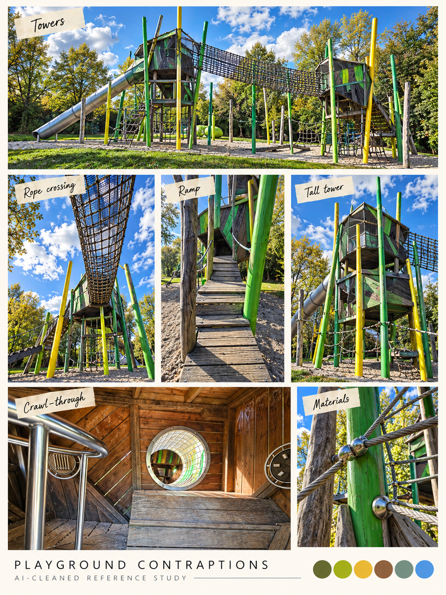
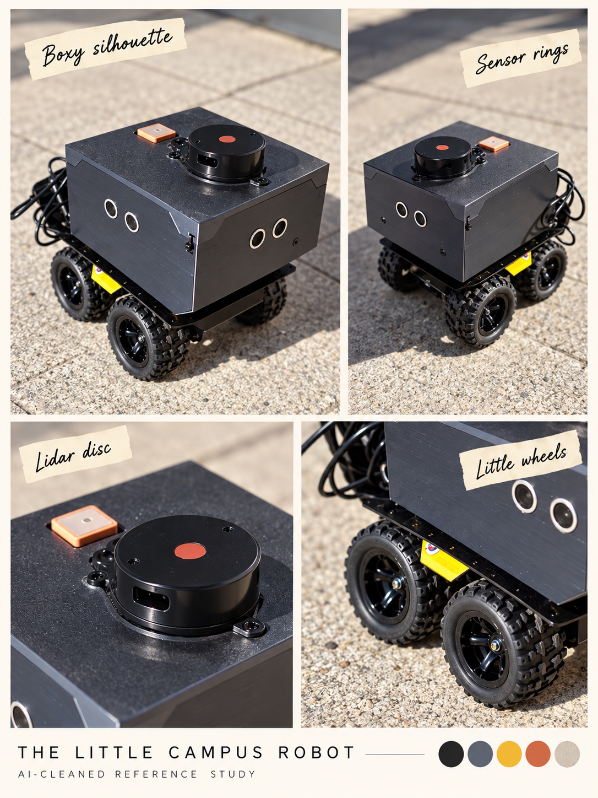

# Campus field notes · a route through the glitch

[← Game references](../README.md) · [Home](../../README.md) · [Read the proposal →](../../docs/proposal/campus-game.md)

**Additional references:** [eight new object/action collages from 67 photos](../campus-objects/README.md) · [HTML review](../campus-objects/viewer.html). These complement the eight location boards below.

**You are in the campus photo-board library.** [Rusty Crossings source board](crossings.md#location-photo-board) · [🎨 Generated stage experiments](../production/README.md) · [Flat banners and seven layers](../production/crossings-strip/README.md). Generated art is a separate section; location Previous/Next stays within the eight boards.

**Lake touch → mirror arrival in Hidden Garden → campus ledges → Lost in the Green → rusty crossings → stepping-stone creek → Toxic Garden.** This is the proposed fictional route, not a geographical campus map or six promised jam levels. Playground is an optional detour with placement still open; the robot is an item. The current preference across nature stages is exploration/action, with hiding as an alternative. Visual image errors can mark villain influences without changing terrain.

| First, reveal a different world | Then, lose the familiar route | Finally, find a different rhythm |
| --- | --- | --- |
|  |  |  |
| [1. Hidden Garden / lake](hidden-gardens.md) | [3. Lost in the Green](lost-in-the-green.md) | [5. Creek / reflections](creek.md) |
|  |  |  |
| [2. Campus ledges](campus.md) | [4. Rusted-bar maze](crossings.md) | [6. Toxic Garden](toxic-garden.md) |

| Optional horror detour | Optional collectible |
| --- | --- |
|  |  |
| [Playground + animation reference](playground.md) | [Cute robot item](campus-robot.md) |

Eight cleaned photographic boards organize 59 owner-supplied photos. They are interpretations, not final pixel art, measured geometry or a collision map. The [source index](source-index.json) preserves every original ID; [generation notes](generation.md) record inputs, prompts, hashes and reconstruction limits. Raw photos, portraits, recordings and unredacted transcripts stay outside Git.

Use Previous / Library / Next through the eight location/item studies. The first six follow the proposed main route; Playground and robot follow as optional material. Sources can inform more than one design study without duplicating the original files.

**Current production study:** a new flat side-scroller layout based on the collage → left/center/right banners → staggered join windows → traversal additions → five-plus depth roles. [See all 15 generated trials](../production/crossings-strip/README.md); seams and extraction are still under review. [Layered stage workflow](../../docs/design/layered-stage-workflow.md) · [Current proposal](../../docs/proposal/campus-game.md).
