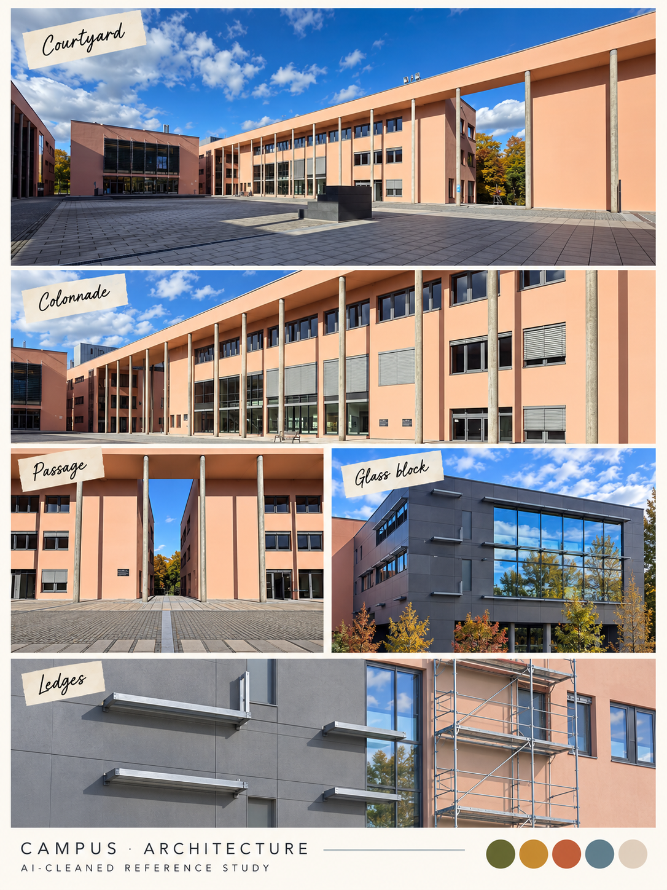

# Campus · architecture and landmarks

<!-- reference-navigation:start -->
[← Previous: Hidden Garden / lake](hidden-gardens.md) · [Campus index](README.md) · **2 / 8** · [Next: Lost in the Green →](lost-in-the-green.md)

[📍 Campus boards](README.md) · [🎮 Game studies](../README.md) · [🎨 Stage experiments](../production/README.md) · [Proposal](../../docs/proposal/campus-game.md)
<!-- reference-navigation:end -->

**Proposed stage 2, between Hidden Garden and Lost in the Green.** Peach walls, long colonnades, window rhythm, grey glass blocks and scaffolding are recognizable motifs.

Proposed use: a short recognizable architecture/ledge passage where image-level cuts, stretched rows or repeated window imagery show a villain influence. A stable doorway/window rhythm gives a landmark while the image becomes unreliable. Physical ledge/passage changes are an optional separate mechanic, not the default visual bug. A repeated window rhythm helps continuity; a distinctive passage gives the player a landmark. Do not turn every window into a platform or assume scaffolding requires a new climbing system.

Sources C01–C02 and C15–C19 in [source-index.json](source-index.json). Crop human subjects, signs and incidental clutter. The collage consolidates angles and reconstructs details; use original photos later if exact architecture matters.

<!-- reference-navigation:start -->
[← Previous: Hidden Garden / lake](hidden-gardens.md) · [Campus index](README.md) · **2 / 8** · [Next: Lost in the Green →](lost-in-the-green.md)

[📍 Campus boards](README.md) · [🎮 Game studies](../README.md) · [🎨 Stage experiments](../production/README.md) · [Proposal](../../docs/proposal/campus-game.md)
<!-- reference-navigation:end -->
