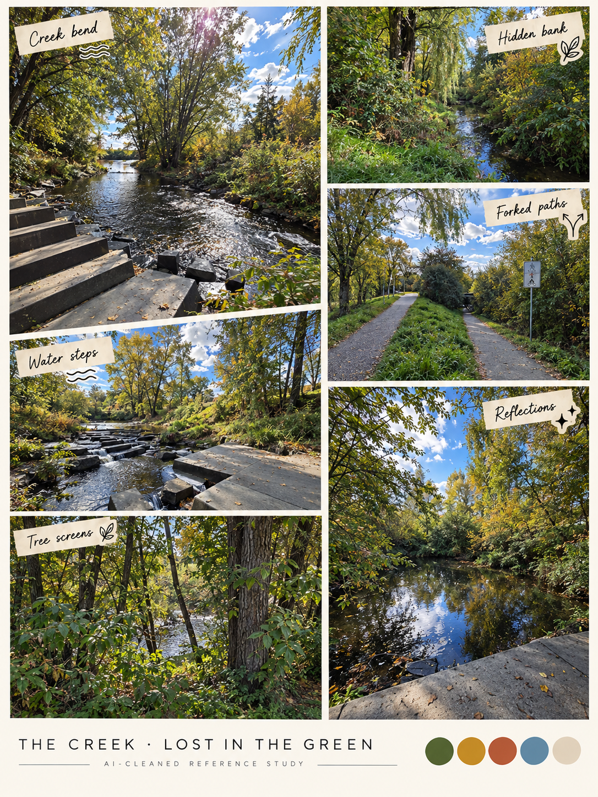

# The creek · pleasantly lost, reliably found

[← Campus](campus.md) · [Library](README.md) · [Next: crossings →](crossings.md)

**Confusing is the intended identity.** This is the leafy, winding location, separate from the rusty bridge-crossing parkour space.

Repeated trees, bends, partial water views and vegetation screens can make a route feel uncertain. Proposal: one short wrong turn with a reward, one recognizable landmark and a clear way back. Do not use invisible collision, identical mandatory branches or offscreen deaths as confusion. A plant foreground mask can occlude scenery without hiding the player's landing point.

**Layer candidates:** far canopy, stream, opposite bank, near reeds, traversable bank, front trunk. Water movement and sound can suggest direction; no hydraulic simulation is needed. Keep the bridge geometry on the [crossings board](crossings.md).

Sources C20–C22 and C28–C32. These are multiple views, not proof of a looping maze. Side-on path and creek-boundary photos remain useful future additions.

[← Campus](campus.md) · [Library](README.md) · [Next: crossings →](crossings.md)
