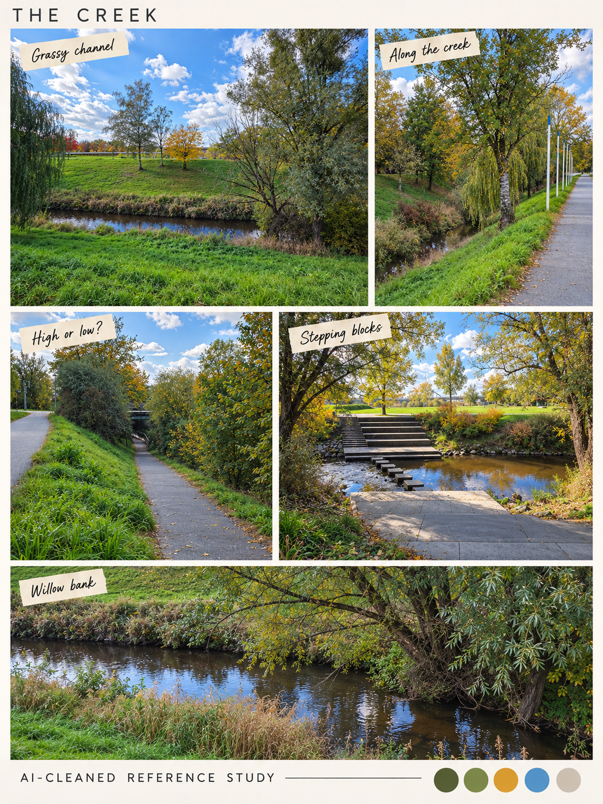

# The creek · pleasantly lost, reliably found

[← Campus](campus.md) · [Library](README.md) · [Next: crossings →](crossings.md)

**Confusing is the intended identity.** This is the grassy creek-and-path location, separate from the rusty bridge-crossing parkour space.

**Regenerated from scratch from original photographs**, using no previous creek collage as input. Open grassy banks, a narrow channel, straight path segments, high/low routes and stepping blocks remain visible. The earlier forked-route interpretation is rejected.

Confusion belongs in the authored stage: repeated landmarks, partial water views and screened turns can make a route feel uncertain without pretending the photographs already show a maze. Proposal: one short wrong turn with a reward, one recognizable landmark and a clear way back. Do not use invisible collision, identical mandatory branches or offscreen deaths as confusion. A plant foreground mask can occlude scenery without hiding the player's landing point.

**Layer candidates:** far canopy, stream, opposite bank, near reeds, traversable bank, front trunk. Water movement and sound can suggest direction; no hydraulic simulation is needed. Keep the bridge geometry on the [crossings board](crossings.md).

Reviewed sources C20–C22 and C28–C32; direct generation inputs C20, C21, C22 and C29 plus the layout example. These are multiple views, not proof of a looping maze. [Exact regeneration prompt](prompts.json) and [provenance/review](generation.md). Side-on path and creek-boundary photos remain useful future additions.

[← Campus](campus.md) · [Library](README.md) · [Next: crossings →](crossings.md)
