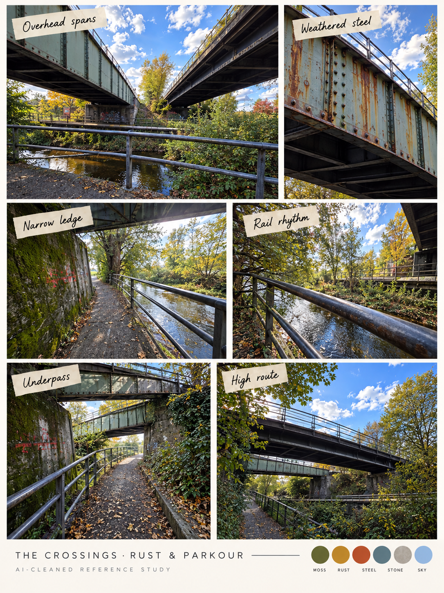

# The crossings · rust and parkour

[← Creek](creek.md) · [Library](README.md) · [Next: playground →](playground.md)

**An industrial traversal location.** Alexander requested rusty exteriors and a more parkour-oriented environment, separate from the confusing creek.

Low overhead spans, rails, narrow paths and vertical supports suggest a clear direction of movement. Proposal: a short sequence of safe landing → jump → low passage → raised exit. A higher route should be seen from below before it is reached. Rail grabs, wall jumps and rope physics are separate scope decisions; the photo of a railing does not require all three.

**Material direction:** weathered metal, rust accents, mossy masonry, cold shade and a bright exit. Photographed corrosion is a reference; heavier rust is an art-direction interpretation. Keep useful silhouette breaks instead of filling every empty space with debris.

Sources C23–C27. Requested parkour positions must first be tested in the greybox; a generated photograph cannot establish reachable jump distances.

[← Creek](creek.md) · [Library](README.md) · [Next: playground →](playground.md)
