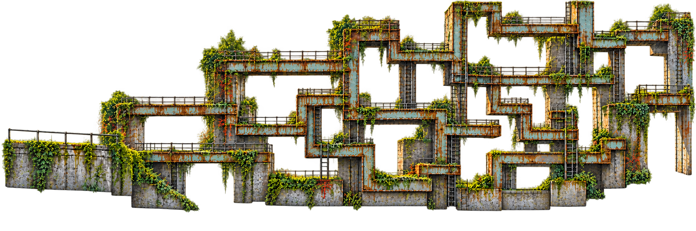

# Rusty Crossings · a maze of rusted bars

<!-- nav:start -->
[← Lost in the Green · grassy channels and screened routes](lost-in-the-green.md) · [Campus collages](README.md) · **4 / 8** · [The creek · stepping stones, reflections and a rise–dip rhythm →](creek.md)
<!-- nav:end -->

**This board became [Rusty Creek](../../art/stages/rusty-creek/README.md)**, the first level: the creek, rails and riveted steel from these photos, rebuilt as a flat side view with a girder maze.

**Latest direction, 23 October:** a recognizable creek/steel location redesigned as a **flat side-scroller**, not a perspective repaint. First a clean banner, then same-width extensions left/right and two staggered join views. Add the horizontal/vertical rusted-bar maze onto that accepted scene; derive five-plus depth/interaction roles afterwards. The algorithm/pathfinding villain seed guides the maze, while the collage's landmarks keep the place recognizable. **[See all banners and seven depth trials →](../../art/stages/rusty-creek/README.md)**

| Visual ingredient | Possible action/exploration use | Scope |
| --- | --- | --- |
| Horizontal bars, vertical connections and right-angle turns | Trace a route, choose a branch, discover a dead end or shortcut | Author one small viable route; no procedural maze required |
| Repeated intersections and loops | Search/pathfinding metaphor | A predetermined highlight is enough if selected; no search simulation assumed |
| Rust, concrete and attached vegetation | Distinguish structure from organic surroundings | Shared scene scale/material language |
| Background image sampled incorrectly | Cut/stretch/repeat pixels through maze openings | Visual-only default; no collision change implied |

The professor/degree connection is an owner-supplied **fictional villain premise**; portrait, name, encounter and degree-to-stage roster are not specified here. Earlier floor-deletion/rail-traversal sketches remain optional mechanics only.

## Location photo board

Source photos C23–C27 show overhead riveted spans, mossy concrete, tubular rails, creek and ivy. Keep those identifying motifs in the newly designed side-on game layout. Do not copy the photographic vanishing point or substitute a generic fantasy maze. The approved board remains unchanged. The added traversal pass is visible below; routes, seams and mask cleanup still need review.

The broad-platform, tall-shaft maze above is the traversal reference for the girders. How the stage is built: [09 – Art pipeline](../../docs/09-ART-PIPELINE.md).

<!-- nav:start -->
[← Lost in the Green · grassy channels and screened routes](lost-in-the-green.md) · [Campus collages](README.md) · **4 / 8** · [The creek · stepping stones, reflections and a rise–dip rhythm →](creek.md)
<!-- nav:end -->
