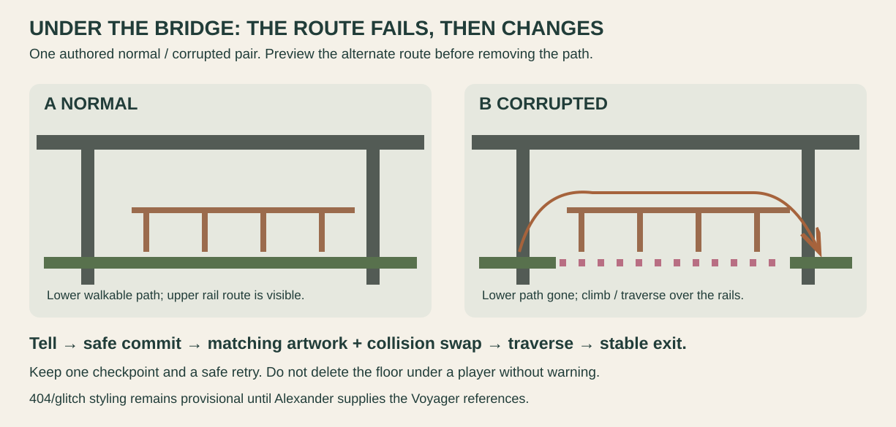

# The crossings · rust and parkour

<!-- reference-navigation:start -->
[← Previous: Lost in the Green](lost-in-the-green.md) · [🖼️ Library](README.md) · **4 / 8** · [Next: Creek / stepping stones →](creek.md)
<!-- reference-navigation:end -->

**An industrial traversal location.** Alexander requested rusty exteriors and a more parkour-oriented environment, between Lost in the Green and the stepping-stone creek.

Low overhead spans, rails, narrow paths and vertical supports suggest a clear direction of movement. **Latest proposed beat:** show the normal path under the bridge and the upper rail route → warn that the lower path is failing → make it disappear → climb/traverse over the railing to a stable exit.

This is actual authored terrain change, not only a screen overlay. Art and collision must switch together; provide a safe staging point and retry. The diagram is an original schematic, not Voyager artwork or a measured bridge. A higher route should be seen from below before it is reached. Rail grabs, wall jumps and rope physics are separate scope decisions; the photo of a railing does not require all three.

**Material direction:** weathered metal, rust accents, mossy masonry, cold shade and a bright exit. Photographed corrosion is a reference; heavier rust is an art-direction interpretation. Keep useful silhouette breaks instead of filling every empty space with debris.

Sources C23–C27. Requested parkour positions must first be tested in the greybox; a generated photograph cannot establish reachable jump distances.

<!-- reference-navigation:start -->
[← Previous: Lost in the Green](lost-in-the-green.md) · [🖼️ Library](README.md) · **4 / 8** · [Next: Creek / stepping stones →](creek.md)
<!-- reference-navigation:end -->
