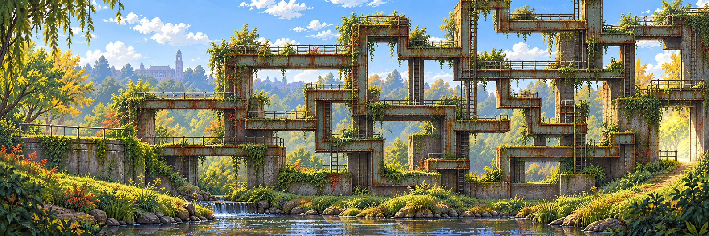

# Rusty Crossings · a maze of rusted bars

<!-- reference-navigation:start -->
[← Previous: Lost in the Green](lost-in-the-green.md) · [🖼️ Library](README.md) · **4 / 8** · [Next: Creek / stepping stones →](creek.md)
<!-- reference-navigation:end -->

**Latest direction, 23 October:** a horizontal/vertical maze of rusted bars, turns, branches, shafts and loops, inspired by pathfinding imagery and the algorithms-and-data-structures secret-villain seed. This is not primarily one bridge with a parkour shortcut. The complete composition is generated first; its [edit/extraction trial](../production/master-first/README.md) explains what was actually achieved.

| Visual ingredient | Possible action/exploration use | Scope |
| --- | --- | --- |
| Horizontal bars, vertical connections and right-angle turns | Trace a route, choose a branch, discover a dead end or shortcut | Author one small viable route; no procedural maze required |
| Repeated intersections and loops | Search/pathfinding metaphor | A predetermined highlight is enough if selected; no search simulation assumed |
| Rust, concrete and attached vegetation | Distinguish structure from organic surroundings | Shared scene scale/material language |
| Background image sampled incorrectly | Cut/stretch/repeat pixels through maze openings | Visual-only default; no collision change implied |

The professor/degree connection is an owner-supplied **fictional villain premise**; portrait, name, encounter and degree-to-stage roster are not specified here. Earlier floor-deletion/rail-traversal sketches remain optional mechanics only.

## Photographs supply materials, not the maze layout

Source photos C23–C27 show bridge structures and rails. Their steel, corrosion and concrete are reference material; they do not prescribe the generated maze or prove its reachability. The approved photographic board is retained unchanged. Test the chosen movement verbs and one traced route before promoting any composition into a game level.

<!-- reference-navigation:start -->
[← Previous: Lost in the Green](lost-in-the-green.md) · [🖼️ Library](README.md) · **4 / 8** · [Next: Creek / stepping stones →](creek.md)
<!-- reference-navigation:end -->
