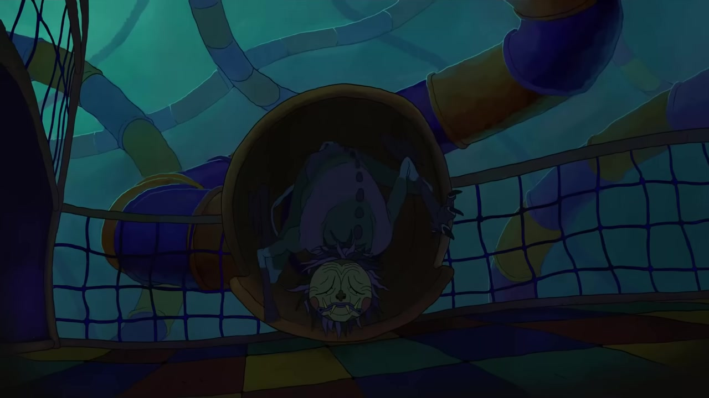

# Playground · familiar shapes, something wrong

<!-- reference-navigation:start -->
[← Previous: Toxic Garden](toxic-garden.md) · [Campus index](README.md) · **7 / 8** · [Next: Robot collectible →](campus-robot.md)

[📍 Campus boards](README.md) · [🎮 Game studies](../README.md) · [🎨 Stage experiments](../production/README.md) · [Proposal](../../docs/proposal/campus-game.md)
<!-- reference-navigation:end -->

**The photographs provide structure; the horror animation provides mood.** Timber towers, green supports, rope bridges and circular crawl holes are the real-location ingredients. The game interpretation can make familiar play equipment feel unnervingly large.

## Watch / look

[▶ Supplied Playground trailer](https://youtu.be/P8U22dvli4w) · **[Ten timecoded trailer screenshots and stage observations](../animation/playground/README.md)**

*Rodrigo Goulão de Sousa; music/sound Jérémy Ben Ammar. Clean source-video frame at 0:10. Reference only, not runtime art.*

Selected trailer sequences were visually reviewed on 22 October 2026; the linked study records ten captures, their source times and observations. The [creator interview](https://www.stashmedia.tv/rodrigo-sousa-teases-horror-mini-series-playground/) supplies context. Colored play structures, confined bright refuges and creatures occupying rope/tube spaces are the visual targets. Sound and exact editing cadence are not analyzed here.

Our optional interpretation: a round crawl opening first reads as shelter; an aligned interior reveal shows a shape behind it. Preserve cheerful equipment colors as well as darkness. Little Nightmares is a character-shape reference, not the ambience source.

**Proposed layers:** far treeline → dark play towers → walkable ramp → rope detail → near posts. Keep bright play surfaces distinct from danger. Make threat cues visible before a chase; horror should come from anticipation, not an unreadable floor.

Source photos C33–C39. The current board deliberately remains photographic; a dusk/horror stage painting comes after approval of the reference and composition.

<!-- reference-navigation:start -->
[← Previous: Toxic Garden](toxic-garden.md) · [Campus index](README.md) · **7 / 8** · [Next: Robot collectible →](campus-robot.md)

[📍 Campus boards](README.md) · [🎮 Game studies](../README.md) · [🎨 Stage experiments](../production/README.md) · [Proposal](../../docs/proposal/campus-game.md)
<!-- reference-navigation:end -->
