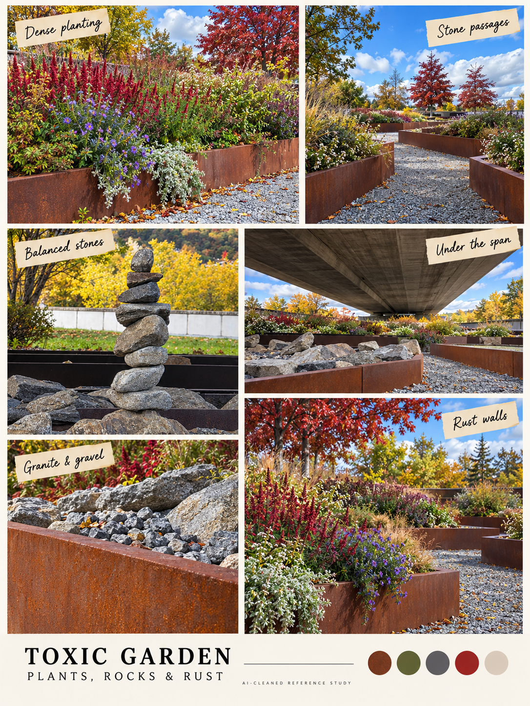

# Toxic Garden · plants, rocks and rust

<!-- reference-navigation:start -->
[← Previous: Creek / stepping stones](creek.md) · [Campus index](README.md) · **6 / 8** · [Next: Playground detour →](playground.md)

[📍 Campus boards](README.md) · [🎮 Game studies](../README.md) · [🎨 Stage experiments](../production/README.md) · [Proposal](../../docs/proposal/campus-game.md)
<!-- reference-navigation:end -->

**A working game-location name, not a claim about the actual campus.** Alexander corrected the initial “riverfront” interpretation: this board is about planted enclosures, angular rusty edges, rocks and maze potential.

Dense plants against rust-brown planters create paths that can double back. Granite piles and stacked stones provide distinctive silhouettes. Overhead concrete creates a shaded ceiling; red foliage gives a distant orientation cue. No greenhouse is documented by these photographs.

The [official Bad Seed listing](https://store.steampowered.com/app/1204130/Dead_Cells__The_Bad_Seed/) identifies the **Dilapidated Arboretum** as a greenhouse. [Targeted exterior, interior and gameplay references](../games/dead-cells/visual-reference.md) show that visual family. Borrow lush growth against decaying structure, not its maps, enemies or assets. The greenhouse belongs to the game reference, not the photographed campus location.

**Proposed experiment:** a planter maze with one readable enemy lane and a short bypass. Thorn edges or a slow plant hazard can share one telegraph and reset rule. Poison meters, several enemy families and procedural mazes are expansion ideas. A 24-hour label does not make them baseline requirements.

Sources C40–C54 in [source-index.json](source-index.json). Bike/promenade views provide context, not the hero composition. Detail boards preserve granite, gravel, rust and planting relationships without importing the original files.

<!-- reference-navigation:start -->
[← Previous: Creek / stepping stones](creek.md) · [Campus index](README.md) · **6 / 8** · [Next: Playground detour →](playground.md)

[📍 Campus boards](README.md) · [🎮 Game studies](../README.md) · [🎨 Stage experiments](../production/README.md) · [Proposal](../../docs/proposal/campus-game.md)
<!-- reference-navigation:end -->
