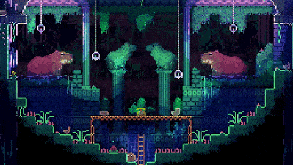
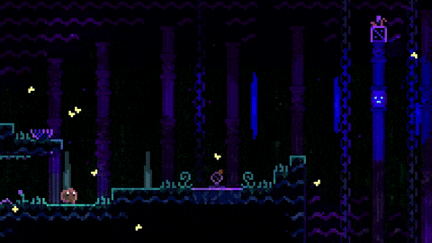

# Visual reference views

<!-- reference-navigation:start -->
[← Previous: Animal Well](README.md) · [🖼️ Library](../../README.md) · **10 / 36** · [Next: Soul Knight →](../soul-knight/README.md)
<!-- reference-navigation:end -->

**Look for:** Watch an object interaction. Could one consistent rule produce a surprising second use?

[← Game study](README.md) · Credits and original sources follow each view below.

Collected 21 October 2026 from the developer or publisher's official site/store listing. These are existing copyrighted promotional/gameplay media, stored for private design analysis. No production-asset license is asserted. Do not put these files into game builds or publish the reference folder as an asset pack.

Views were visually inspected. GIF inspection showed a rendered frame; this is not a frame-by-frame timing analysis. No sprite sheets, source code or meshes were extracted. Captions are our observations and discussion prompts, not developer documentation.

## capybara.gif

Symmetrical room, small player scale, creature placement and environmental interaction framing.

- Credit: Shared Memory LLC.
- [Official source page](https://www.animalwell.net/).
- [Original image](https://www.animalwell.net/press/Animal%20Well/images/gif_capybara.gif).
- Local SHA-256: `ce0e5adec5bba2c70fc662e178e3cad7372c997b29e0a2b06d797c459787ea65`.

## ghostbuster.gif

Dark traversal space with bright interactive accents; inspect the animation before choosing a specific effect.

- Credit: Shared Memory LLC.
- [Official source page](https://www.animalwell.net/).
- [Original image](https://www.animalwell.net/press/Animal%20Well/images/gif_GhostBuster.gif).
- Local SHA-256: `aad23eea16e1222eafbb19e8f2b871120e4a3f4057167069cf120b07fea49557`.

## catch.gif

Creature, platform, ladder and hanging switch in a compact interaction space.

- Credit: Shared Memory LLC.
- [Official source page](https://www.animalwell.net/).
- [Original image](https://www.animalwell.net/press/Animal%20Well/images/gif_Catch.gif).
- Local SHA-256: `7196305ff93f0c0a300124b576d9e98acf9345bcab11b413bea14aa6cc921b26`.

## Review with Vatsal and Lex

Choose one view and name the exact quality you want: camera scale, readable terrain, color mood, animation economy or interaction feedback. Then identify one quality to omit. A still cannot establish movement feel, input latency or exact animation timing; use the README's gameplay sources or a played session for those questions.

<!-- reference-navigation:start -->
[← Previous: Animal Well](README.md) · [🖼️ Library](../../README.md) · **10 / 36** · [Next: Soul Knight →](../soul-knight/README.md)
<!-- reference-navigation:end -->
