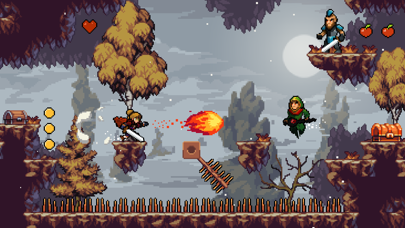
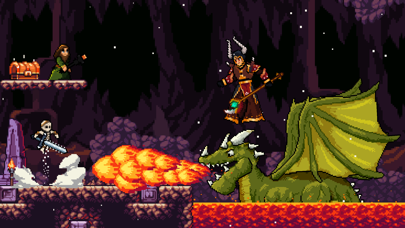

# Visual reference views

Collected 21 October 2026 from the developer or publisher's official site/store listing. These are existing copyrighted promotional/gameplay media, stored for private design analysis. No production-asset license is asserted. Do not put these files into game builds or publish the reference folder as an asset pack.

Views were visually inspected. GIF inspection showed a rendered frame; this is not a frame-by-frame timing analysis. No sprite sheets, source code or meshes were extracted. Captions are our observations and discussion prompts, not developer documentation.

## store-1.png

Forest combat and title overlay; useful for terrain layering, not a clean timing study.

- Credit: Limitless LLC.
- [Official source page](https://apps.apple.com/us/app/apple-knight/id1486055730).
- [Original image](https://is1-ssl.mzstatic.com/image/thumb/Purple112/v4/80/3a/88/803a8855-e0d1-41fa-a606-84c262dff4c0/6207f910-641c-44cc-8dce-ada8eb2d6614_File135.2357.png/406x228bb.png).
- Local SHA-256: `3cc2b0d9b2f6ab788b09d23c9422d2562675a54f21bd5275a11fe6df8a00f257`.

## store-2.png

Platform gaps, spike floor, projectile and enemy placement in one readable hazard view.

- Credit: Limitless LLC.
- [Official source page](https://apps.apple.com/us/app/apple-knight/id1486055730).
- [Original image](https://is1-ssl.mzstatic.com/image/thumb/Purple112/v4/31/94/41/319441cb-d0a4-33d9-5494-4d64c17508cd/c4e293d9-a497-447a-b180-cf42814da25e_File61.18133.png/406x228bb.png).
- Local SHA-256: `4bb32f4543b763b55ddf0dde7879bbb307a07327fd29975e866a27c9a22bf21b`.

## store-3.png

Dragon encounter demonstrates the extra boss and effect workload.

- Credit: Limitless LLC.
- [Official source page](https://apps.apple.com/us/app/apple-knight/id1486055730).
- [Original image](https://is1-ssl.mzstatic.com/image/thumb/Purple122/v4/cb/b9/7f/cbb97f39-8eb0-56d3-33ec-f7f3db7a7828/b5628bbc-92ca-4ab3-bb92-df309eb5adee_5.5-6.png/406x228bb.png).
- Local SHA-256: `d4ca5ff84c5f747fd67f34c30bbb30a7cab53c2a7337dc9ca8b597a3667cbc3f`.

## Review with Vatsal and Lex

Choose one view and name the exact quality you want: camera scale, readable terrain, color mood, animation economy or interaction feedback. Then identify one quality to omit. A still cannot establish movement feel, input latency or exact animation timing; use the README's gameplay sources or a played session for those questions.
