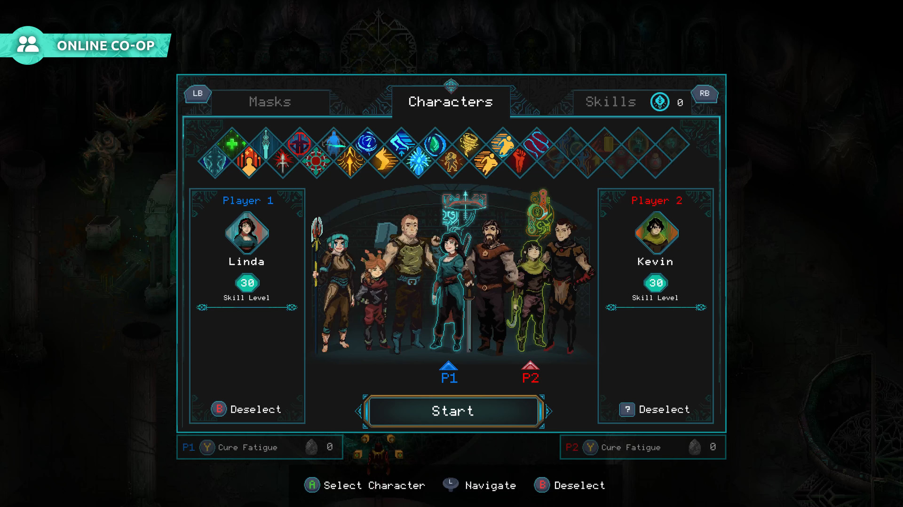
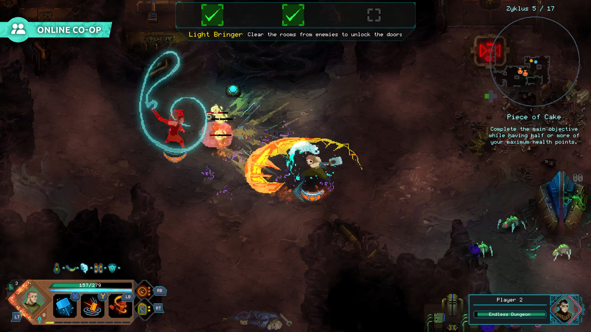

# Visual reference views

<!-- reference-navigation:start -->
[← Previous: Children of Morta](README.md) · [🖼️ Library](../../README.md) · **22 / 36** · [Next: Planet of Lana →](../planet-of-lana/README.md)
<!-- reference-navigation:end -->

**Look for:** Study detailed pixel design and magical effects; preserve the character silhouette through bright spell shapes. Family/homecoming mechanics are not the requested reference.

[← Game study](README.md) · Credits and original sources follow each view below.

Collected 21 October 2026 from the developer/publisher store listing. Visually inspected in a contact sheet; these are composition observations, not timing or source-pipeline analysis. Copyright remains with the credited rightsholders. Private research only; no runtime reuse license.

## images/01-official-gameplay.jpg

Top-down combat: crowded effects and HUD compete with enemy silhouettes.

- Credit: Dead Mage / 11 bit studios.
- [Source page](https://store.steampowered.com/app/330020/).
- [Original image](https://shared.akamai.steamstatic.com/store_item_assets/steam/apps/330020/ss_83a775e3ef93bde16a08d009a0ad1fb1b2a43b76.1920x1080.jpg?t=1765218667).
- SHA-256: `6832a95fd867e0aa66ee7ce914087f5f824f233ad77562cf5d5b00e3fb530c62`.

## images/02-official-gameplay.jpg

Character/upgrade selection interface; this is not a world-navigation view.

- Credit: Dead Mage / 11 bit studios.
- [Source page](https://store.steampowered.com/app/330020/).
- [Original image](https://shared.akamai.steamstatic.com/store_item_assets/steam/apps/330020/ss_e7bbfd5607b247a6931f521c397bcd50328d45fc.1920x1080.jpg?t=1765218667).
- SHA-256: `a3681bb2146ac6c5c03b0e363308cbb6766e50f9b007a135e1eba4202ba1ea30`.

## images/03-official-gameplay.jpg

Top-down battle: character spacing, enemy tells and visibility under effects.

- Credit: Dead Mage / 11 bit studios.
- [Source page](https://store.steampowered.com/app/330020/).
- [Original image](https://shared.akamai.steamstatic.com/store_item_assets/steam/apps/330020/ss_7e1a090f480f8392e1e1ae019624425a8ded8484.1920x1080.jpg?t=1765218667).
- SHA-256: `7f781bd9aeca4381844fa26678f5e392670c3a00880b51640c824d50b1ef4370`.

## Gameplay study

Use official trailers on the source page to compare camera behavior, movement, transitions and visual feedback. Still images cannot establish responsiveness. See media-sources.json for the named trailer inventory where available.

<!-- reference-navigation:start -->
[← Previous: Children of Morta](README.md) · [🖼️ Library](../../README.md) · **22 / 36** · [Next: Planet of Lana →](../planet-of-lana/README.md)
<!-- reference-navigation:end -->
