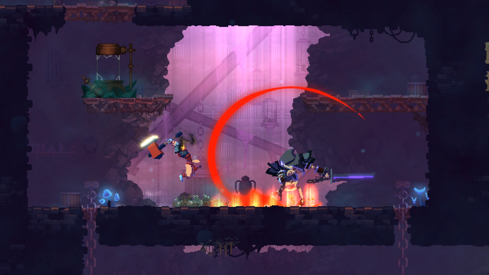

# Dead Cells

<!-- reference-navigation:start -->
[← Previous: Planet of Lana · gallery](../planet-of-lana/visual-reference.md) · [🖼️ Library](../../README.md) · **25 / 36** · [Next: Dead Cells · gallery →](visual-reference.md)
<!-- reference-navigation:end -->

**22 October connection:** [Toxic Garden](../../campus/toxic-garden.md) takes plants, rocks and rusty planter walls from local photographs. The greenhouse/garden comparison is provisionally the Dilapidated Arboretum, pending confirmation, not a request to copy a biome or enemies.

## At a glance · Action with a clear reaction

**Look for:** Read the attack silhouette against the background. Motion and recovery matter more than extra particles.

[▶ Gameplay / trailer sources](visual-reference.md#gameplay-study) · [🖼️ More views and credits](visual-reference.md)

*Existing-game reference, not our concept art or a runtime asset. Image credit and original source: [visual reference](visual-reference.md).*

## Go deeper (optional)

Research date: 21 October 2026. Secondary team reference; Vatsal's Hollow Knight preference remains the lead.

## Evidence and presentation

Motion Twin's action-platformer combines repeated runs, combat and Metroidvania-inspired exploration. Its lead developer identifies Haxe/Heaps and a GameBase foundation. [Developer/publisher store listing and trailers](https://store.steampowered.com/app/588650/). Screenshots are publisher-supplied promotional/gameplay views, not extracted development files. [Visual views](visual-reference.md) and [source manifest](media-sources.json) retain provenance.

Side-scrolling action with layered pixel-looking environments and emphatic combat effects.

## Design interpretation

The following is our analysis for a tiny prototype, not a claim about the developer's internal architecture.

**Loop:** Read threats, execute an action, receive immediate feedback, fail and improve on another run. Fast feedback depends on timings and readable encounters, not just particle density.

**Dependencies:** Weapons multiply animation/hitbox/recovery combinations; randomized routes need valid connectivity; run resets and permanent progression must be separated. Those costs are inappropriate additions to a traversal-focused jam baseline.

**Worldbuilding:** Architecture, props and recurring threats imply a ruined society. One coherent space is enough for a vignette; procedural biomes are not needed to convey decay.

Verified pipeline evidence: artist Thomas Vasseur explains starting from a pixel model sheet, constructing/animating simple 3D models and rendering them at low resolution without antialiasing. This makes retiming practical but is a real custom production pipeline, not a free AI sprite generator. [Artist's first-person article](https://www.gamedeveloper.com/production/art-design-deep-dive-using-a-3d-pipeline-for-2d-animation-in-i-dead-cells-i-). [Lead developer's engine account](https://deepnight.net/games/motion-twin/dead-cells/). Internal source assets and exact atlas layout are not available here.

## Jam experiment and question

Borrow readable anticipation and responsive recovery if combat is selected. Keep one attack and one enemy. Do not adopt its production tools merely because the output appears pixelated.

Is Vatsal looking for responsive movement, or repeated high-skill combat runs? Choose before budgeting combat animation.

For our own asset organization, group player states, terrain, interaction props and feedback separately, with fixed pivots and explicit frame durations. That is a proposed export contract, not the original game's source folder structure. Before making a whole sheet, test one frame at actual camera scale.

Use the store's official trailers to compare movement, feedback and transitions with the stills. We verified the page/trailer inventory, not a frame-by-frame play session. No commercial sprites, music, source code or maps are licensed for our runtime by this research.

<!-- reference-navigation:start -->
[← Previous: Planet of Lana · gallery](../planet-of-lana/visual-reference.md) · [🖼️ Library](../../README.md) · **25 / 36** · [Next: Dead Cells · gallery →](visual-reference.md)
<!-- reference-navigation:end -->
