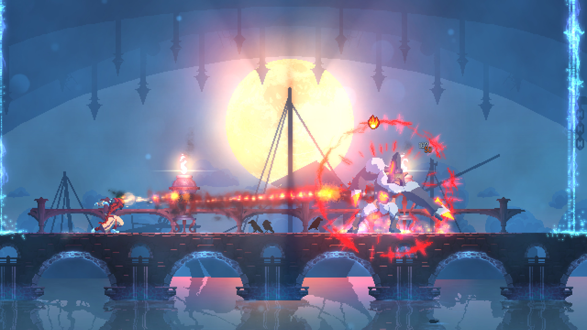

# Visual reference views

<!-- reference-navigation:start -->
[← Previous: Dead Cells](README.md) · [🖼️ Library](../../README.md) · **26 / 26** · [Next: Compare the games →](../../comparison.md)
<!-- reference-navigation:end -->

**Look for:** Read the attack silhouette against the background. Motion and recovery matter more than extra particles.

[← Game study](README.md) · Credits and original sources follow each view below.

Collected 21 October 2026 from the developer/publisher store listing. Visually inspected in a contact sheet; these are composition observations, not timing or source-pipeline analysis. Copyright remains with the credited rightsholders. Private research only; no runtime reuse license.

## images/01-official-gameplay.jpg

Side-view close combat: bright attack arc against a muted corridor.

- Credit: Motion Twin / Motion Twin.
- [Source page](https://store.steampowered.com/app/588650/).
- [Original image](https://shared.akamai.steamstatic.com/store_item_assets/steam/apps/588650/ss_ac28000ade40cc2fe5c128f32ac98ba33c008a7a.1920x1080.jpg?t=1779086887).
- SHA-256: `d4ef9dd9c62f448dc9d18f2485f58584b15c29b542792b1733745e8819172cde`.

## images/02-official-gameplay.jpg

Platforms at different heights and a bright player attack; note safe landings.

- Credit: Motion Twin / Motion Twin.
- [Source page](https://store.steampowered.com/app/588650/).
- [Original image](https://shared.akamai.steamstatic.com/store_item_assets/steam/apps/588650/ss_7bde51ea6c8f6289e85ea1d8c1c941e1f8bfee91.1920x1080.jpg?t=1779086887).
- SHA-256: `5570ded11394e20d79d7ea315e743833a6ac1b220343dcf3be4659f1d1fc91a5`.

## images/03-official-gameplay.jpg

Large bridge encounter: strong silhouette and attack effects against distant light.

- Credit: Motion Twin / Motion Twin.
- [Source page](https://store.steampowered.com/app/588650/).
- [Original image](https://shared.akamai.steamstatic.com/store_item_assets/steam/apps/588650/ss_e87e72a247918d8493892e035d5e1b4b84470d2f.1920x1080.jpg?t=1779086887).
- SHA-256: `192561581df7fb557365c85c016b27e653d9aa076400f06cdf0a88a1ed21d0eb`.

## Gameplay study

Use official trailers on the source page to compare camera behavior, movement, transitions and visual feedback. Still images cannot establish responsiveness. See media-sources.json for the named trailer inventory where available.

<!-- reference-navigation:start -->
[← Previous: Dead Cells](README.md) · [🖼️ Library](../../README.md) · **26 / 26** · [Next: Compare the games →](../../comparison.md)
<!-- reference-navigation:end -->
