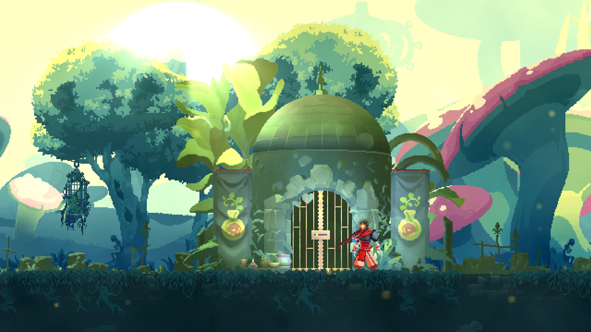
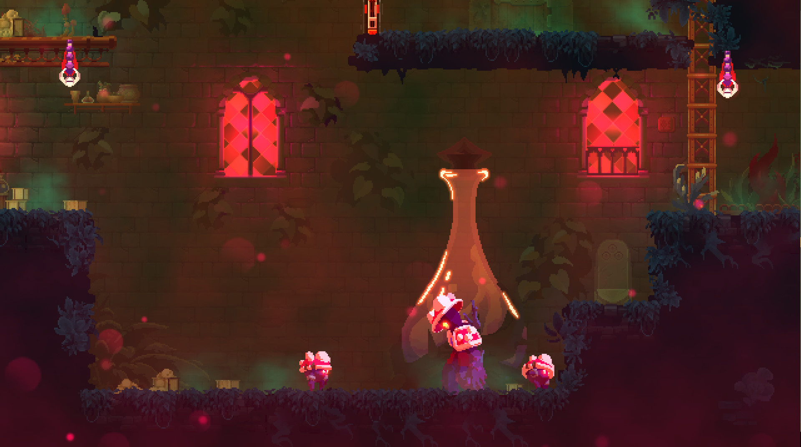
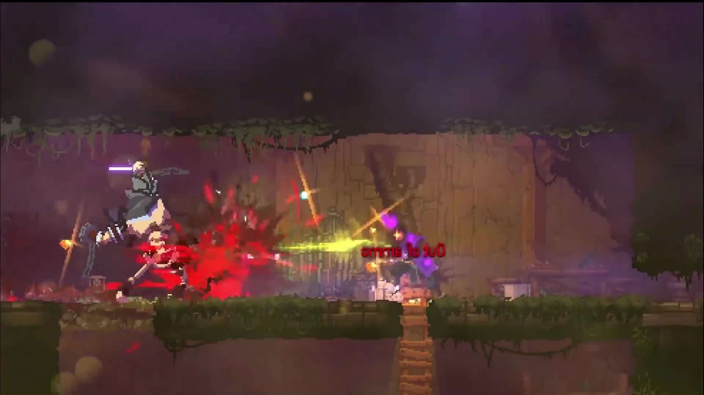
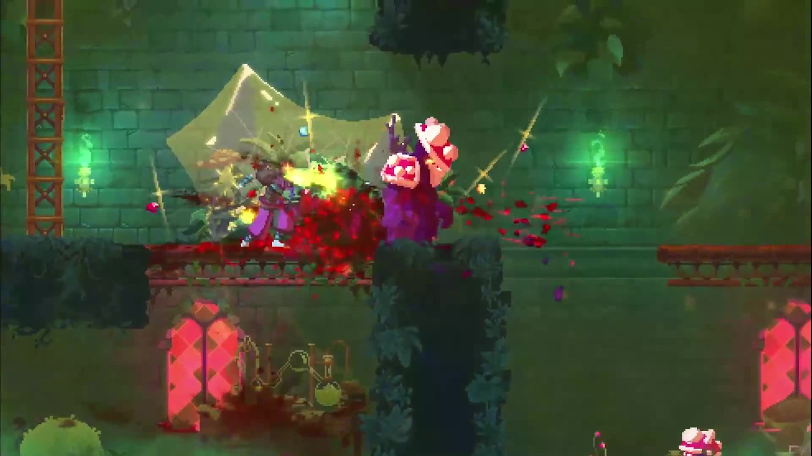

# Dead Cells · Dilapidated Arboretum · visual reference

<!-- reference-navigation:start -->
[← Previous: Dead Cells](README.md) · [🖼️ Library](../../README.md) · **26 / 36** · [Next: Terraria →](../terraria/README.md)
<!-- reference-navigation:end -->

**Greenhouse before generic combat.** Official Bad Seed images and two greenhouse gameplay frames; adjacent swamp/boss screenshots are excluded.

[Game study](README.md) · [Hashes and full provenance](media-sources.json)

Selected visual research, 22 October 2026. These are existing-game references, not our concept art or runtime assets. Video frames are captured at the listed source times without browser/player overlays. A still cannot establish responsiveness or the exact timing of an attack.

## Exterior greenhouse dome surrounded by overgrowth

Exterior greenhouse dome surrounded by overgrowth: architecture and vegetation remain separate masses.

Credit: Motion Twin / Evil Empire. [Source](https://store.steampowered.com/app/1204130/).

## Greenhouse interior

Greenhouse interior: tall arched windows, green light, hanging vegetation and a broken playable floor.

Credit: Motion Twin / Evil Empire. [Source](https://store.steampowered.com/app/1204130/).

## Dark greenhouse/laboratory detail

Dark greenhouse/laboratory detail: glass containers and dense red plant forms contrast with the structure.

Credit: Motion Twin / Evil Empire. [Source](https://store.steampowered.com/app/1204130/).

## 0:40 · Combat inside the Arboretum greenhouse

Combat inside the Arboretum greenhouse: broken floor, overgrowth and structure remain visible.

Credit: Motion Twin / Evil Empire. [Source at 0:40](https://store.steampowered.com/app/1204130/).

## 0:50 · Vertical greenhouse framing and hanging plants leave a distinct playable horizontal ledge.

Vertical greenhouse framing and hanging plants leave a distinct playable horizontal ledge.

Credit: Motion Twin / Evil Empire. [Source at 0:50](https://store.steampowered.com/app/1204130/).

## Gameplay study

The official Gameplay Trailer is a montage of Bad Seed environments; only selected greenhouse shots are retained. [Official DLC description and trailers](https://store.steampowered.com/app/1204130/). Separate window/structure planes, hanging growth, playable ledges and front framing for our own original stage; this is analysis, not the developer’s source-layer organization.

<!-- reference-navigation:start -->
[← Previous: Dead Cells](README.md) · [🖼️ Library](../../README.md) · **26 / 36** · [Next: Terraria →](../terraria/README.md)
<!-- reference-navigation:end -->
