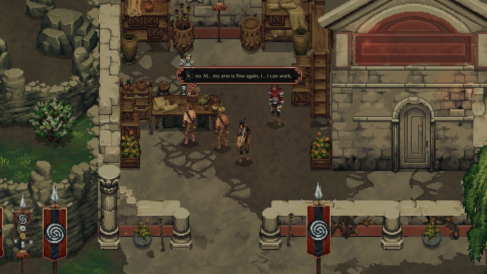
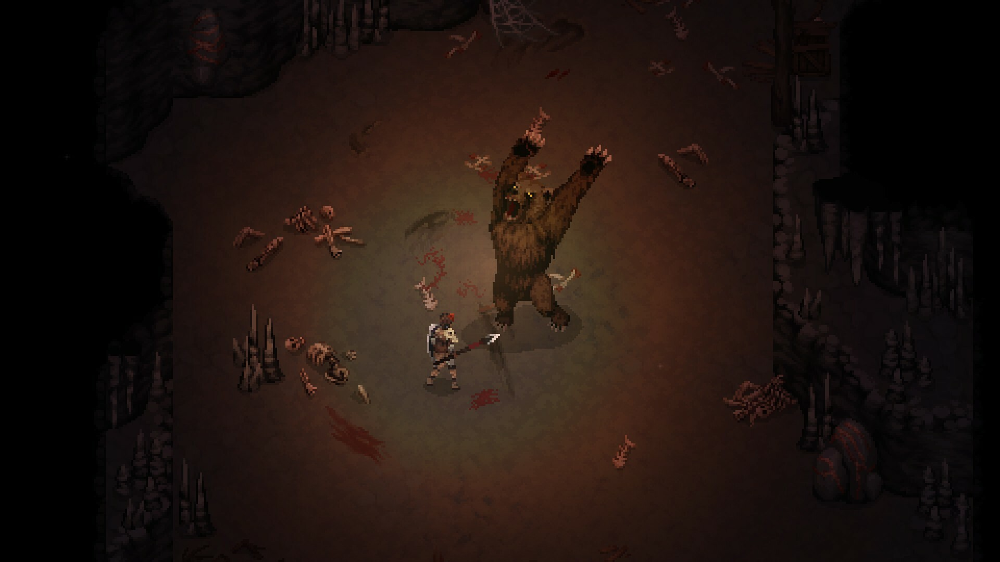

# Visual reference views

<!-- reference-navigation:start -->
[← Previous: Drova – Forsaken Kin](README.md) · [🖼️ Library](../../README.md) · **14 / 26** · [Next: Kingdom Two Crowns →](../kingdom-two-crowns/README.md)
<!-- reference-navigation:end -->

**Look for:** Notice paths, fences and buildings. One small prop can imply a larger society.

[← Game study](README.md) · Credits and original sources follow each view below.

Collected 21 October 2026 from the developer/publisher store listing. Visually inspected in a contact sheet; these are composition observations, not timing or source-pipeline analysis. Copyright remains with the credited rightsholders. Private research only; no runtime reuse license.

## images/01-official-gameplay.jpg

Oblique settlement scene: narrow routes bounded by fences and architecture.

- Credit: Just2D / Deck13, Smilegate, Gamersky Games.
- [Source page](https://store.steampowered.com/app/1585180/).
- [Original image](https://shared.akamai.steamstatic.com/store_item_assets/steam/apps/1585180/ss_747e0589ecd12091730bc181b995d0a9bfbf1fc9.1920x1080.jpg?t=1792569797).
- SHA-256: `4e88251e51a24ba87c13059bc20e2445804915186daba819a51a05efaac4525c`.

## images/02-official-gameplay.jpg

Dialogue in a settlement: social interaction shares the exploration camera.

- Credit: Just2D / Deck13, Smilegate, Gamersky Games.
- [Source page](https://store.steampowered.com/app/1585180/).
- [Original image](https://shared.akamai.steamstatic.com/store_item_assets/steam/apps/1585180/ss_807e7b8d4f8fe6d5243a78a627a4c1b920b86900.1920x1080.jpg?t=1792569797).
- SHA-256: `f21099f0219a2a9c7d24afc7f523feaa2402fec8196a88d131c7a84ecb59983a`.

## images/03-official-gameplay.jpg

Dark encounter space: local light and enemy scale affect readability.

- Credit: Just2D / Deck13, Smilegate, Gamersky Games.
- [Source page](https://store.steampowered.com/app/1585180/).
- [Original image](https://shared.akamai.steamstatic.com/store_item_assets/steam/apps/1585180/ss_757683477f1cc491c3f5b3d26b2f9a5f0063ddc8.1920x1080.jpg?t=1792569797).
- SHA-256: `0a7f722e3335701a9d88b6b2cf4214b1c31a8e988ba047f4a4d0ac153403dffc`.

## Gameplay study

Use official trailers on the source page to compare camera behavior, movement, transitions and visual feedback. Still images cannot establish responsiveness. See media-sources.json for the named trailer inventory where available.

<!-- reference-navigation:start -->
[← Previous: Drova – Forsaken Kin](README.md) · [🖼️ Library](../../README.md) · **14 / 26** · [Next: Kingdom Two Crowns →](../kingdom-two-crowns/README.md)
<!-- reference-navigation:end -->
