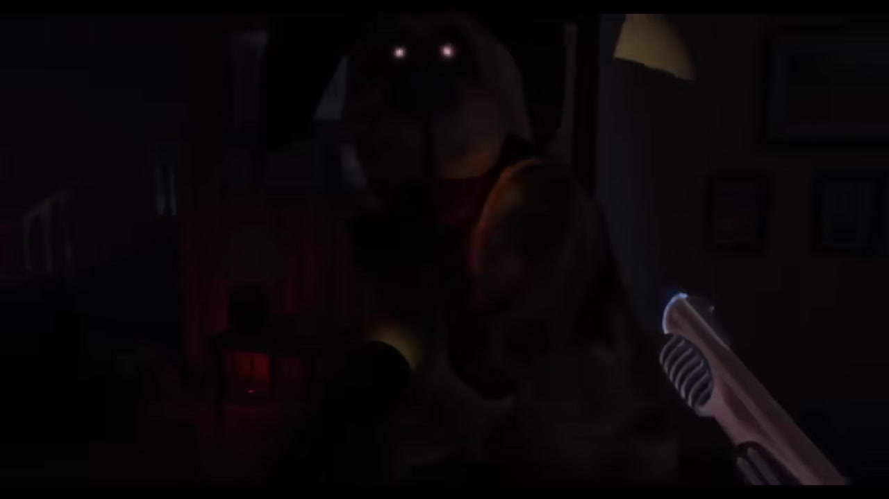

# Duck Season · the mascot changes its role

<!-- reference-navigation:start -->
[← Previous: Little Nightmares · gallery](../little-nightmares/visual-reference.md) · [Game index](../../README.md) · **31 / 36** · [Next: Duck Season · gallery →](visual-reference.md)

[📍 Campus boards](../../campus/README.md) · [🎮 Game studies](../../README.md) · [🎨 Stage experiments](../../production/README.md) · [Proposal](../../../docs/proposal/campus-game.md)
<!-- reference-navigation:end -->

**Study the dog mascot and contrasting endings: familiar performer, intruder, threat, then a changed explanation.**

[More pictures and credits](visual-reference.md) · [Compare references](../../comparison.md)

## Follow the mascot, not the shooting game

The [selected ending frames](visual-reference.md) show the dog crossing from television into the room, a threatening presence beside the TV, a contrasting ending tableau, and a surveillance-room reversal. These are spoiler references, kept together so the escalation is visible. The source is a recorded playthrough, credited separately from developer Stress Level Zero.

**Interpretation:** a repeated friendly shape can become unsettling when its position, gaze, distance or implied control changes. The same prop may acquire a second meaning without a new level. This is more relevant here than VR shooting or nostalgic room decoration.

**Optional original translation:** a harmless mascot prop appears in an unexpected place on a later pass; a final reveal changes who seems to be observing whom. Secret bosses remain future scope. First establish an ordinary version, one deliberate change and a payoff. Do not copy the dog costume, ending scenes, VHS props or the seven-ending structure.

The recording's chapter labels identify the ending segments. They are not a verified recipe for ending triggers or a requirement for WinCS to reproduce them.

Research updated 22 October 2026. Observations and WinCS translations below are design analysis, not extracted development files or accepted game requirements. Reference media remains with its credited rightsholders; no runtime reuse license is inferred.

<!-- reference-navigation:start -->
[← Previous: Little Nightmares · gallery](../little-nightmares/visual-reference.md) · [Game index](../../README.md) · **31 / 36** · [Next: Duck Season · gallery →](visual-reference.md)

[📍 Campus boards](../../campus/README.md) · [🎮 Game studies](../../README.md) · [🎨 Stage experiments](../../production/README.md) · [Proposal](../../../docs/proposal/campus-game.md)
<!-- reference-navigation:end -->
